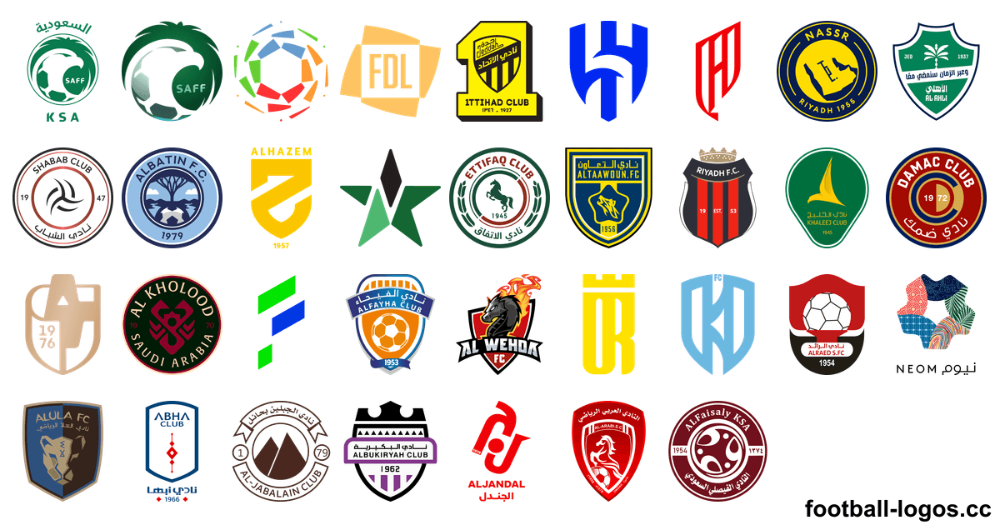
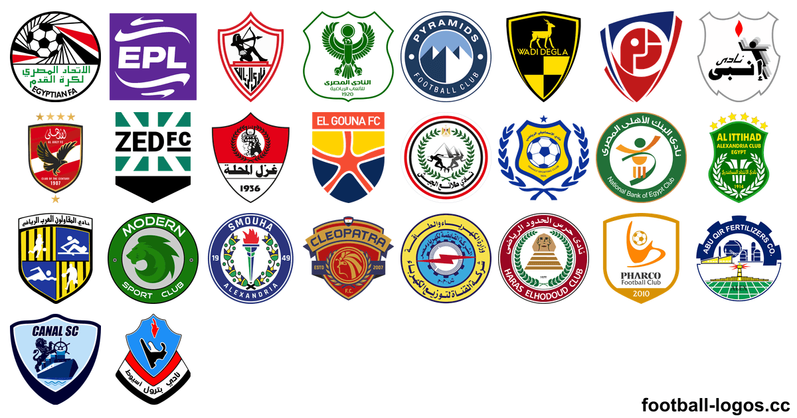
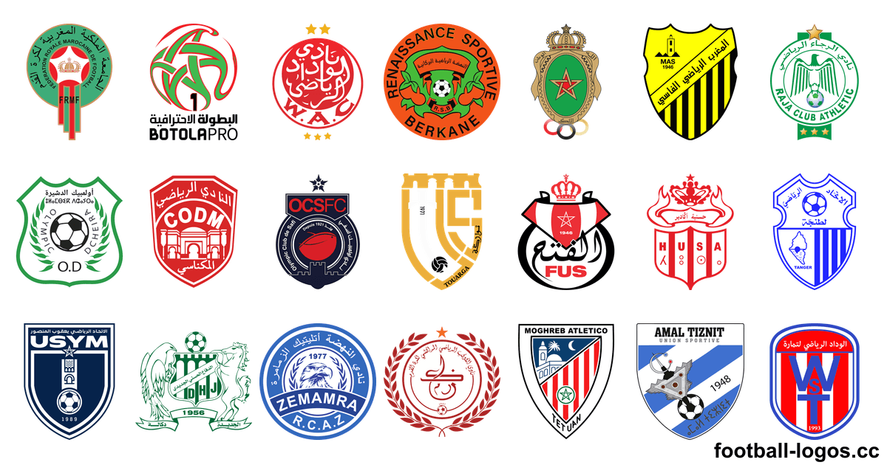
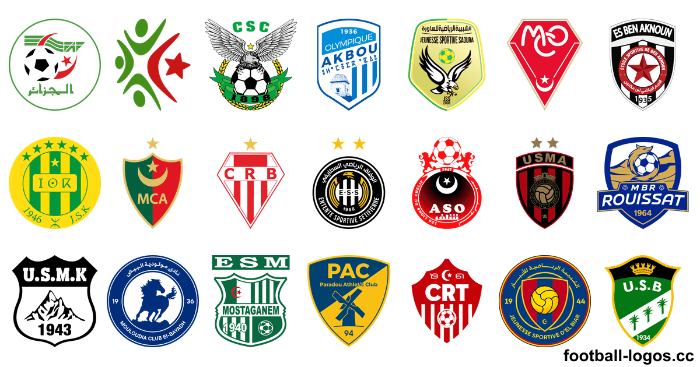
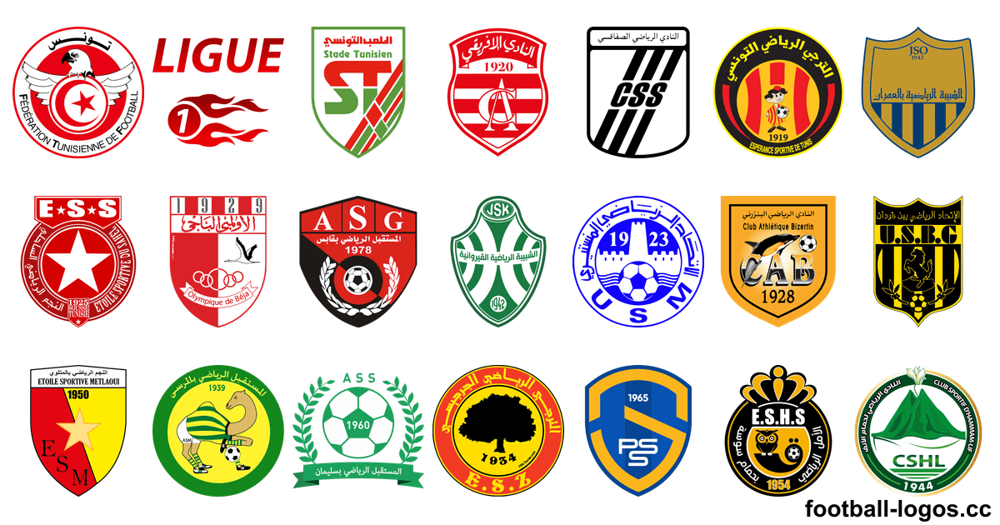

<h1>شعارات أندية كرة القدم – أكثر من 5,900 شعار بصيغة PNG و SVG</h1>

شعارات الأندية والمنتخبات والدوريات والبطولات من أكثر من 220 دولة: صور PNG بخلفية شفافة من 64 إلى 3000 بكسل، وملفات SVG متجهة. حمّلها مجانًا من <a href="https://football-logos.cc">football-logos.cc</a> (الموقع باللغة الإنجليزية). آخر تحديث: نوفمبر 2026.

<a href="https://github.com/Leo4815162342/football-logos">English</a> · <a href="README.es.md">Español</a> · <a href="README.pt-BR.md">Português</a> · <a href="README.fr.md">Français</a> · <b>العربية</b> · <a href="README.vi.md">Tiếng Việt</a> · <a href="README.ja.md">日本語</a>

<a href="https://football-logos.cc"><picture><source media="(prefers-color-scheme: dark)" srcset="screenshot-dark.png"></picture></a>

## محتوى المجموعة

- **شعارات الأندية** من أكثر من 220 دولة ومنطقة، من الدوريات الكبرى إلى الدرجات الأدنى
- **[شعارات المنتخبات](https://football-logos.cc/national-teams/)** لأكثر من 220 دولة
- **[شعارات الدوريات والبطولات](https://football-logos.cc/tournaments/)**: دوري أبطال أوروبا، والدوري الأوروبي، وكأس العالم، وكوبا أمريكا، وكأس الأمم الأوروبية، وغيرها
- **صور PNG بخلفية شفافة** بمقاسات 64 و128 و256 و512 و700 و1500 و3000 بكسل، وملفات **SVG** متجهة لكل الشعارات تقريبًا
- **نسخ بالأبيض والأسود** لأكثر من 610 من الشعارات
- **[شعارات جديدة](https://football-logos.cc/new/)** كل يوم: أكثر من 280 من الشعارات في آخر 30 يومًا
- **تاريخ الشعارات** لأكثر من 30 من الأندية، مثل [Real Madrid](https://football-logos.cc/spain/real-madrid/logo-history/) و[Barcelona](https://football-logos.cc/spain/barcelona/logo-history/)
- **[خريطة الأندية](https://football-logos.cc/map/)**: ابحث عن أي نادٍ حسب المدينة أو الدولة أو الدوري

## شعارات الأندية الأكثر شعبية

### ‏🇸🇦 [شعارات الأندية السعودية](https://football-logos.cc/saudi-arabia/)

‏[النصر](https://football-logos.cc/saudi-arabia/al-nassr/) (Al Nassr) · [الهلال](https://football-logos.cc/saudi-arabia/al-hilal/) (Al Hilal) · [الاتحاد](https://football-logos.cc/saudi-arabia/al-ittihad/) (Al Ittihad) · [الأهلي](https://football-logos.cc/saudi-arabia/al-ahli/) (Al Ahli) · [القادسية](https://football-logos.cc/saudi-arabia/al-qadsiah/) (Al Qadsiah) · [نادي الدرعية](https://football-logos.cc/saudi-arabia/diriyah-club/) (Diriyah Club) · [نيوم](https://football-logos.cc/saudi-arabia/neom/) (Neom SC) · [الشباب](https://football-logos.cc/saudi-arabia/al-shabab/) (Al Shabab) · [نادي الفيصلي](https://football-logos.cc/saudi-arabia/al-faisaly-fc/) (Al-Faisaly FC) · [الفتح](https://football-logos.cc/saudi-arabia/al-fateh/) (Al Fateh) · [الاتفاق](https://football-logos.cc/saudi-arabia/al-ettifaq/) (Al Ettifaq) · [الخلود](https://football-logos.cc/saudi-arabia/al-kholood/) (Al-Kholood) · [أبها](https://football-logos.cc/saudi-arabia/abha/) (Abha) · [التعاون](https://football-logos.cc/saudi-arabia/al-taawoun/) (Al Taawoun) · [الرياض](https://football-logos.cc/saudi-arabia/al-riyadh/) (Al Riyadh) · [الحزم](https://football-logos.cc/saudi-arabia/al-hazem/) (Al Hazem) · [الخليج](https://football-logos.cc/saudi-arabia/al-khaleej/) (Al Khaleej) · [الفيحاء](https://football-logos.cc/saudi-arabia/al-fayha/) (Al Fayha)

### ‏🇪🇬 [شعارات الأندية المصرية](https://football-logos.cc/egypt/)

‏[الأهلي](https://football-logos.cc/egypt/al-ahly/) (Al Ahly SC) · [الزمالك](https://football-logos.cc/egypt/zamalek/) (Zamalek SC) · [بيراميدز](https://football-logos.cc/egypt/pyramids/) (Pyramids FC) · [المصري](https://football-logos.cc/egypt/al-masry/) (Al-Masry SC) · [نادي سيراميكا كليوباترا](https://football-logos.cc/egypt/ceramica-cleopatra/) (Ceramica Cleopatra FC) · [نادي الاتحاد السكندري](https://football-logos.cc/egypt/al-ittihad-alexandria/) (Al Ittihad Alexandria Club) · [زد إف سي](https://football-logos.cc/egypt/zed-fc/) (ZED FC) · [وادي دجلة](https://football-logos.cc/egypt/wadi-degla/) (Wadi Degla SC) · [نادي المقاولون العرب](https://football-logos.cc/egypt/al-mokawloon-al-arab/) (Al Mokawloon Al Arab SC) · [نادي سموحة](https://football-logos.cc/egypt/smouha/) (Smouha SC) · [إنبي](https://football-logos.cc/egypt/enppi/) (ENPPI SC) · [نادي البنك الأهلي](https://football-logos.cc/egypt/national-bank/) (National Bank of Egypt SC)

### ‏🇲🇦 [شعارات الأندية المغربية](https://football-logos.cc/morocco/)

‏[الوداد الرياضي](https://football-logos.cc/morocco/wydad-ac/) (Wydad AC) · [الرجاء الرياضي](https://football-logos.cc/morocco/raja-ca/) (Raja Casablanca) · [نهضة بركان](https://football-logos.cc/morocco/rs-berkane/) (RS Berkane) · [الجيش الملكي](https://football-logos.cc/morocco/as-far/) (AS FAR) · [المغرب الفاسي](https://football-logos.cc/morocco/maghreb-of-fez/) (Maghreb of Fez) · [الحسنية الإتحاد الرياضي لأكادير](https://football-logos.cc/morocco/hassania-agadir/) (Hassania Agadir) · [اتحاد طنجة](https://football-logos.cc/morocco/ir-tanger/) (IR Tanger) · [الفتح الرياضي](https://football-logos.cc/morocco/fus-rabat/) (Fath Union Sports Rabat)

### ‏🇩🇿 [شعارات الأندية الجزائرية](https://football-logos.cc/algeria/)

‏[مولودية الجزائر](https://football-logos.cc/algeria/mc-alger/) (MC Alger) · [إتحاد الجزائر](https://football-logos.cc/algeria/usm-alger/) (USM Alger) · [شباب بلوزداد](https://football-logos.cc/algeria/cr-belouizdad/) (CR Belouizdad) · [شبيبة القبائل](https://football-logos.cc/algeria/js-kabylie/) (JS Kabylie) · [وفاق سطيف](https://football-logos.cc/algeria/es-setif/) (ES Sétif) · [مولودية وهران](https://football-logos.cc/algeria/mc-oran/) (MC Oran) · [شباب قسنطينة](https://football-logos.cc/algeria/cs-constantine/) (CS Constantine) · [أولمبيك أقبو](https://football-logos.cc/algeria/olympique-akbou/) (Olympique Akbou)

### ‏🇹🇳 [شعارات الأندية التونسية](https://football-logos.cc/tunisia/)

‏[الترجي الرياضي التونسي](https://football-logos.cc/tunisia/esperance/) (Espérance Sportive de Tunis) · [النادي الإفريقي](https://football-logos.cc/tunisia/club-africain/) (Club Africain) · [النادي الرياضي الصفاقسي](https://football-logos.cc/tunisia/cs-sfaxien/) (CS Sfaxien) · [النجم الرياضي الساحلي](https://football-logos.cc/tunisia/etoile-du-sahel/) (Étoile Sportive du Sahel) · [الاتحاد الرياضي المنستيري](https://football-logos.cc/tunisia/us-monastir/) (Union Sportive Monastirienne) · [الملعب التونسي](https://football-logos.cc/tunisia/stade-tunisien/) (Stade Tunisien) · [النادي الرياضي البنزرتي](https://football-logos.cc/tunisia/ca-bizertin/) (Club Athlétique Bizertin) · [الأولمبي الباجي](https://football-logos.cc/tunisia/olympique-de-beja/) (Olympique Béja)

### شعارات أندية عربية أخرى

‏[نادي العين](https://football-logos.cc/uae/al-ain/) (Al Ain FC) · [السد](https://football-logos.cc/qatar/al-sadd/) (Al Sadd) · [الغرافة](https://football-logos.cc/qatar/al-gharafa/) (Al Gharafa) · [شباب الأهلي دبي](https://football-logos.cc/uae/shabab-al-ahli/) (Shabab Al Ahli Dubai FC) · [نادي الوصل](https://football-logos.cc/uae/al-wasl/) (Al Wasl FC) · [نادي الجزيرة](https://football-logos.cc/uae/al-jazira/) (Al Jazira Club) · [نادي القوة الجوية الرياضي](https://football-logos.cc/iraq/al-quwa-al-jawiya/) (Al-Quwa Al-Jawiya) · [الشمال](https://football-logos.cc/qatar/al-shamal/) (Al Shamal) · [الدحيل](https://football-logos.cc/qatar/al-duhail/) (Al Duhail) · [نادي الوحدة](https://football-logos.cc/uae/al-wahda/) (Al Wahda FC) · [نادي الشرطة الرياضي](https://football-logos.cc/iraq/al-shorta/) (Al-Shorta) · [الريان](https://football-logos.cc/qatar/al-rayyan/) (Al Rayyan) · [نادي الشارقة](https://football-logos.cc/uae/sharjah/) (Sharjah FC) · [نادي زاخو الرياضي](https://football-logos.cc/iraq/zakho-sc/) (Zakho SC) · [الأهلي](https://football-logos.cc/qatar/al-ahli/) (Al Ahli) · [نادي الزوراء الرياضي](https://football-logos.cc/iraq/al-zawraa/) (Al-Zawraa SC)

### شعارات الأندية الأوروبية

‏[Real Madrid](https://football-logos.cc/spain/real-madrid/) · [Barcelona](https://football-logos.cc/spain/barcelona/) · [Liverpool FC](https://football-logos.cc/england/liverpool/) · [Manchester City](https://football-logos.cc/england/manchester-city/) · [Chelsea](https://football-logos.cc/england/chelsea/) · [Arsenal](https://football-logos.cc/england/arsenal/) · [Manchester United](https://football-logos.cc/england/manchester-united/) · [PSG](https://football-logos.cc/france/paris-saint-germain/) · [Bayern Munich](https://football-logos.cc/germany/bayern-munchen/) · [Tottenham](https://football-logos.cc/england/tottenham/) · [Atletico Madrid](https://football-logos.cc/spain/atletico-madrid/) · [Inter](https://football-logos.cc/italy/inter/) · [Aston Villa](https://football-logos.cc/england/aston-villa/) · [Juventus](https://football-logos.cc/italy/juventus/) · [Milan](https://football-logos.cc/italy/milan/) · [AS Roma](https://football-logos.cc/italy/roma/)

الأكثر تحميلًا حول العالم: [Real Madrid](https://football-logos.cc/spain/real-madrid/) · [Barcelona](https://football-logos.cc/spain/barcelona/) · [Liverpool FC](https://football-logos.cc/england/liverpool/) · [Manchester City](https://football-logos.cc/england/manchester-city/) · [Chelsea](https://football-logos.cc/england/chelsea/) · [Arsenal](https://football-logos.cc/england/arsenal/) · [Manchester United](https://football-logos.cc/england/manchester-united/) · [PSG](https://football-logos.cc/france/paris-saint-germain/) · [Bayern Munich](https://football-logos.cc/germany/bayern-munchen/) · [Tottenham](https://football-logos.cc/england/tottenham/) · [Atletico Madrid](https://football-logos.cc/spain/atletico-madrid/) · [Inter](https://football-logos.cc/italy/inter/)

## الشعارات حسب الدوري

شعارات الأندية لموسم 2026/27 حسب الدولة والدوري:

| الدوري | الدولة | الشعارات |
| --- | --- | ---: |
| Saudi Professional League · Saudi Cup | 🇸🇦 [المملكة العربية السعودية](https://football-logos.cc/saudi-arabia/) | 50+ |
| Egyptian Premier League · Egyptian Cup | 🇪🇬 [مصر](https://football-logos.cc/egypt/) | 20+ |
| Botola Pro · Moroccan Cup | 🇲🇦 [المغرب](https://football-logos.cc/morocco/) | 20+ |
| Algerian Ligue 1 · Algerian Cup | 🇩🇿 [الجزائر](https://football-logos.cc/algeria/) | 20+ |
| Tunisian Ligue 1 · Tunisian Cup | 🇹🇳 [تونس](https://football-logos.cc/tunisia/) | 20+ |
| Iraqi Premier League · Iraq Cup | 🇮🇶 [العراق](https://football-logos.cc/iraq/) | 20+ |
| Qatar Premier League · Qatar Cup | 🇶🇦 [قطر](https://football-logos.cc/qatar/) | 20+ |
| UAE Premier League · UAE Cup | 🇦🇪 [الإمارات العربية المتحدة](https://football-logos.cc/uae/) | 10+ |
| Jordanian Premier League · Jordanian Cup | 🇯🇴 [الأردن](https://football-logos.cc/jordan/) | 5 |
| Premier League · FA Cup | 🏴󠁧󠁢󠁥󠁮󠁧󠁿 [إنجلترا](https://football-logos.cc/england/) | 540+ |
| La Liga · Copa del Rey | 🇪🇸 [إسبانيا](https://football-logos.cc/spain/) | 240+ |
| Serie A · Coppa Italia | 🇮🇹 [إيطاليا](https://football-logos.cc/italy/) | 400+ |
| Bundesliga · DFB-Pokal | 🇩🇪 [ألمانيا](https://football-logos.cc/germany/) | 420+ |
| Ligue 1 · Coupe de France | 🇫🇷 [فرنسا](https://football-logos.cc/france/) | 370+ |

## شعارات وأطقم DLS 26

للعبة دريم ليج سوكر (DLS 26):

- [شعارات DLS](https://football-logos.cc/dls/): روابط شعارات بمقاس 512×512 لأي نادٍ، جاهزة للنسخ
- [أطقم DLS](https://football-logos.cc/dls/kits/): روابط أطقم بمقاس 512×512 مع معاينة ثلاثية الأبعاد
- [صانع شعارات DLS](https://football-logos.cc/logo-maker/): صمّم شعارك الخاص وانسخ رابطه
- [صانع أطقم DLS](https://football-logos.cc/kit-maker/): صمّم طقمك وشاهده بتقنية ثلاثية الأبعاد ثم انسخ رابطه

## خلفيات كرة القدم

[أكثر من 9,600 خلفية كرة قدم بدقة 4K](https://football-logos.cc/wallpapers/) مجانًا، بشعارات أكثر من 600 من الأندية والمنتخبات، لأجهزة iPhone وAndroid وiPad والكمبيوتر.

## الشعارات حسب الدولة

كل الدول والمناطق في المجموعة:

‏🇮🇸 [آيسلندا](https://football-logos.cc/iceland/) (30+) · 🇪🇹 [إثيوبيا](https://football-logos.cc/ethiopia/) (1) · 🇦🇿 [أذربيجان](https://football-logos.cc/azerbaijan/) (20+) · 🇦🇲 [أرمينيا](https://football-logos.cc/armenia/) (10+) · 🇦🇼 [أروبا](https://football-logos.cc/aruba/) (1) · 🇪🇷 [إريتريا](https://football-logos.cc/eritrea/) (1) · 🇪🇸 [إسبانيا](https://football-logos.cc/spain/) (240+) · 🇦🇺 [أستراليا](https://football-logos.cc/australia/) (20+) · 🇪🇪 [إستونيا](https://football-logos.cc/estonia/) (10+) · 🇮🇱 [إسرائيل](https://football-logos.cc/israel/) (20+) · 🏴󠁧󠁢󠁳󠁣󠁴󠁿 [اسكتلندا](https://football-logos.cc/scotland/) (80+) · 🇸🇿 [إسواتيني](https://football-logos.cc/eswatini/) (1) · 🇦🇫 [أفغانستان](https://football-logos.cc/afghanistan/) (1) · 🇦🇷 [الأرجنتين](https://football-logos.cc/argentina/) (180+) · 🇯🇴 [الأردن](https://football-logos.cc/jordan/) (5) · 🇪🇨 [الإكوادور](https://football-logos.cc/ecuador/) (20+) · 🇦🇪 [الإمارات العربية المتحدة](https://football-logos.cc/uae/) (10+) · 🇦🇱 [ألبانيا](https://football-logos.cc/albania/) (20+) · 🇧🇭 [البحرين](https://football-logos.cc/bahrain/) (1) · 🇧🇷 [البرازيل](https://football-logos.cc/brazil/) (270+) · 🇵🇹 [البرتغال](https://football-logos.cc/portugal/) (180+) · 🇧🇦 [البوسنة والهرسك](https://football-logos.cc/bosnia-and-herzegovina/) (20+) · 🇨🇿 [التشيك](https://football-logos.cc/czech-republic/) (40+) · 🇲🇪 [الجبل الأسود](https://football-logos.cc/montenegro/) (10+) · 🇩🇿 [الجزائر](https://football-logos.cc/algeria/) (20+) · 🇩🇰 [الدانمرك](https://football-logos.cc/denmark/) (50+) · 🇨🇻 [الرأس الأخضر](https://football-logos.cc/cabo-verde/) (2) · 🇸🇻 [السلفادور](https://football-logos.cc/el-salvador/) (2) · 🇸🇳 [السنغال](https://football-logos.cc/senegal/) (3) · 🇸🇩 [السودان](https://football-logos.cc/sudan/) (1) · 🇸🇪 [السويد](https://football-logos.cc/sweden/) (60+) · 🇸🇴 [الصومال](https://football-logos.cc/somalia/) (1) · 🇨🇳 [الصين](https://football-logos.cc/china/) (30+) · 🇮🇶 [العراق](https://football-logos.cc/iraq/) (20+) · 🇬🇦 [الغابون](https://football-logos.cc/gabon/) (1) · 🇻🇦 [الفاتيكان](https://football-logos.cc/vatican-city/) (1) · 🇵🇭 [الفلبين](https://football-logos.cc/philippines/) (1) · 🇨🇲 [الكاميرون](https://football-logos.cc/cameroon/) (2) · 🇨🇬 [الكونغو](https://football-logos.cc/congo/) (1) · 🇨🇩 [الكونغو الديمقراطية](https://football-logos.cc/congo-dr/) (2) · 🇰🇼 [الكويت](https://football-logos.cc/kuwait/) (1) · 🇩🇪 [ألمانيا](https://football-logos.cc/germany/) (420+) · 🇲🇦 [المغرب](https://football-logos.cc/morocco/) (20+) · 🇲🇽 [المكسيك](https://football-logos.cc/mexico/) (70+) · 🇸🇦 [المملكة العربية السعودية](https://football-logos.cc/saudi-arabia/) (50+) · 🇳🇴 [النرويج](https://football-logos.cc/norway/) (50+) · 🇦🇹 [النمسا](https://football-logos.cc/austria/) (40+) · 🇳🇪 [النيجر](https://football-logos.cc/niger/) (1) · 🇮🇳 [الهند](https://football-logos.cc/india/) (20+) · 🇺🇸 [الولايات المتحدة](https://football-logos.cc/usa/) (130+) · 🇯🇵 [اليابان](https://football-logos.cc/japan/) (70+) · 🇾🇪 [اليمن](https://football-logos.cc/yemen/) (1) · 🇬🇷 [اليونان](https://football-logos.cc/greece/) (90+) · 🇦🇬 [أنتيغوا وبربودا](https://football-logos.cc/antigua-and-barbuda/) (1) · 🏴󠁧󠁢󠁥󠁮󠁧󠁿 [إنجلترا](https://football-logos.cc/england/) (540+) · 🇦🇩 [أندورا](https://football-logos.cc/andorra/) (10+) · 🇮🇩 [إندونيسيا](https://football-logos.cc/indonesia/) (60+) · 🇦🇴 [أنغولا](https://football-logos.cc/angola/) (2) · 🇦🇮 [أنغويلا](https://football-logos.cc/anguilla/) (1) · 🇺🇾 [أورغواي](https://football-logos.cc/uruguay/) (30+) · 🇺🇿 [أوزبكستان](https://football-logos.cc/uzbekistan/) (20+) · 🇺🇬 [أوغندا](https://football-logos.cc/uganda/) (2) · 🇺🇦 [أوكرانيا](https://football-logos.cc/ukraine/) (50+) · 🇮🇷 [إيران](https://football-logos.cc/iran/) (20+) · 🇮🇪 [أيرلندا](https://football-logos.cc/republic-of-ireland/) (20+) · 🏴 [أيرلندا الشمالية](https://football-logos.cc/northern-ireland/) (20+) · 🇮🇹 [إيطاليا](https://football-logos.cc/italy/) (400+) · 🇵🇬 [بابوا غينيا الجديدة](https://football-logos.cc/papua-new-guinea/) (1) · 🇵🇾 [باراغواي](https://football-logos.cc/paraguay/) (10+) · 🇵🇰 [باكستان](https://football-logos.cc/pakistan/) (1) · 🇵🇼 [بالاو](https://football-logos.cc/palau/) (1) · 🇧🇧 [بربادوس](https://football-logos.cc/barbados/) (1) · 🇧🇲 [برمودا](https://football-logos.cc/bermuda/) (1) · 🇧🇳 [بروناي](https://football-logos.cc/brunei/) (1) · 🇧🇪 [بلجيكا](https://football-logos.cc/belgium/) (60+) · 🇧🇬 [بلغاريا](https://football-logos.cc/bulgaria/) (20+) · 🇧🇿 [بليز](https://football-logos.cc/belize/) (1) · 🇧🇩 [بنغلاديش](https://football-logos.cc/bangladesh/) (10+) · 🇵🇦 [بنما](https://football-logos.cc/panama/) (10+) · 🇧🇯 [بنين](https://football-logos.cc/benin/) (1) · 🇧🇹 [بوتان](https://football-logos.cc/bhutan/) (1) · 🇧🇼 [بوتسوانا](https://football-logos.cc/botswana/) (1) · 🇵🇷 [بورتوريكو](https://football-logos.cc/puerto-rico/) (10+) · 🇧🇫 [بوركينا فاسو](https://football-logos.cc/burkina-faso/) (1) · 🇧🇮 [بوروندي](https://football-logos.cc/burundi/) (3) · 🇵🇱 [بولندا](https://football-logos.cc/poland/) (60+) · 🇧🇴 [بوليفيا](https://football-logos.cc/bolivia/) (20+) · 🇧🇶 [بونير](https://football-logos.cc/bonaire/) (1) · 🇵🇪 [بيرو](https://football-logos.cc/peru/) (30+) · 🇧🇾 [بيلاروس](https://football-logos.cc/belarus/) (20+) · 🇵🇫 [تاهيتي](https://football-logos.cc/tahiti/) (1) · 🇹🇭 [تايلاند](https://football-logos.cc/thailand/) (10+) · 🇹🇼 [تايوان](https://football-logos.cc/taiwan/) (10+) · 🇹🇲 [تركمانستان](https://football-logos.cc/turkmenistan/) (1) · 🇹🇷 [تركيا](https://football-logos.cc/turkey/) (110+) · 🇹🇹 [ترينيداد وتوباغو](https://football-logos.cc/trinidad-and-tobago/) (1) · 🇹🇩 [تشاد](https://football-logos.cc/chad/) (1) · 🇨🇱 [تشيلي](https://football-logos.cc/chile/) (30+) · 🇹🇿 [تنزانيا](https://football-logos.cc/tanzania/) (20+) · 🇹🇬 [توغو](https://football-logos.cc/togo/) (1) · 🇹🇻 [توفالو](https://football-logos.cc/tuvalu/) (1) · 🇹🇳 [تونس](https://football-logos.cc/tunisia/) (20+) · 🇹🇴 [تونغا](https://football-logos.cc/tonga/) (1) · 🇹🇱 [تيمور - ليشتي](https://football-logos.cc/timor-leste/) (1) · 🇯🇲 [جامايكا](https://football-logos.cc/jamaica/) (2) · 🇬🇮 [جبل طارق](https://football-logos.cc/gibraltar/) (10+) · 🇧🇸 [جزر البهاما](https://football-logos.cc/bahamas/) (1) · 🇰🇲 [جزر القمر](https://football-logos.cc/comoros/) (1) · 🇲🇶 [جزر المارتينيك](https://football-logos.cc/martinique/) (1) · 🇲🇻 [جزر المالديف](https://football-logos.cc/maldives/) (2) · 🇹🇨 [جزر توركس وكايكوس](https://football-logos.cc/turks-and-caicos-islands/) (1) · 🇸🇧 [جزر سليمان](https://football-logos.cc/solomon-islands/) (1) · 🇫🇴 [جزر فارو](https://football-logos.cc/faroe-islands/) (10+) · 🇻🇮 [جزر فيرجن الأمريكية](https://football-logos.cc/us-virgin-islands/) (1) · 🇻🇬 [جزر فيرجن البريطانية](https://football-logos.cc/british-virgin-islands/) (1) · 🇰🇾 [جزر كايمان](https://football-logos.cc/cayman-islands/) (1) · 🇨🇰 [جزر كوك](https://football-logos.cc/cook-islands/) (1) · 🇲🇵 [جزر ماريانا الشمالية](https://football-logos.cc/northern-mariana-islands/) (1) · 🇨🇫 [جمهورية أفريقيا الوسطى](https://football-logos.cc/central-african-republic/) (1) · 🇩🇴 [جمهورية الدومينيكان](https://football-logos.cc/dominican-republic/) (1) · 🇿🇦 [جنوب أفريقيا](https://football-logos.cc/south-africa/) (20+) · 🇸🇸 [جنوب السودان](https://football-logos.cc/south-sudan/) (1) · 🇬🇪 [جورجيا](https://football-logos.cc/georgia/) (20+) · 🇩🇯 [جيبوتي](https://football-logos.cc/djibouti/) (1) · 🇩🇲 [دومينيكا](https://football-logos.cc/dominica/) (1) · 🇷🇼 [رواندا](https://football-logos.cc/rwanda/) (1) · 🇷🇺 [روسيا](https://football-logos.cc/russia/) (60+) · 🇷🇴 [رومانيا](https://football-logos.cc/romania/) (20+) · 🇷🇪 [روينيون](https://football-logos.cc/reunion/) (2) · 🇿🇲 [زامبيا](https://football-logos.cc/zambia/) (1) · 🏴 [زنجبار](https://football-logos.cc/zanzibar/) (1) · 🇿🇼 [زيمبابوي](https://football-logos.cc/zimbabwe/) (1) · 🇨🇮 [ساحل العاج](https://football-logos.cc/cote-d-ivoire/) (2) · 🇼🇸 [ساموا](https://football-logos.cc/samoa/) (1) · 🇦🇸 [ساموا الأمريكية](https://football-logos.cc/american-samoa/) (1) · 🇲🇫 [سان مارتن](https://football-logos.cc/saint-martin/) (1) · 🇸🇲 [سان مارينو](https://football-logos.cc/san-marino/) (10+) · 🇻🇨 [سانت فنسنت وجزر غرينادين](https://football-logos.cc/saint-vincent-and-the-grenadines/) (1) · 🇰🇳 [سانت كيتس ونيفيس](https://football-logos.cc/st-kitts-and-nevis/) (1) · 🇱🇨 [سانت لوسيا](https://football-logos.cc/saint-lucia/) (1) · 🇸🇽 [سانت مارتن](https://football-logos.cc/sint-maarten/) (1) · 🇸🇹 [ساو تومي وبرينسيبي](https://football-logos.cc/sao-tome-and-principe/) (1) · 🇱🇰 [سريلانكا](https://football-logos.cc/sri-lanka/) (1) · 🇸🇰 [سلوفاكيا](https://football-logos.cc/slovakia/) (20+) · 🇸🇮 [سلوفينيا](https://football-logos.cc/slovenia/) (20+) · 🇸🇬 [سنغافورة](https://football-logos.cc/singapore/) (10+) · 🇸🇾 [سوريا](https://football-logos.cc/syria/) (1) · 🇸🇷 [سورينام](https://football-logos.cc/suriname/) (1) · 🇨🇭 [سويسرا](https://football-logos.cc/switzerland/) (20+) · 🇸🇱 [سيراليون](https://football-logos.cc/sierra-leone/) (1) · 🇸🇨 [سيشل](https://football-logos.cc/seychelles/) (1) · 🇷🇸 [صربيا](https://football-logos.cc/serbia/) (30+) · 🇹🇯 [طاجيكستان](https://football-logos.cc/tajikistan/) (1) · 🇴🇲 [عُمان](https://football-logos.cc/oman/) (1) · 🇬🇲 [غامبيا](https://football-logos.cc/gambia/) (1) · 🇬🇭 [غانا](https://football-logos.cc/ghana/) (20+) · 🇬🇩 [غرينادا](https://football-logos.cc/grenada/) (1) · 🇬🇱 [غرينلاند](https://football-logos.cc/greenland/) (1) · 🇬🇹 [غواتيمالا](https://football-logos.cc/guatemala/) (10+) · 🇬🇵 [غوادلوب](https://football-logos.cc/guadeloupe/) (1) · 🇬🇺 [غوام](https://football-logos.cc/guam/) (1) · 🇬🇫 [غويانا الفرنسية](https://football-logos.cc/french-guiana/) (1) · 🇬🇾 [غيانا](https://football-logos.cc/guyana/) (1) · 🇬🇳 [غينيا](https://football-logos.cc/guinea/) (1) · 🇬🇶 [غينيا الاستوائية](https://football-logos.cc/equatorial-guinea/) (1) · 🇬🇼 [غينيا بيساو](https://football-logos.cc/guinea-bissau/) (1) · 🇻🇺 [فانواتو](https://football-logos.cc/vanuatu/) (1) · 🇫🇷 [فرنسا](https://football-logos.cc/france/) (370+) · 🇵🇸 [فلسطين](https://football-logos.cc/palestine/) (1) · 🇻🇪 [فنزويلا](https://football-logos.cc/venezuela/) (10+) · 🇫🇮 [فنلندا](https://football-logos.cc/finland/) (30+) · 🇻🇳 [فيتنام](https://football-logos.cc/vietnam/) (30+) · 🇫🇯 [فيجي](https://football-logos.cc/fiji/) (1) · 🇨🇾 [قبرص](https://football-logos.cc/cyprus/) (20+) · 🇶🇦 [قطر](https://football-logos.cc/qatar/) (20+) · 🇰🇬 [قيرغيزستان](https://football-logos.cc/kyrgyzstan/) (1) · 🇰🇿 [كازاخستان](https://football-logos.cc/kazakhstan/) (20+) · 🇳🇨 [كاليدونيا الجديدة](https://football-logos.cc/new-caledonia/) (1) · 🏳 [كتالونيا](https://football-logos.cc/catalonia/) (1) · 🏴 [كردستان](https://football-logos.cc/kurdistan/) (1) · 🇭🇷 [كرواتيا](https://football-logos.cc/croatia/) (20+) · 🇰🇭 [كمبوديا](https://football-logos.cc/cambodia/) (2) · 🇨🇦 [كندا](https://football-logos.cc/canada/) (10+) · 🇨🇺 [كوبا](https://football-logos.cc/cuba/) (1) · 🇨🇼 [كوراساو](https://football-logos.cc/curacao/) (4) · 🇰🇷 [كوريا الجنوبية](https://football-logos.cc/south-korea/) (30+) · 🇰🇵 [كوريا الشمالية](https://football-logos.cc/north-korea/) (1) · 🇨🇷 [كوستاريكا](https://football-logos.cc/costa-rica/) (10+) · 🇽🇰 [كوسوفو](https://football-logos.cc/kosovo/) (10+) · 🇨🇴 [كولومبيا](https://football-logos.cc/colombia/) (20+) · 🇰🇮 [كيريباتي](https://football-logos.cc/kiribati/) (1) · 🇰🇪 [كينيا](https://football-logos.cc/kenya/) (2) · 🇱🇻 [لاتفيا](https://football-logos.cc/latvia/) (10+) · 🇱🇦 [لاوس](https://football-logos.cc/laos/) (1) · 🇱🇧 [لبنان](https://football-logos.cc/lebanon/) (1) · 🇱🇺 [لوكسمبورغ](https://football-logos.cc/luxembourg/) (30+) · 🇱🇾 [ليبيا](https://football-logos.cc/libya/) (1) · 🇱🇷 [ليبيريا](https://football-logos.cc/liberia/) (1) · 🇱🇹 [ليتوانيا](https://football-logos.cc/lithuania/) (10+) · 🇱🇮 [ليختنشتاين](https://football-logos.cc/liechtenstein/) (5) · 🇱🇸 [ليسوتو](https://football-logos.cc/lesotho/) (1) · 🇲🇴 [ماكاو](https://football-logos.cc/macau/) (1) · 🇲🇹 [مالطا](https://football-logos.cc/malta/) (20+) · 🇲🇱 [مالي](https://football-logos.cc/mali/) (1) · 🇲🇾 [ماليزيا](https://football-logos.cc/malaysia/) (10+) · 🇲🇬 [مدغشقر](https://football-logos.cc/madagascar/) (2) · 🇪🇬 [مصر](https://football-logos.cc/egypt/) (20+) · 🇲🇰 [مقدونيا الشمالية](https://football-logos.cc/north-macedonia/) (20+) · 🇲🇼 [ملاوي](https://football-logos.cc/malawi/) (1) · 🇲🇳 [منغوليا](https://football-logos.cc/mongolia/) (1) · 🇲🇷 [موريتانيا](https://football-logos.cc/mauritania/) (1) · 🇲🇺 [موريشيوس](https://football-logos.cc/mauritius/) (1) · 🇲🇿 [موزمبيق](https://football-logos.cc/mozambique/) (1) · 🇲🇩 [مولدوفا](https://football-logos.cc/moldova/) (10+) · 🇲🇸 [مونتسرات](https://football-logos.cc/montserrat/) (1) · 🇲🇲 [ميانمار](https://football-logos.cc/myanmar/) (1) · 🇳🇦 [ناميبيا](https://football-logos.cc/namibia/) (2) · 🇳🇷 [ناورو](https://football-logos.cc/nauru/) (1) · 🇳🇵 [نيبال](https://football-logos.cc/nepal/) (1) · 🇳🇬 [نيجيريا](https://football-logos.cc/nigeria/) (20+) · 🇳🇮 [نيكاراغوا](https://football-logos.cc/nicaragua/) (1) · 🇳🇿 [نيوزيلندا](https://football-logos.cc/new-zealand/) (10+) · 🇭🇹 [هايتي](https://football-logos.cc/haiti/) (2) · 🇭🇳 [هندوراس](https://football-logos.cc/honduras/) (1) · 🇭🇺 [هنغاريا](https://football-logos.cc/hungary/) (40+) · 🇳🇱 [هولندا](https://football-logos.cc/netherlands/) (120+) · 🇭🇰 [هونغ كونغ](https://football-logos.cc/hong-kong/) (10+) · 🏴󠁧󠁢󠁷󠁬󠁳󠁿 [ويلز](https://football-logos.cc/wales/) (60+)

## أسئلة شائعة

### هل الشعارات مجانية؟

نعم. يمكن تحميل جميع الشعارات مجانًا من [football-logos.cc](https://football-logos.cc) بصيغة PNG أو SVG. وتبقى الشعارات ملكًا لأنديتها واتحاداتها، لذا اطّلع على [إخلاء المسؤولية عن استخدام الشعارات](https://football-logos.cc/license/) (بالإنجليزية) قبل استخدامها.

### ما الصيغ والمقاسات المتوفرة؟

PNG بخلفية شفافة بمقاسات 64 و128 و256 و512 و700 و1500 و3000 بكسل، وSVG متجه يمكن تكبيره دون فقدان الجودة. ويتوفر أكثر من 610 من الشعارات بالأبيض والأسود أيضًا.

### هل يمكنني استخدام الشعارات تجاريًا؟

لا. الشعارات علامات تجارية مملوكة لأنديتها ودورياتها واتحاداتها، وهي متاحة للاستخدام المعلوماتي والتحريري واستخدام المشجعين (البحث، والتصاميم غير التجارية، ومشاريع المشجعين)، وليست للمنتجات أو البضائع أو الهوية التجارية أو أي استخدام يوحي بشراكة رسمية.

### كيف أضع شعارًا في دريم ليج سوكر (DLS)؟

ابحث عن النادي في [شعارات DLS](https://football-logos.cc/dls/)، وانسخ رابط الشعار بمقاس 512×512، ثم الصقه في Custom Logo في DLS 26. ولتصميم شعارك الخاص استخدم [صانع الشعارات](https://football-logos.cc/logo-maker/).

### شعار ناقص أو قديم، ماذا أفعل؟

اطلبه من [football-logos.cc/request](https://football-logos.cc/request/).

## الاستخدام والعلامات التجارية

جميع الشعارات ملك لأنديتها ودورياتها واتحاداتها ومحمية بقوانين العلامات التجارية. موقع football-logos.cc موقع مستقل ولا يرتبط بأي منها. الشعارات متاحة للاستخدام المعلوماتي والتحريري واستخدام المشجعين، فلا تستخدمها في المنتجات التجارية أو البضائع أو الهوية التجارية، ولا بطريقة توحي بشراكة رسمية. التفاصيل في [إخلاء المسؤولية عن استخدام الشعارات](https://football-logos.cc/license/) (بالإنجليزية).

