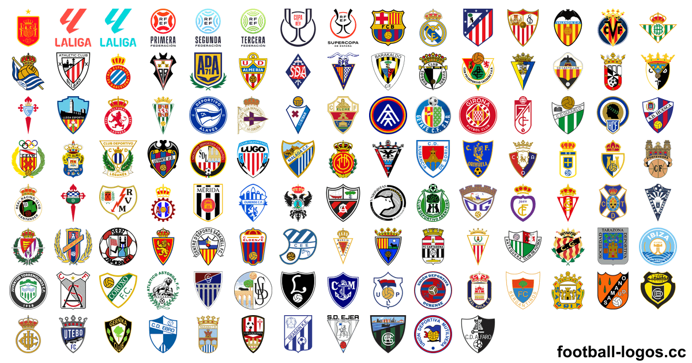
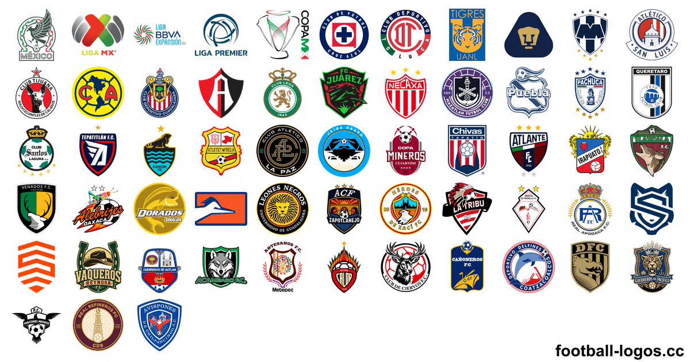
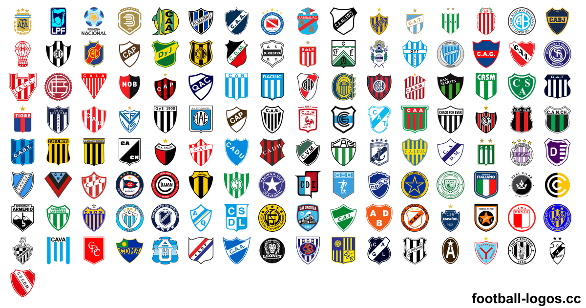
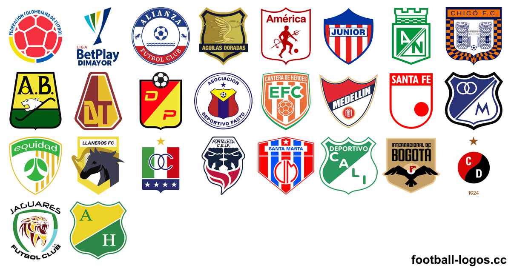
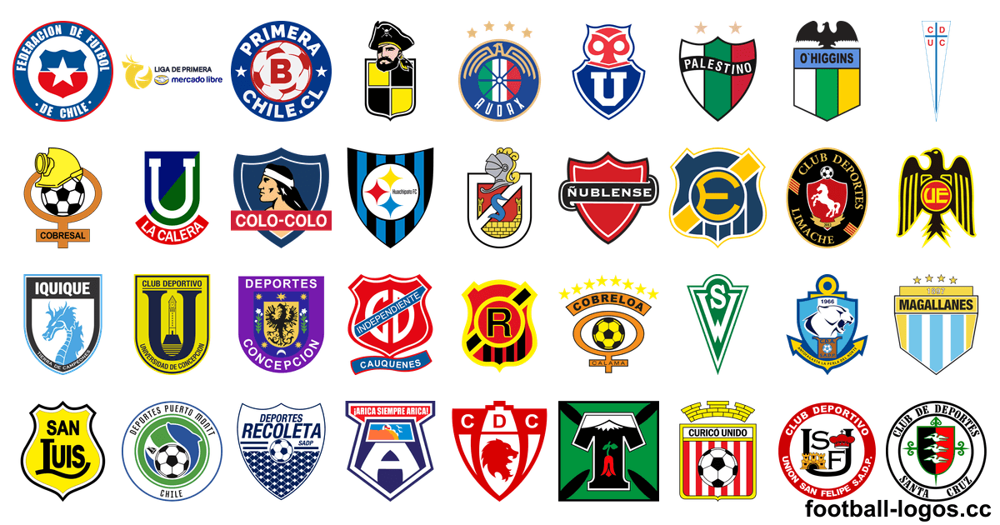

<h1>Escudos de fútbol – más de 5900 logos de equipos en PNG y SVG</h1>

Escudos y logos de clubes, selecciones, ligas y torneos de fútbol de más de 220 países: PNG sin fondo (transparente) de 64 a 3000 px y SVG vectorial. Descárgalos gratis en <a href="https://football-logos.cc">football-logos.cc</a> (sitio en inglés). Actualizado en noviembre de 2026.

<a href="https://github.com/Leo4815162342/football-logos">English</a> · <b>Español</b> · <a href="README.pt-BR.md">Português</a> · <a href="README.fr.md">Français</a> · <a href="README.ar.md">العربية</a> · <a href="README.vi.md">Tiếng Việt</a> · <a href="README.ja.md">日本語</a>

<a href="https://football-logos.cc"><picture><source media="(prefers-color-scheme: dark)" srcset="screenshot-dark.png"></picture></a>

## Qué incluye la colección

- **Escudos de clubes** de más de 220 países y territorios, de las ligas principales a las categorías inferiores
- **[Escudos de selecciones](https://football-logos.cc/national-teams/)** de más de 220 países
- **[Logos de ligas y torneos](https://football-logos.cc/tournaments/)**: Champions League, Europa League, Mundial, Copa América, Eurocopa y más
- **PNG con fondo transparente** en 64, 128, 256, 512, 700, 1500 y 3000 px y **SVG vectorial** de casi todos los escudos
- **Versiones en blanco y negro** de más de 610 escudos
- **[Escudos nuevos](https://football-logos.cc/new/)** cada día: más de 280 en los últimos 30 días
- **Historia de los escudos** de más de 30 clubes, como [Real Madrid](https://football-logos.cc/spain/real-madrid/logo-history/) y [Barcelona](https://football-logos.cc/spain/barcelona/logo-history/)
- **[Mapa de clubes](https://football-logos.cc/map/)**: busca cualquier equipo por ciudad, país o liga

## Escudos de equipos populares

### 🇪🇸 [Escudos de equipos de España](https://football-logos.cc/spain/)

[Real Madrid](https://football-logos.cc/spain/real-madrid/) · [Barcelona](https://football-logos.cc/spain/barcelona/) · [Atletico Madrid](https://football-logos.cc/spain/atletico-madrid/) · [Real Betis](https://football-logos.cc/spain/real-betis/) · [Villarreal](https://football-logos.cc/spain/villarreal/) · [Sevilla](https://football-logos.cc/spain/sevilla/) · [Real Sociedad](https://football-logos.cc/spain/real-sociedad/) · [Athletic Club Bilbao](https://football-logos.cc/spain/athletic-club/) · [Valencia](https://football-logos.cc/spain/valencia/) · [Deportivo La Coruña](https://football-logos.cc/spain/deportivo-la-coruna/) · [Celta](https://football-logos.cc/spain/celta/) · [Málaga](https://football-logos.cc/spain/malaga/) · [Racing Santander](https://football-logos.cc/spain/racing/) · [Rayo Vallecano](https://football-logos.cc/spain/rayo-vallecano/) · [Getafe](https://football-logos.cc/spain/getafe/) · [Espanyol](https://football-logos.cc/spain/espanyol/)

### 🇲🇽 [Escudos de la Liga MX](https://football-logos.cc/mexico/)

[Club America](https://football-logos.cc/mexico/club-america/) · [Cruz Azul](https://football-logos.cc/mexico/cruz-azul/) · [CD Guadalajara](https://football-logos.cc/mexico/cd-guadalajara/) · [Monterrey](https://football-logos.cc/mexico/monterrey/) · [Tigres UANL](https://football-logos.cc/mexico/tigres-uanl/) · [UNAM Pumas](https://football-logos.cc/mexico/unam-pumas/) · [Toluca](https://football-logos.cc/mexico/toluca/) · [Club Leon](https://football-logos.cc/mexico/club-leon/) · [Pachuca](https://football-logos.cc/mexico/pachuca/) · [Atlante FC](https://football-logos.cc/mexico/atlante/) · [Atlas](https://football-logos.cc/mexico/atlas/) · [Club Tijuana](https://football-logos.cc/mexico/club-tijuana/)

### 🇦🇷 [Escudos de fútbol argentino](https://football-logos.cc/argentina/)

[Boca Juniors](https://football-logos.cc/argentina/boca-juniors/) · [River Plate](https://football-logos.cc/argentina/river-plate/) · [Estudiantes de La Plata](https://football-logos.cc/argentina/estudiantes-de-la-plata/) · [Rosario Central](https://football-logos.cc/argentina/rosario-central/) · [Independiente](https://football-logos.cc/argentina/independiente/) · [Racing Club](https://football-logos.cc/argentina/racing-club/) · [Vélez Sarsfield](https://football-logos.cc/argentina/velez-sarsfield/) · [San Lorenzo de Almagro](https://football-logos.cc/argentina/san-lorenzo-de-almagro/) · [Newell's Old Boys](https://football-logos.cc/argentina/newells-old-boys/) · [Argeninos Juniors](https://football-logos.cc/argentina/argeninos-juniors/) · [Independiente Rivadavia](https://football-logos.cc/argentina/independiente-rivadavia/) · [Lanús](https://football-logos.cc/argentina/lanus/)

### 🇨🇴 [Escudos de equipos de Colombia](https://football-logos.cc/colombia/)

[Atlético Nacional](https://football-logos.cc/colombia/atletico-nacional/) · [Independiente Santa Fe](https://football-logos.cc/colombia/independiente-santa-fe/) · [América de Cali](https://football-logos.cc/colombia/america-de-cali/) · [Millonarios](https://football-logos.cc/colombia/millonarios/) · [Atlético Junior](https://football-logos.cc/colombia/atletico-junior/) · [Deportes Tolima](https://football-logos.cc/colombia/deportes-tolima/) · [Deportivo Cali](https://football-logos.cc/colombia/deportivo-cali/) · [Independiente Medellín](https://football-logos.cc/colombia/independiente-medellin/)

### 🇨🇱 [Escudos de equipos de Chile](https://football-logos.cc/chile/)

[Colo Colo](https://football-logos.cc/chile/colo-colo/) · [Universidad de Chile](https://football-logos.cc/chile/universidad-de-chile/) · [Universidad Católica](https://football-logos.cc/chile/universidad-catolica/) · [Coquimbo Unido](https://football-logos.cc/chile/coquimbo-unido/) · [Palestino](https://football-logos.cc/chile/palestino/) · [Audax Italiano](https://football-logos.cc/chile/audax-italiano/) · [O'Higgins](https://football-logos.cc/chile/ohiggins/) · [Unión La Calera](https://football-logos.cc/chile/union-la-calera/)

### Escudos de equipos europeos

[Liverpool FC](https://football-logos.cc/england/liverpool/) · [Manchester City](https://football-logos.cc/england/manchester-city/) · [Chelsea](https://football-logos.cc/england/chelsea/) · [Arsenal](https://football-logos.cc/england/arsenal/) · [Manchester United](https://football-logos.cc/england/manchester-united/) · [PSG](https://football-logos.cc/france/paris-saint-germain/) · [Bayern Munich](https://football-logos.cc/germany/bayern-munchen/) · [Tottenham](https://football-logos.cc/england/tottenham/) · [Inter](https://football-logos.cc/italy/inter/) · [Aston Villa](https://football-logos.cc/england/aston-villa/) · [Juventus](https://football-logos.cc/italy/juventus/) · [Milan](https://football-logos.cc/italy/milan/) · [AS Roma](https://football-logos.cc/italy/roma/) · [Borussia Dortmund](https://football-logos.cc/germany/borussia-dortmund/) · [Newcastle United](https://football-logos.cc/england/newcastle/) · [Napoli](https://football-logos.cc/italy/napoli/)

Los más descargados en todo el mundo: [Real Madrid](https://football-logos.cc/spain/real-madrid/) · [Barcelona](https://football-logos.cc/spain/barcelona/) · [Liverpool FC](https://football-logos.cc/england/liverpool/) · [Manchester City](https://football-logos.cc/england/manchester-city/) · [Chelsea](https://football-logos.cc/england/chelsea/) · [Arsenal](https://football-logos.cc/england/arsenal/) · [Manchester United](https://football-logos.cc/england/manchester-united/) · [PSG](https://football-logos.cc/france/paris-saint-germain/) · [Bayern Munich](https://football-logos.cc/germany/bayern-munchen/) · [Tottenham](https://football-logos.cc/england/tottenham/) · [Atletico Madrid](https://football-logos.cc/spain/atletico-madrid/) · [Inter](https://football-logos.cc/italy/inter/)

## Escudos por liga

Escudos de la temporada 2026/27, por país y liga principal:

| Liga | País | Escudos |
| --- | --- | ---: |
| La Liga · Copa del Rey | 🇪🇸 [España](https://football-logos.cc/spain/) | 240+ |
| Liga MX · Copa MX | 🇲🇽 [México](https://football-logos.cc/mexico/) | 70+ |
| Argentine Primera Division · Argentine Cup | 🇦🇷 [Argentina](https://football-logos.cc/argentina/) | 180+ |
| Categoría Primera A · Copa Colombia | 🇨🇴 [Colombia](https://football-logos.cc/colombia/) | 20+ |
| Primera División · Copa Chile | 🇨🇱 [Chile](https://football-logos.cc/chile/) | 30+ |
| Uruguayan Primera División · Uruguayan Cup | 🇺🇾 [Uruguay](https://football-logos.cc/uruguay/) | 30+ |
| Peruvian Primera División · Peruvian Cup | 🇵🇪 [Perú](https://football-logos.cc/peru/) | 30+ |
| Premier League · FA Cup | 🏴󠁧󠁢󠁥󠁮󠁧󠁿 [Inglaterra](https://football-logos.cc/england/) | 540+ |
| Serie A · Coppa Italia | 🇮🇹 [Italia](https://football-logos.cc/italy/) | 400+ |
| Bundesliga · DFB-Pokal | 🇩🇪 [Alemania](https://football-logos.cc/germany/) | 420+ |
| Ligue 1 · Coupe de France | 🇫🇷 [Francia](https://football-logos.cc/france/) | 370+ |
| Primeira Liga · Taça de Portugal | 🇵🇹 [Portugal](https://football-logos.cc/portugal/) | 180+ |
| Campeonato Brasileiro Série A · Copa do Brasil | 🇧🇷 [Brasil](https://football-logos.cc/brazil/) | 270+ |
| MLS · MLS Cup | 🇺🇸 [Estados Unidos](https://football-logos.cc/usa/) | 130+ |

## Escudos y kits para DLS 26

Para Dream League Soccer (DLS 26):

- [Logos para DLS](https://football-logos.cc/dls/): URLs de escudos de 512×512 de cualquier equipo, listas para copiar
- [Kits para DLS](https://football-logos.cc/dls/kits/): URLs de uniformes de 512×512 con vista previa en 3D
- [Creador de escudos para DLS](https://football-logos.cc/logo-maker/): crea tu propio escudo y copia su URL
- [Creador de kits para DLS](https://football-logos.cc/kit-maker/): diseña tu uniforme, míralo en 3D y copia su URL

## Fondos de pantalla de fútbol

[Más de 9600 fondos de pantalla de fútbol en 4K](https://football-logos.cc/wallpapers/), gratis, con los escudos de más de 600 clubes y selecciones, para iPhone, Android, iPad y PC.

## Escudos de fútbol por país

Todos los países y territorios de la colección:

**A** · 🇦🇫 [Afganistán](https://football-logos.cc/afghanistan/) (1) · 🇦🇱 [Albania](https://football-logos.cc/albania/) (20+) · 🇩🇪 [Alemania](https://football-logos.cc/germany/) (420+) · 🇦🇩 [Andorra](https://football-logos.cc/andorra/) (10+) · 🇦🇴 [Angola](https://football-logos.cc/angola/) (2) · 🇦🇮 [Anguila](https://football-logos.cc/anguilla/) (1) · 🇦🇬 [Antigua y Barbuda](https://football-logos.cc/antigua-and-barbuda/) (1) · 🇸🇦 [Arabia Saudí](https://football-logos.cc/saudi-arabia/) (50+) · 🇩🇿 [Argelia](https://football-logos.cc/algeria/) (20+) · 🇦🇷 [Argentina](https://football-logos.cc/argentina/) (180+) · 🇦🇲 [Armenia](https://football-logos.cc/armenia/) (10+) · 🇦🇼 [Aruba](https://football-logos.cc/aruba/) (1) · 🇦🇺 [Australia](https://football-logos.cc/australia/) (20+) · 🇦🇹 [Austria](https://football-logos.cc/austria/) (40+) · 🇦🇿 [Azerbaiyán](https://football-logos.cc/azerbaijan/) (20+)

**B** · 🇧🇸 [Bahamas](https://football-logos.cc/bahamas/) (1) · 🇧🇩 [Bangladés](https://football-logos.cc/bangladesh/) (10+) · 🇧🇧 [Barbados](https://football-logos.cc/barbados/) (1) · 🇧🇭 [Baréin](https://football-logos.cc/bahrain/) (1) · 🇧🇪 [Bélgica](https://football-logos.cc/belgium/) (60+) · 🇧🇿 [Belice](https://football-logos.cc/belize/) (1) · 🇧🇯 [Benín](https://football-logos.cc/benin/) (1) · 🇧🇲 [Bermudas](https://football-logos.cc/bermuda/) (1) · 🇧🇾 [Bielorrusia](https://football-logos.cc/belarus/) (20+) · 🇧🇴 [Bolivia](https://football-logos.cc/bolivia/) (20+) · 🇧🇶 [Bonaire](https://football-logos.cc/bonaire/) (1) · 🇧🇦 [Bosnia y Herzegovina](https://football-logos.cc/bosnia-and-herzegovina/) (20+) · 🇧🇼 [Botsuana](https://football-logos.cc/botswana/) (1) · 🇧🇷 [Brasil](https://football-logos.cc/brazil/) (270+) · 🇧🇳 [Brunéi](https://football-logos.cc/brunei/) (1) · 🇧🇬 [Bulgaria](https://football-logos.cc/bulgaria/) (20+) · 🇧🇫 [Burkina Faso](https://football-logos.cc/burkina-faso/) (1) · 🇧🇮 [Burundi](https://football-logos.cc/burundi/) (3) · 🇧🇹 [Bután](https://football-logos.cc/bhutan/) (1)

**C** · 🇨🇻 [Cabo Verde](https://football-logos.cc/cabo-verde/) (2) · 🇰🇭 [Camboya](https://football-logos.cc/cambodia/) (2) · 🇨🇲 [Camerún](https://football-logos.cc/cameroon/) (2) · 🇨🇦 [Canadá](https://football-logos.cc/canada/) (10+) · 🏳 [Cataluña](https://football-logos.cc/catalonia/) (1) · 🇶🇦 [Catar](https://football-logos.cc/qatar/) (20+) · 🇹🇩 [Chad](https://football-logos.cc/chad/) (1) · 🇨🇿 [Chequia](https://football-logos.cc/czech-republic/) (40+) · 🇨🇱 [Chile](https://football-logos.cc/chile/) (30+) · 🇨🇳 [China](https://football-logos.cc/china/) (30+) · 🇨🇾 [Chipre](https://football-logos.cc/cyprus/) (20+) · 🇻🇦 [Ciudad del Vaticano](https://football-logos.cc/vatican-city/) (1) · 🇨🇴 [Colombia](https://football-logos.cc/colombia/) (20+) · 🇰🇲 [Comoras](https://football-logos.cc/comoros/) (1) · 🇨🇬 [Congo](https://football-logos.cc/congo/) (1) · 🇰🇵 [Corea del Norte](https://football-logos.cc/north-korea/) (1) · 🇰🇷 [Corea del Sur](https://football-logos.cc/south-korea/) (30+) · 🇨🇷 [Costa Rica](https://football-logos.cc/costa-rica/) (10+) · 🇨🇮 [Côte d’Ivoire](https://football-logos.cc/cote-d-ivoire/) (2) · 🇭🇷 [Croacia](https://football-logos.cc/croatia/) (20+) · 🇨🇺 [Cuba](https://football-logos.cc/cuba/) (1) · 🇨🇼 [Curazao](https://football-logos.cc/curacao/) (4)

**D** · 🇩🇰 [Dinamarca](https://football-logos.cc/denmark/) (50+) · 🇩🇲 [Dominica](https://football-logos.cc/dominica/) (1)

**E** · 🇪🇨 [Ecuador](https://football-logos.cc/ecuador/) (20+) · 🇪🇬 [Egipto](https://football-logos.cc/egypt/) (20+) · 🇸🇻 [El Salvador](https://football-logos.cc/el-salvador/) (2) · 🇦🇪 [Emiratos Árabes Unidos](https://football-logos.cc/uae/) (10+) · 🇪🇷 [Eritrea](https://football-logos.cc/eritrea/) (1) · 🏴󠁧󠁢󠁳󠁣󠁴󠁿 [Escocia](https://football-logos.cc/scotland/) (80+) · 🇸🇰 [Eslovaquia](https://football-logos.cc/slovakia/) (20+) · 🇸🇮 [Eslovenia](https://football-logos.cc/slovenia/) (20+) · 🇪🇸 [España](https://football-logos.cc/spain/) (240+) · 🇺🇸 [Estados Unidos](https://football-logos.cc/usa/) (130+) · 🇪🇪 [Estonia](https://football-logos.cc/estonia/) (10+) · 🇸🇿 [Esuatini](https://football-logos.cc/eswatini/) (1) · 🇪🇹 [Etiopía](https://football-logos.cc/ethiopia/) (1)

**F** · 🇵🇭 [Filipinas](https://football-logos.cc/philippines/) (1) · 🇫🇮 [Finlandia](https://football-logos.cc/finland/) (30+) · 🇫🇯 [Fiyi](https://football-logos.cc/fiji/) (1) · 🇫🇷 [Francia](https://football-logos.cc/france/) (370+)

**G** · 🇬🇦 [Gabón](https://football-logos.cc/gabon/) (1) · 🏴󠁧󠁢󠁷󠁬󠁳󠁿 [Gales](https://football-logos.cc/wales/) (60+) · 🇬🇲 [Gambia](https://football-logos.cc/gambia/) (1) · 🇬🇪 [Georgia](https://football-logos.cc/georgia/) (20+) · 🇬🇭 [Ghana](https://football-logos.cc/ghana/) (20+) · 🇬🇮 [Gibraltar](https://football-logos.cc/gibraltar/) (10+) · 🇬🇩 [Granada](https://football-logos.cc/grenada/) (1) · 🇬🇷 [Grecia](https://football-logos.cc/greece/) (90+) · 🇬🇱 [Groenlandia](https://football-logos.cc/greenland/) (1) · 🇬🇵 [Guadalupe](https://football-logos.cc/guadeloupe/) (1) · 🇬🇺 [Guam](https://football-logos.cc/guam/) (1) · 🇬🇹 [Guatemala](https://football-logos.cc/guatemala/) (10+) · 🇬🇫 [Guayana Francesa](https://football-logos.cc/french-guiana/) (1) · 🇬🇳 [Guinea](https://football-logos.cc/guinea/) (1) · 🇬🇶 [Guinea Ecuatorial](https://football-logos.cc/equatorial-guinea/) (1) · 🇬🇼 [Guinea-Bisáu](https://football-logos.cc/guinea-bissau/) (1) · 🇬🇾 [Guyana](https://football-logos.cc/guyana/) (1)

**H** · 🇭🇹 [Haití](https://football-logos.cc/haiti/) (2) · 🇭🇳 [Honduras](https://football-logos.cc/honduras/) (1) · 🇭🇰 [Hong Kong](https://football-logos.cc/hong-kong/) (10+) · 🇭🇺 [Hungría](https://football-logos.cc/hungary/) (40+)

**I** · 🇮🇳 [India](https://football-logos.cc/india/) (20+) · 🇮🇩 [Indonesia](https://football-logos.cc/indonesia/) (60+) · 🏴󠁧󠁢󠁥󠁮󠁧󠁿 [Inglaterra](https://football-logos.cc/england/) (540+) · 🇮🇶 [Irak](https://football-logos.cc/iraq/) (20+) · 🇮🇷 [Irán](https://football-logos.cc/iran/) (20+) · 🇮🇪 [Irlanda](https://football-logos.cc/republic-of-ireland/) (20+) · 🏴 [Irlanda del Norte](https://football-logos.cc/northern-ireland/) (20+) · 🇮🇸 [Islandia](https://football-logos.cc/iceland/) (30+) · 🇰🇾 [Islas Caimán](https://football-logos.cc/cayman-islands/) (1) · 🇨🇰 [Islas Cook](https://football-logos.cc/cook-islands/) (1) · 🇫🇴 [Islas Feroe](https://football-logos.cc/faroe-islands/) (10+) · 🇲🇵 [Islas Marianas del Norte](https://football-logos.cc/northern-mariana-islands/) (1) · 🇸🇧 [Islas Salomón](https://football-logos.cc/solomon-islands/) (1) · 🇹🇨 [Islas Turcas y Caicos](https://football-logos.cc/turks-and-caicos-islands/) (1) · 🇻🇬 [Islas Vírgenes Británicas](https://football-logos.cc/british-virgin-islands/) (1) · 🇻🇮 [Islas Vírgenes de EE. UU.](https://football-logos.cc/us-virgin-islands/) (1) · 🇮🇱 [Israel](https://football-logos.cc/israel/) (20+) · 🇮🇹 [Italia](https://football-logos.cc/italy/) (400+)

**J** · 🇯🇲 [Jamaica](https://football-logos.cc/jamaica/) (2) · 🇯🇵 [Japón](https://football-logos.cc/japan/) (70+) · 🇯🇴 [Jordania](https://football-logos.cc/jordan/) (5)

**K** · 🇰🇿 [Kazajistán](https://football-logos.cc/kazakhstan/) (20+) · 🇰🇪 [Kenia](https://football-logos.cc/kenya/) (2) · 🇰🇬 [Kirguistán](https://football-logos.cc/kyrgyzstan/) (1) · 🇰🇮 [Kiribati](https://football-logos.cc/kiribati/) (1) · 🇽🇰 [Kosovo](https://football-logos.cc/kosovo/) (10+) · 🏴 [Kurdistán](https://football-logos.cc/kurdistan/) (1) · 🇰🇼 [Kuwait](https://football-logos.cc/kuwait/) (1)

**L** · 🇱🇦 [Laos](https://football-logos.cc/laos/) (1) · 🇱🇸 [Lesoto](https://football-logos.cc/lesotho/) (1) · 🇱🇻 [Letonia](https://football-logos.cc/latvia/) (10+) · 🇱🇧 [Líbano](https://football-logos.cc/lebanon/) (1) · 🇱🇷 [Liberia](https://football-logos.cc/liberia/) (1) · 🇱🇾 [Libia](https://football-logos.cc/libya/) (1) · 🇱🇮 [Liechtenstein](https://football-logos.cc/liechtenstein/) (5) · 🇱🇹 [Lituania](https://football-logos.cc/lithuania/) (10+) · 🇱🇺 [Luxemburgo](https://football-logos.cc/luxembourg/) (30+)

**M** · 🇲🇴 [Macao](https://football-logos.cc/macau/) (1) · 🇲🇰 [Macedonia del Norte](https://football-logos.cc/north-macedonia/) (20+) · 🇲🇬 [Madagascar](https://football-logos.cc/madagascar/) (2) · 🇲🇾 [Malasia](https://football-logos.cc/malaysia/) (10+) · 🇲🇼 [Malaui](https://football-logos.cc/malawi/) (1) · 🇲🇻 [Maldivas](https://football-logos.cc/maldives/) (2) · 🇲🇱 [Mali](https://football-logos.cc/mali/) (1) · 🇲🇹 [Malta](https://football-logos.cc/malta/) (20+) · 🇲🇦 [Marruecos](https://football-logos.cc/morocco/) (20+) · 🇲🇶 [Martinica](https://football-logos.cc/martinique/) (1) · 🇲🇺 [Mauricio](https://football-logos.cc/mauritius/) (1) · 🇲🇷 [Mauritania](https://football-logos.cc/mauritania/) (1) · 🇲🇽 [México](https://football-logos.cc/mexico/) (70+) · 🇲🇩 [Moldavia](https://football-logos.cc/moldova/) (10+) · 🇲🇳 [Mongolia](https://football-logos.cc/mongolia/) (1) · 🇲🇪 [Montenegro](https://football-logos.cc/montenegro/) (10+) · 🇲🇸 [Montserrat](https://football-logos.cc/montserrat/) (1) · 🇲🇿 [Mozambique](https://football-logos.cc/mozambique/) (1) · 🇲🇲 [Myanmar](https://football-logos.cc/myanmar/) (1)

**N** · 🇳🇦 [Namibia](https://football-logos.cc/namibia/) (2) · 🇳🇷 [Nauru](https://football-logos.cc/nauru/) (1) · 🇳🇵 [Nepal](https://football-logos.cc/nepal/) (1) · 🇳🇮 [Nicaragua](https://football-logos.cc/nicaragua/) (1) · 🇳🇪 [Níger](https://football-logos.cc/niger/) (1) · 🇳🇬 [Nigeria](https://football-logos.cc/nigeria/) (20+) · 🇳🇴 [Noruega](https://football-logos.cc/norway/) (50+) · 🇳🇨 [Nueva Caledonia](https://football-logos.cc/new-caledonia/) (1) · 🇳🇿 [Nueva Zelanda](https://football-logos.cc/new-zealand/) (10+)

**O** · 🇴🇲 [Omán](https://football-logos.cc/oman/) (1)

**P** · 🇳🇱 [Países Bajos](https://football-logos.cc/netherlands/) (120+) · 🇵🇰 [Pakistán](https://football-logos.cc/pakistan/) (1) · 🇵🇼 [Palaos](https://football-logos.cc/palau/) (1) · 🇵🇸 [Palestina](https://football-logos.cc/palestine/) (1) · 🇵🇦 [Panamá](https://football-logos.cc/panama/) (10+) · 🇵🇬 [Papúa Nueva Guinea](https://football-logos.cc/papua-new-guinea/) (1) · 🇵🇾 [Paraguay](https://football-logos.cc/paraguay/) (10+) · 🇵🇪 [Perú](https://football-logos.cc/peru/) (30+) · 🇵🇱 [Polonia](https://football-logos.cc/poland/) (60+) · 🇵🇹 [Portugal](https://football-logos.cc/portugal/) (180+) · 🇵🇷 [Puerto Rico](https://football-logos.cc/puerto-rico/) (10+)

**R** · 🇨🇩 [RD del Congo](https://football-logos.cc/congo-dr/) (2) · 🇨🇫 [República Centroafricana](https://football-logos.cc/central-african-republic/) (1) · 🇩🇴 [República Dominicana](https://football-logos.cc/dominican-republic/) (1) · 🇷🇪 [Reunión](https://football-logos.cc/reunion/) (2) · 🇷🇼 [Ruanda](https://football-logos.cc/rwanda/) (1) · 🇷🇴 [Rumanía](https://football-logos.cc/romania/) (20+) · 🇷🇺 [Rusia](https://football-logos.cc/russia/) (60+)

**S** · 🇼🇸 [Samoa](https://football-logos.cc/samoa/) (1) · 🇦🇸 [Samoa Americana](https://football-logos.cc/american-samoa/) (1) · 🇰🇳 [San Cristóbal y Nieves](https://football-logos.cc/st-kitts-and-nevis/) (1) · 🇸🇲 [San Marino](https://football-logos.cc/san-marino/) (10+) · 🇲🇫 [San Martín](https://football-logos.cc/saint-martin/) (1) · 🇻🇨 [San Vicente y las Granadinas](https://football-logos.cc/saint-vincent-and-the-grenadines/) (1) · 🇱🇨 [Santa Lucía](https://football-logos.cc/saint-lucia/) (1) · 🇸🇹 [Santo Tomé y Príncipe](https://football-logos.cc/sao-tome-and-principe/) (1) · 🇸🇳 [Senegal](https://football-logos.cc/senegal/) (3) · 🇷🇸 [Serbia](https://football-logos.cc/serbia/) (30+) · 🇸🇨 [Seychelles](https://football-logos.cc/seychelles/) (1) · 🇸🇱 [Sierra Leona](https://football-logos.cc/sierra-leone/) (1) · 🇸🇬 [Singapur](https://football-logos.cc/singapore/) (10+) · 🇸🇽 [Sint Maarten](https://football-logos.cc/sint-maarten/) (1) · 🇸🇾 [Siria](https://football-logos.cc/syria/) (1) · 🇸🇴 [Somalia](https://football-logos.cc/somalia/) (1) · 🇱🇰 [Sri Lanka](https://football-logos.cc/sri-lanka/) (1) · 🇿🇦 [Sudáfrica](https://football-logos.cc/south-africa/) (20+) · 🇸🇩 [Sudán](https://football-logos.cc/sudan/) (1) · 🇸🇸 [Sudán del Sur](https://football-logos.cc/south-sudan/) (1) · 🇸🇪 [Suecia](https://football-logos.cc/sweden/) (60+) · 🇨🇭 [Suiza](https://football-logos.cc/switzerland/) (20+) · 🇸🇷 [Surinam](https://football-logos.cc/suriname/) (1)

**T** · 🇵🇫 [Tahití](https://football-logos.cc/tahiti/) (1) · 🇹🇭 [Tailandia](https://football-logos.cc/thailand/) (10+) · 🇹🇼 [Taiwán](https://football-logos.cc/taiwan/) (10+) · 🇹🇿 [Tanzania](https://football-logos.cc/tanzania/) (20+) · 🇹🇯 [Tayikistán](https://football-logos.cc/tajikistan/) (1) · 🇹🇱 [Timor-Leste](https://football-logos.cc/timor-leste/) (1) · 🇹🇬 [Togo](https://football-logos.cc/togo/) (1) · 🇹🇴 [Tonga](https://football-logos.cc/tonga/) (1) · 🇹🇹 [Trinidad y Tobago](https://football-logos.cc/trinidad-and-tobago/) (1) · 🇹🇳 [Túnez](https://football-logos.cc/tunisia/) (20+) · 🇹🇲 [Turkmenistán](https://football-logos.cc/turkmenistan/) (1) · 🇹🇷 [Turquía](https://football-logos.cc/turkey/) (110+) · 🇹🇻 [Tuvalu](https://football-logos.cc/tuvalu/) (1)

**U** · 🇺🇦 [Ucrania](https://football-logos.cc/ukraine/) (50+) · 🇺🇬 [Uganda](https://football-logos.cc/uganda/) (2) · 🇺🇾 [Uruguay](https://football-logos.cc/uruguay/) (30+) · 🇺🇿 [Uzbekistán](https://football-logos.cc/uzbekistan/) (20+)

**V** · 🇻🇺 [Vanuatu](https://football-logos.cc/vanuatu/) (1) · 🇻🇪 [Venezuela](https://football-logos.cc/venezuela/) (10+) · 🇻🇳 [Vietnam](https://football-logos.cc/vietnam/) (30+)

**Y** · 🇾🇪 [Yemen](https://football-logos.cc/yemen/) (1) · 🇩🇯 [Yibuti](https://football-logos.cc/djibouti/) (1)

**Z** · 🇿🇲 [Zambia](https://football-logos.cc/zambia/) (1) · 🏴 [Zanzíbar](https://football-logos.cc/zanzibar/) (1) · 🇿🇼 [Zimbabue](https://football-logos.cc/zimbabwe/) (1)

## Preguntas frecuentes

### ¿Los escudos son gratis?

Sí. Todos los escudos se descargan gratis en [football-logos.cc](https://football-logos.cc), en PNG o SVG. Siguen siendo propiedad de sus clubes y federaciones, así que lee el [aviso de uso de logos](https://football-logos.cc/license/) (en inglés) antes de usarlos.

### ¿En qué formatos y tamaños están?

PNG con fondo transparente en 64, 128, 256, 512, 700, 1500 y 3000 px, y SVG vectorial, que se amplía sin perder calidad. Más de 610 escudos también están en blanco y negro.

### ¿Puedo usar los escudos con fines comerciales?

No. Los escudos son marcas registradas de sus clubes, ligas y federaciones. Se comparten con fines informativos, editoriales y para aficionados (investigación, diseños sin fines comerciales, proyectos de fans), no para productos, merchandising, branding ni nada que sugiera un respaldo oficial.

### ¿Cómo pongo un escudo en Dream League Soccer (DLS)?

Busca el equipo en [Logos para DLS](https://football-logos.cc/dls/), copia la URL del escudo de 512×512 y pégala en Custom Logo, en DLS 26. Para crear tu propio escudo, usa el [creador de escudos](https://football-logos.cc/logo-maker/).

### Falta un escudo o está desactualizado. ¿Qué hago?

Pídelo en [football-logos.cc/request](https://football-logos.cc/request/).

## Uso y marcas registradas

Todos los escudos son propiedad de sus clubes, ligas y federaciones y están protegidos como marcas registradas. football-logos.cc es un sitio independiente y no está afiliado a ninguno de ellos. Los escudos se comparten con fines informativos, editoriales y para aficionados: no los uses en productos comerciales, merchandising o branding, ni de forma que sugiera un respaldo oficial. Más información en el [aviso de uso de logos](https://football-logos.cc/license/) (en inglés).

