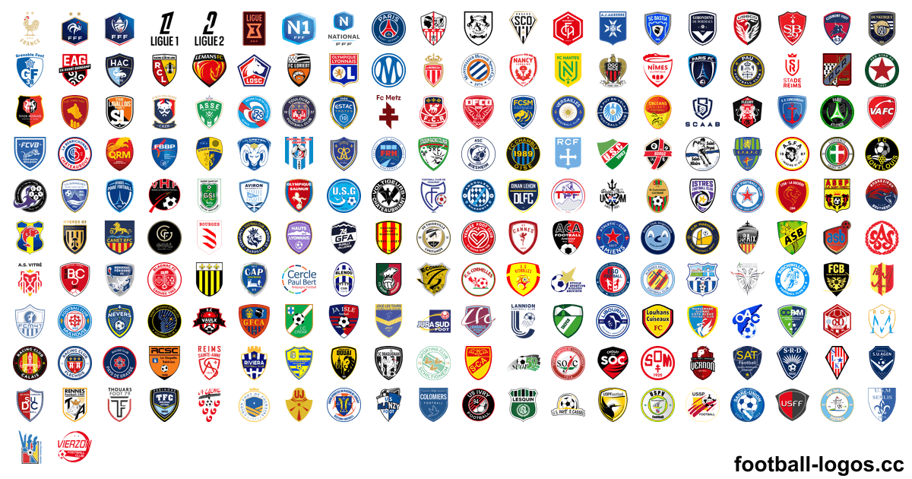
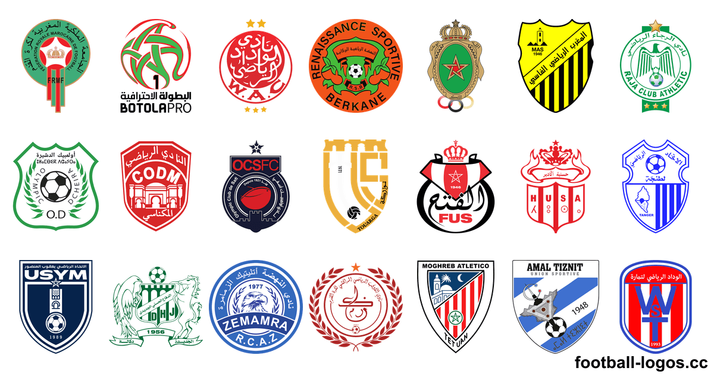
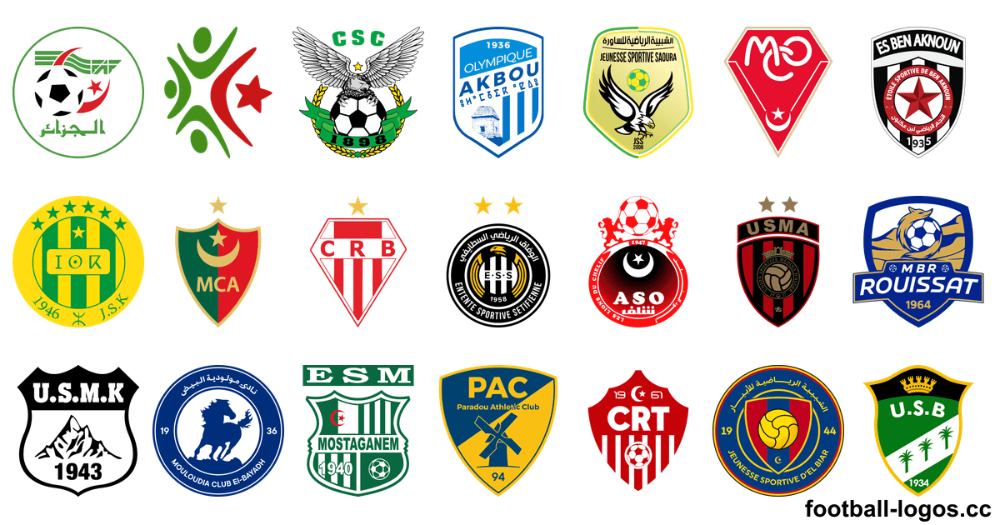
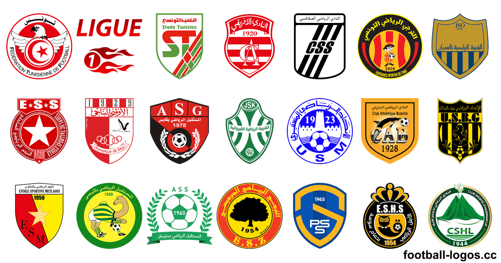
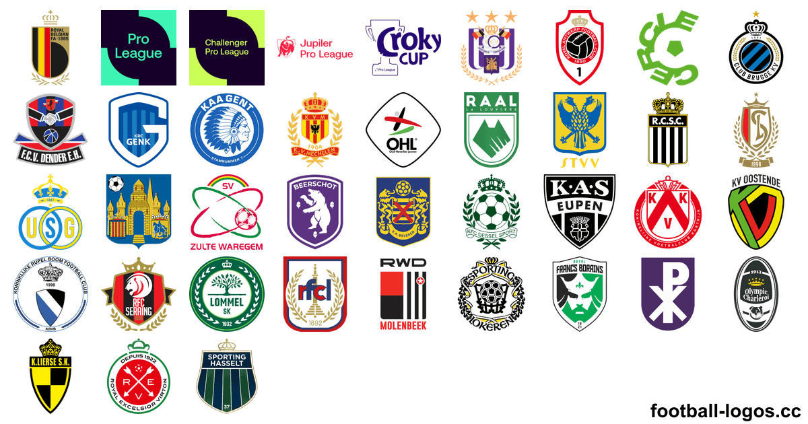

<h1>Logos de foot – plus de 6 100 logos de clubs en PNG et SVG</h1>

Logos et écussons des clubs de football, des sélections nationales, des ligues et des compétitions de plus de 220 pays : PNG transparent de 64 à 3000 px et SVG vectoriel. Téléchargement gratuit sur <a href="https://football-logos.cc">football-logos.cc</a> (site en anglais). Mis à jour en novembre 2026.

<a href="https://github.com/Leo4815162342/football-logos">English</a> · <a href="README.es.md">Español</a> · <a href="README.pt-BR.md">Português</a> · <b>Français</b> · <a href="README.ar.md">العربية</a> · <a href="README.vi.md">Tiếng Việt</a> · <a href="README.ja.md">日本語</a>

<a href="https://football-logos.cc"><picture><source media="(prefers-color-scheme: dark)" srcset="screenshot-dark.png"></picture></a>

## Contenu de la collection

- **Logos de clubs** de plus de 220 pays et territoires, des championnats majeurs aux divisions inférieures
- **[Logos des sélections nationales](https://football-logos.cc/national-teams/)** de plus de 230 pays
- **[Logos des ligues et compétitions](https://football-logos.cc/tournaments/)** : Ligue des champions, Ligue Europa, Coupe du monde, Copa América, Euro et plus
- **PNG transparent** en 64, 128, 256, 512, 700, 1500 et 3000 px et **SVG vectoriel** pour presque tous les logos
- **Versions noir et blanc** de plus de 710 logos
- **[Nouveaux logos](https://football-logos.cc/new/)** chaque jour : plus de 330 ces 30 derniers jours
- **Historique des logos** de plus de 30 clubs, par exemple [Real Madrid](https://football-logos.cc/spain/real-madrid/logo-history/) et [Barcelona](https://football-logos.cc/spain/barcelona/logo-history/)
- **[Carte des clubs](https://football-logos.cc/map/)** : trouvez n'importe quel club par ville, pays ou championnat

## Logos des clubs populaires

### 🇫🇷 [Logos des clubs français](https://football-logos.cc/france/)

[PSG](https://football-logos.cc/france/paris-saint-germain/) · [Marseille](https://football-logos.cc/france/marseille/) · [Lille](https://football-logos.cc/france/lille/) · [Olympique Lyonnais](https://football-logos.cc/france/lyon/) · [RC Lens](https://football-logos.cc/france/rc-lens/) · [AS Monaco](https://football-logos.cc/france/as-monaco/) · [Rennes](https://football-logos.cc/france/rennes/) · [RC Strasbourg Alsace](https://football-logos.cc/france/rc-strasbourg-alsace/) · [Toulouse](https://football-logos.cc/france/toulouse/) · [Paris FC](https://football-logos.cc/france/paris-fc/) · [Nice](https://football-logos.cc/france/nice/) · [Le Mans FC](https://football-logos.cc/france/le-mans/) · [Le Havre AC](https://football-logos.cc/france/le-havre-ac/) · [Brest](https://football-logos.cc/france/brest/) · [Troyes](https://football-logos.cc/france/troyes/) · [Auxerre](https://football-logos.cc/france/auxerre/)

### 🇲🇦 [Logos des clubs marocains](https://football-logos.cc/morocco/)

[Wydad AC](https://football-logos.cc/morocco/wydad-ac/) · [Raja Casablanca](https://football-logos.cc/morocco/raja-ca/) · [RS Berkane](https://football-logos.cc/morocco/rs-berkane/) · [AS FAR](https://football-logos.cc/morocco/as-far/) · [Maghreb of Fez](https://football-logos.cc/morocco/maghreb-of-fez/) · [IR Tanger](https://football-logos.cc/morocco/ir-tanger/) · [Fath Union Sports Rabat](https://football-logos.cc/morocco/fus-rabat/) · [Hassania Agadir](https://football-logos.cc/morocco/hassania-agadir/)

### 🇩🇿 [Logos des clubs algériens](https://football-logos.cc/algeria/)

[MC Alger](https://football-logos.cc/algeria/mc-alger/) · [USM Alger](https://football-logos.cc/algeria/usm-alger/) · [CR Belouizdad](https://football-logos.cc/algeria/cr-belouizdad/) · [JS Kabylie](https://football-logos.cc/algeria/js-kabylie/) · [MC Oran](https://football-logos.cc/algeria/mc-oran/) · [ES Sétif](https://football-logos.cc/algeria/es-setif/) · [CS Constantine](https://football-logos.cc/algeria/cs-constantine/) · [Olympique Akbou](https://football-logos.cc/algeria/olympique-akbou/)

### 🇹🇳 [Logos des clubs tunisiens](https://football-logos.cc/tunisia/)

[Espérance Sportive de Tunis](https://football-logos.cc/tunisia/esperance/) · [Club Africain](https://football-logos.cc/tunisia/club-africain/) · [CS Sfaxien](https://football-logos.cc/tunisia/cs-sfaxien/) · [Étoile Sportive du Sahel](https://football-logos.cc/tunisia/etoile-du-sahel/) · [Union Sportive Monastirienne](https://football-logos.cc/tunisia/us-monastir/) · [Stade Tunisien](https://football-logos.cc/tunisia/stade-tunisien/) · [Club Athlétique Bizertin](https://football-logos.cc/tunisia/ca-bizertin/) · [Olympique Béja](https://football-logos.cc/tunisia/olympique-de-beja/)

### 🇧🇪 [Logos des clubs belges](https://football-logos.cc/belgium/)

[Club Brugge](https://football-logos.cc/belgium/club-brugge/) · [RSC Anderlecht](https://football-logos.cc/belgium/anderlecht/) · [Union Saint-Gilloise](https://football-logos.cc/belgium/union-saint-gilloise/) · [KAA Gent](https://football-logos.cc/belgium/gent/) · [KRC Genk](https://football-logos.cc/belgium/genk/) · [Sint-Truidense VV](https://football-logos.cc/belgium/sint-truidense/) · [Royal Antwerp FC](https://football-logos.cc/belgium/antwerp/) · [Standard Liège](https://football-logos.cc/belgium/standard-liege/)

### Logos des clubs anglais, espagnols, italiens et allemands

[Real Madrid](https://football-logos.cc/spain/real-madrid/) · [Barcelona](https://football-logos.cc/spain/barcelona/) · [Liverpool FC](https://football-logos.cc/england/liverpool/) · [Manchester City](https://football-logos.cc/england/manchester-city/) · [Manchester United](https://football-logos.cc/england/manchester-united/) · [Arsenal](https://football-logos.cc/england/arsenal/) · [Chelsea](https://football-logos.cc/england/chelsea/) · [Bayern Munich](https://football-logos.cc/germany/bayern-munchen/) · [Atletico Madrid](https://football-logos.cc/spain/atletico-madrid/) · [Aston Villa](https://football-logos.cc/england/aston-villa/) · [Tottenham](https://football-logos.cc/england/tottenham/) · [Inter](https://football-logos.cc/italy/inter/) · [Juventus](https://football-logos.cc/italy/juventus/) · [AS Roma](https://football-logos.cc/italy/roma/) · [Milan](https://football-logos.cc/italy/milan/) · [Borussia Dortmund](https://football-logos.cc/germany/borussia-dortmund/)

Les plus téléchargés dans le monde : [Real Madrid](https://football-logos.cc/spain/real-madrid/) · [Barcelona](https://football-logos.cc/spain/barcelona/) · [Liverpool FC](https://football-logos.cc/england/liverpool/) · [Manchester City](https://football-logos.cc/england/manchester-city/) · [Manchester United](https://football-logos.cc/england/manchester-united/) · [Arsenal](https://football-logos.cc/england/arsenal/) · [Chelsea](https://football-logos.cc/england/chelsea/) · [PSG](https://football-logos.cc/france/paris-saint-germain/) · [Bayern Munich](https://football-logos.cc/germany/bayern-munchen/) · [Atletico Madrid](https://football-logos.cc/spain/atletico-madrid/) · [Aston Villa](https://football-logos.cc/england/aston-villa/) · [Tottenham](https://football-logos.cc/england/tottenham/)

## Logos de foot par pays

Tous les pays et territoires de la collection :

**A** · 🇦🇫 [Afghanistan](https://football-logos.cc/afghanistan/) (1) · 🇿🇦 [Afrique du Sud](https://football-logos.cc/south-africa/) (20+) · 🇦🇱 [Albanie](https://football-logos.cc/albania/) (20+) · 🇩🇿 [Algérie](https://football-logos.cc/algeria/) (20+) · 🇩🇪 [Allemagne](https://football-logos.cc/germany/) (450+) · 🇦🇩 [Andorre](https://football-logos.cc/andorra/) (10+) · 🏴󠁧󠁢󠁥󠁮󠁧󠁿 [Angleterre](https://football-logos.cc/england/) (560+) · 🇦🇴 [Angola](https://football-logos.cc/angola/) (3) · 🇦🇮 [Anguilla](https://football-logos.cc/anguilla/) (1) · 🇦🇬 [Antigua-et-Barbuda](https://football-logos.cc/antigua-and-barbuda/) (1) · 🇸🇦 [Arabie saoudite](https://football-logos.cc/saudi-arabia/) (50+) · 🇦🇷 [Argentine](https://football-logos.cc/argentina/) (200+) · 🇦🇲 [Arménie](https://football-logos.cc/armenia/) (10+) · 🇦🇼 [Aruba](https://football-logos.cc/aruba/) (1) · 🇦🇺 [Australie](https://football-logos.cc/australia/) (20+) · 🇦🇹 [Autriche](https://football-logos.cc/austria/) (40+) · 🇦🇿 [Azerbaïdjan](https://football-logos.cc/azerbaijan/) (20+)

**B** · 🇧🇸 [Bahamas](https://football-logos.cc/bahamas/) (1) · 🇧🇭 [Bahreïn](https://football-logos.cc/bahrain/) (2) · 🇧🇩 [Bangladesh](https://football-logos.cc/bangladesh/) (10+) · 🇧🇧 [Barbade](https://football-logos.cc/barbados/) (1) · 🇧🇪 [Belgique](https://football-logos.cc/belgium/) (80+) · 🇧🇿 [Belize](https://football-logos.cc/belize/) (1) · 🇧🇯 [Bénin](https://football-logos.cc/benin/) (1) · 🇧🇲 [Bermudes](https://football-logos.cc/bermuda/) (1) · 🇧🇹 [Bhoutan](https://football-logos.cc/bhutan/) (1) · 🇧🇾 [Biélorussie](https://football-logos.cc/belarus/) (20+) · 🇧🇴 [Bolivie](https://football-logos.cc/bolivia/) (20+) · 🇧🇶 [Bonaire](https://football-logos.cc/bonaire/) (1) · 🇧🇦 [Bosnie-Herzégovine](https://football-logos.cc/bosnia-and-herzegovina/) (20+) · 🇧🇼 [Botswana](https://football-logos.cc/botswana/) (1) · 🇧🇷 [Brésil](https://football-logos.cc/brazil/) (320+) · 🇧🇳 [Brunei](https://football-logos.cc/brunei/) (1) · 🇧🇬 [Bulgarie](https://football-logos.cc/bulgaria/) (20+) · 🇧🇫 [Burkina Faso](https://football-logos.cc/burkina-faso/) (1) · 🇧🇮 [Burundi](https://football-logos.cc/burundi/) (3)

**C** · 🇰🇭 [Cambodge](https://football-logos.cc/cambodia/) (3) · 🇨🇲 [Cameroun](https://football-logos.cc/cameroon/) (2) · 🇨🇦 [Canada](https://football-logos.cc/canada/) (10+) · 🇨🇻 [Cap-Vert](https://football-logos.cc/cabo-verde/) (2) · 🏳 [Catalogne](https://football-logos.cc/catalonia/) (1) · 🇨🇱 [Chili](https://football-logos.cc/chile/) (40+) · 🇨🇳 [Chine](https://football-logos.cc/china/) (30+) · 🇨🇾 [Chypre](https://football-logos.cc/cyprus/) (20+) · 🇨🇴 [Colombie](https://football-logos.cc/colombia/) (20+) · 🇰🇲 [Comores](https://football-logos.cc/comoros/) (1) · 🇨🇬 [Congo](https://football-logos.cc/congo/) (1) · 🇰🇵 [Corée du Nord](https://football-logos.cc/north-korea/) (1) · 🇰🇷 [Corée du Sud](https://football-logos.cc/south-korea/) (30+) · 🇨🇷 [Costa Rica](https://football-logos.cc/costa-rica/) (10+) · 🇨🇮 [Côte d’Ivoire](https://football-logos.cc/cote-d-ivoire/) (2) · 🇭🇷 [Croatie](https://football-logos.cc/croatia/) (20+) · 🇨🇺 [Cuba](https://football-logos.cc/cuba/) (1) · 🇨🇼 [Curaçao](https://football-logos.cc/curacao/) (4)

**D** · 🇩🇰 [Danemark](https://football-logos.cc/denmark/) (50+) · 🇩🇯 [Djibouti](https://football-logos.cc/djibouti/) (1) · 🇩🇲 [Dominique](https://football-logos.cc/dominica/) (1)

**E** · 🏴󠁧󠁢󠁳󠁣󠁴󠁿 [Écosse](https://football-logos.cc/scotland/) (80+) · 🇪🇬 [Égypte](https://football-logos.cc/egypt/) (20+) · 🇦🇪 [Émirats arabes unis](https://football-logos.cc/uae/) (10+) · 🇪🇨 [Équateur](https://football-logos.cc/ecuador/) (20+) · 🇪🇷 [Érythrée](https://football-logos.cc/eritrea/) (1) · 🇪🇸 [Espagne](https://football-logos.cc/spain/) (240+) · 🇪🇪 [Estonie](https://football-logos.cc/estonia/) (10+) · 🇸🇿 [Eswatini](https://football-logos.cc/eswatini/) (1) · 🇻🇦 [État de la Cité du Vatican](https://football-logos.cc/vatican-city/) (1) · 🇺🇸 [États-Unis](https://football-logos.cc/usa/) (140+) · 🇪🇹 [Éthiopie](https://football-logos.cc/ethiopia/) (1)

**F** · 🇫🇯 [Fidji](https://football-logos.cc/fiji/) (1) · 🇫🇮 [Finlande](https://football-logos.cc/finland/) (30+) · 🇫🇷 [France](https://football-logos.cc/france/) (400+)

**G** · 🇬🇦 [Gabon](https://football-logos.cc/gabon/) (1) · 🇬🇲 [Gambie](https://football-logos.cc/gambia/) (1) · 🇬🇪 [Géorgie](https://football-logos.cc/georgia/) (20+) · 🇬🇭 [Ghana](https://football-logos.cc/ghana/) (20+) · 🇬🇮 [Gibraltar](https://football-logos.cc/gibraltar/) (10+) · 🇬🇷 [Grèce](https://football-logos.cc/greece/) (100+) · 🇬🇩 [Grenade](https://football-logos.cc/grenada/) (1) · 🇬🇱 [Groenland](https://football-logos.cc/greenland/) (1) · 🇬🇵 [Guadeloupe](https://football-logos.cc/guadeloupe/) (1) · 🇬🇺 [Guam](https://football-logos.cc/guam/) (1) · 🇬🇹 [Guatemala](https://football-logos.cc/guatemala/) (10+) · 🇬🇳 [Guinée](https://football-logos.cc/guinea/) (1) · 🇬🇶 [Guinée équatoriale](https://football-logos.cc/equatorial-guinea/) (1) · 🇬🇼 [Guinée-Bissau](https://football-logos.cc/guinea-bissau/) (1) · 🇬🇾 [Guyana](https://football-logos.cc/guyana/) (1) · 🇬🇫 [Guyane française](https://football-logos.cc/french-guiana/) (1)

**H** · 🇭🇹 [Haïti](https://football-logos.cc/haiti/) (2) · 🇭🇳 [Honduras](https://football-logos.cc/honduras/) (1) · 🇭🇰 [Hong Kong](https://football-logos.cc/hong-kong/) (10+) · 🇭🇺 [Hongrie](https://football-logos.cc/hungary/) (40+)

**I** · 🇰🇾 [Îles Caïmans](https://football-logos.cc/cayman-islands/) (1) · 🇨🇰 [Îles Cook](https://football-logos.cc/cook-islands/) (1) · 🇫🇴 [Îles Féroé](https://football-logos.cc/faroe-islands/) (10+) · 🇲🇵 [Îles Mariannes du Nord](https://football-logos.cc/northern-mariana-islands/) (1) · 🇸🇧 [Îles Salomon](https://football-logos.cc/solomon-islands/) (1) · 🇹🇨 [Îles Turques-et-Caïques](https://football-logos.cc/turks-and-caicos-islands/) (1) · 🇻🇬 [Îles Vierges britanniques](https://football-logos.cc/british-virgin-islands/) (1) · 🇻🇮 [Îles Vierges des États-Unis](https://football-logos.cc/us-virgin-islands/) (1) · 🇮🇳 [Inde](https://football-logos.cc/india/) (20+) · 🇮🇩 [Indonésie](https://football-logos.cc/indonesia/) (60+) · 🇮🇶 [Irak](https://football-logos.cc/iraq/) (20+) · 🇮🇷 [Iran](https://football-logos.cc/iran/) (20+) · 🇮🇪 [Irlande](https://football-logos.cc/republic-of-ireland/) (20+) · 🏴 [Irlande du Nord](https://football-logos.cc/northern-ireland/) (20+) · 🇮🇸 [Islande](https://football-logos.cc/iceland/) (30+) · 🇮🇱 [Israël](https://football-logos.cc/israel/) (20+) · 🇮🇹 [Italie](https://football-logos.cc/italy/) (420+)

**J** · 🇯🇲 [Jamaïque](https://football-logos.cc/jamaica/) (2) · 🇯🇵 [Japon](https://football-logos.cc/japan/) (70+) · 🇯🇴 [Jordanie](https://football-logos.cc/jordan/) (6)

**K** · 🇰🇿 [Kazakhstan](https://football-logos.cc/kazakhstan/) (20+) · 🇰🇪 [Kenya](https://football-logos.cc/kenya/) (2) · 🇰🇬 [Kirghizstan](https://football-logos.cc/kyrgyzstan/) (1) · 🇰🇮 [Kiribati](https://football-logos.cc/kiribati/) (1) · 🇽🇰 [Kosovo](https://football-logos.cc/kosovo/) (10+) · 🇰🇼 [Koweït](https://football-logos.cc/kuwait/) (1) · 🏴 [Kurdistan](https://football-logos.cc/kurdistan/) (1)

**L** · 🇷🇪 [La Réunion](https://football-logos.cc/reunion/) (2) · 🇱🇦 [Laos](https://football-logos.cc/laos/) (1) · 🇱🇸 [Lesotho](https://football-logos.cc/lesotho/) (1) · 🇱🇻 [Lettonie](https://football-logos.cc/latvia/) (10+) · 🇱🇧 [Liban](https://football-logos.cc/lebanon/) (1) · 🇱🇷 [Liberia](https://football-logos.cc/liberia/) (1) · 🇱🇾 [Libye](https://football-logos.cc/libya/) (1) · 🇱🇮 [Liechtenstein](https://football-logos.cc/liechtenstein/) (6) · 🇱🇹 [Lituanie](https://football-logos.cc/lithuania/) (10+) · 🇱🇺 [Luxembourg](https://football-logos.cc/luxembourg/) (30+)

**M** · 🇲🇴 [Macao](https://football-logos.cc/macau/) (1) · 🇲🇰 [Macédoine du Nord](https://football-logos.cc/north-macedonia/) (20+) · 🇲🇬 [Madagascar](https://football-logos.cc/madagascar/) (2) · 🇲🇾 [Malaisie](https://football-logos.cc/malaysia/) (10+) · 🇲🇼 [Malawi](https://football-logos.cc/malawi/) (1) · 🇲🇻 [Maldives](https://football-logos.cc/maldives/) (2) · 🇲🇱 [Mali](https://football-logos.cc/mali/) (1) · 🇲🇹 [Malte](https://football-logos.cc/malta/) (20+) · 🇲🇦 [Maroc](https://football-logos.cc/morocco/) (20+) · 🇲🇶 [Martinique](https://football-logos.cc/martinique/) (1) · 🇲🇺 [Maurice](https://football-logos.cc/mauritius/) (1) · 🇲🇷 [Mauritanie](https://football-logos.cc/mauritania/) (1) · 🇲🇽 [Mexique](https://football-logos.cc/mexico/) (70+) · 🇲🇩 [Moldavie](https://football-logos.cc/moldova/) (10+) · 🇲🇳 [Mongolie](https://football-logos.cc/mongolia/) (1) · 🇲🇪 [Monténégro](https://football-logos.cc/montenegro/) (10+) · 🇲🇸 [Montserrat](https://football-logos.cc/montserrat/) (1) · 🇲🇿 [Mozambique](https://football-logos.cc/mozambique/) (1) · 🇲🇲 [Myanmar](https://football-logos.cc/myanmar/) (1)

**N** · 🇳🇦 [Namibie](https://football-logos.cc/namibia/) (2) · 🇳🇷 [Nauru](https://football-logos.cc/nauru/) (1) · 🇳🇵 [Népal](https://football-logos.cc/nepal/) (1) · 🇳🇮 [Nicaragua](https://football-logos.cc/nicaragua/) (1) · 🇳🇪 [Niger](https://football-logos.cc/niger/) (1) · 🇳🇬 [Nigeria](https://football-logos.cc/nigeria/) (20+) · 🇳🇴 [Norvège](https://football-logos.cc/norway/) (50+) · 🇳🇨 [Nouvelle-Calédonie](https://football-logos.cc/new-caledonia/) (1) · 🇳🇿 [Nouvelle-Zélande](https://football-logos.cc/new-zealand/) (10+)

**O** · 🇴🇲 [Oman](https://football-logos.cc/oman/) (1) · 🇺🇬 [Ouganda](https://football-logos.cc/uganda/) (2) · 🇺🇿 [Ouzbékistan](https://football-logos.cc/uzbekistan/) (20+)

**P** · 🇵🇰 [Pakistan](https://football-logos.cc/pakistan/) (1) · 🇵🇼 [Palaos](https://football-logos.cc/palau/) (1) · 🇵🇸 [Palestine](https://football-logos.cc/palestine/) (1) · 🇵🇦 [Panama](https://football-logos.cc/panama/) (10+) · 🇵🇬 [Papouasie-Nouvelle-Guinée](https://football-logos.cc/papua-new-guinea/) (1) · 🇵🇾 [Paraguay](https://football-logos.cc/paraguay/) (10+) · 🏴󠁧󠁢󠁷󠁬󠁳󠁿 [Pays de Galles](https://football-logos.cc/wales/) (60+) · 🇳🇱 [Pays-Bas](https://football-logos.cc/netherlands/) (140+) · 🇵🇪 [Pérou](https://football-logos.cc/peru/) (30+) · 🇵🇭 [Philippines](https://football-logos.cc/philippines/) (1) · 🇵🇱 [Pologne](https://football-logos.cc/poland/) (60+) · 🇵🇷 [Porto Rico](https://football-logos.cc/puerto-rico/) (10+) · 🇵🇹 [Portugal](https://football-logos.cc/portugal/) (180+)

**Q** · 🇶🇦 [Qatar](https://football-logos.cc/qatar/) (20+)

**R** · 🇨🇩 [RD Congo](https://football-logos.cc/congo-dr/) (3) · 🇨🇫 [République centrafricaine](https://football-logos.cc/central-african-republic/) (1) · 🇩🇴 [République dominicaine](https://football-logos.cc/dominican-republic/) (1) · 🇷🇴 [Roumanie](https://football-logos.cc/romania/) (30+) · 🇷🇺 [Russie](https://football-logos.cc/russia/) (60+) · 🇷🇼 [Rwanda](https://football-logos.cc/rwanda/) (1)

**S** · 🇰🇳 [Saint-Christophe-et-Niévès](https://football-logos.cc/st-kitts-and-nevis/) (1) · 🇸🇲 [Saint-Marin](https://football-logos.cc/san-marino/) (10+) · 🇲🇫 [Saint-Martin](https://football-logos.cc/saint-martin/) (1) · 🇸🇽 [Saint-Martin (partie néerlandaise)](https://football-logos.cc/sint-maarten/) (1) · 🇻🇨 [Saint-Vincent-et-les Grenadines](https://football-logos.cc/saint-vincent-and-the-grenadines/) (1) · 🇱🇨 [Sainte-Lucie](https://football-logos.cc/saint-lucia/) (1) · 🇸🇻 [Salvador](https://football-logos.cc/el-salvador/) (2) · 🇼🇸 [Samoa](https://football-logos.cc/samoa/) (1) · 🇦🇸 [Samoa américaines](https://football-logos.cc/american-samoa/) (1) · 🇸🇹 [Sao Tomé-et-Principe](https://football-logos.cc/sao-tome-and-principe/) (1) · 🇸🇳 [Sénégal](https://football-logos.cc/senegal/) (3) · 🇷🇸 [Serbie](https://football-logos.cc/serbia/) (30+) · 🇸🇨 [Seychelles](https://football-logos.cc/seychelles/) (1) · 🇸🇱 [Sierra Leone](https://football-logos.cc/sierra-leone/) (1) · 🇸🇬 [Singapour](https://football-logos.cc/singapore/) (10+) · 🇸🇰 [Slovaquie](https://football-logos.cc/slovakia/) (20+) · 🇸🇮 [Slovénie](https://football-logos.cc/slovenia/) (20+) · 🇸🇴 [Somalie](https://football-logos.cc/somalia/) (1) · 🇸🇩 [Soudan](https://football-logos.cc/sudan/) (1) · 🇸🇸 [Soudan du Sud](https://football-logos.cc/south-sudan/) (1) · 🇱🇰 [Sri Lanka](https://football-logos.cc/sri-lanka/) (1) · 🇸🇪 [Suède](https://football-logos.cc/sweden/) (60+) · 🇨🇭 [Suisse](https://football-logos.cc/switzerland/) (30+) · 🇸🇷 [Suriname](https://football-logos.cc/suriname/) (6) · 🇸🇾 [Syrie](https://football-logos.cc/syria/) (1)

**T** · 🇹🇯 [Tadjikistan](https://football-logos.cc/tajikistan/) (1) · 🇵🇫 [Tahiti](https://football-logos.cc/tahiti/) (1) · 🇹🇼 [Taïwan](https://football-logos.cc/taiwan/) (10+) · 🇹🇿 [Tanzanie](https://football-logos.cc/tanzania/) (20+) · 🇹🇩 [Tchad](https://football-logos.cc/chad/) (1) · 🇨🇿 [Tchéquie](https://football-logos.cc/czech-republic/) (40+) · 🇹🇭 [Thaïlande](https://football-logos.cc/thailand/) (10+) · 🇹🇱 [Timor oriental](https://football-logos.cc/timor-leste/) (1) · 🇹🇬 [Togo](https://football-logos.cc/togo/) (1) · 🇹🇴 [Tonga](https://football-logos.cc/tonga/) (1) · 🇹🇹 [Trinité-et-Tobago](https://football-logos.cc/trinidad-and-tobago/) (1) · 🇹🇳 [Tunisie](https://football-logos.cc/tunisia/) (20+) · 🇹🇲 [Turkménistan](https://football-logos.cc/turkmenistan/) (2) · 🇹🇷 [Turquie](https://football-logos.cc/turkey/) (120+) · 🇹🇻 [Tuvalu](https://football-logos.cc/tuvalu/) (1)

**U** · 🇺🇦 [Ukraine](https://football-logos.cc/ukraine/) (50+) · 🇺🇾 [Uruguay](https://football-logos.cc/uruguay/) (30+)

**V** · 🇻🇺 [Vanuatu](https://football-logos.cc/vanuatu/) (1) · 🇻🇪 [Venezuela](https://football-logos.cc/venezuela/) (10+) · 🇻🇳 [Viêt Nam](https://football-logos.cc/vietnam/) (30+)

**Y** · 🇾🇪 [Yémen](https://football-logos.cc/yemen/) (1) · 🏴 [Yougoslavie](https://football-logos.cc/yugoslavia/) (1)

**Z** · 🇿🇲 [Zambie](https://football-logos.cc/zambia/) (2) · 🏴 [Zanzibar](https://football-logos.cc/zanzibar/) (1) · 🇿🇼 [Zimbabwe](https://football-logos.cc/zimbabwe/) (1)

## Logos par championnat

Logos des clubs pour la saison 2026-2027, par pays et championnat principal :

| Championnat | Pays | Logos |
| --- | --- | ---: |
| Ligue 1 · Coupe de France | 🇫🇷 [France](https://football-logos.cc/france/) | 400+ |
| Belgian Pro League · Belgian Cup | 🇧🇪 [Belgique](https://football-logos.cc/belgium/) | 80+ |
| Swiss Super League · Swiss Cup | 🇨🇭 [Suisse](https://football-logos.cc/switzerland/) | 30+ |
| Botola Pro · Moroccan Cup | 🇲🇦 [Maroc](https://football-logos.cc/morocco/) | 20+ |
| Algerian Ligue 1 · Algerian Cup | 🇩🇿 [Algérie](https://football-logos.cc/algeria/) | 20+ |
| Tunisian Ligue 1 · Tunisian Cup | 🇹🇳 [Tunisie](https://football-logos.cc/tunisia/) | 20+ |
| Premier League · FA Cup | 🏴󠁧󠁢󠁥󠁮󠁧󠁿 [Angleterre](https://football-logos.cc/england/) | 560+ |
| La Liga · Copa del Rey | 🇪🇸 [Espagne](https://football-logos.cc/spain/) | 240+ |
| Serie A · Coppa Italia | 🇮🇹 [Italie](https://football-logos.cc/italy/) | 420+ |
| Bundesliga · DFB-Pokal | 🇩🇪 [Allemagne](https://football-logos.cc/germany/) | 450+ |
| Primeira Liga · Taça de Portugal | 🇵🇹 [Portugal](https://football-logos.cc/portugal/) | 180+ |
| Eredivisie · KNVB Cup | 🇳🇱 [Pays-Bas](https://football-logos.cc/netherlands/) | 140+ |
| Süper Lig · Turkish Cup | 🇹🇷 [Turquie](https://football-logos.cc/turkey/) | 120+ |
| Saudi Professional League · Saudi Cup | 🇸🇦 [Arabie saoudite](https://football-logos.cc/saudi-arabia/) | 50+ |
| MLS · MLS Cup | 🇺🇸 [États-Unis](https://football-logos.cc/usa/) | 140+ |

## Logos et kits pour DLS 26

Pour Dream League Soccer (DLS 26) :

- [Logos DLS](https://football-logos.cc/dls/) : URL de logos 512×512 pour n'importe quel club, prêtes à copier
- [Kits DLS](https://football-logos.cc/dls/kits/) : URL de maillots 512×512 avec aperçu 3D
- [Créateur de logo DLS](https://football-logos.cc/logo-maker/) : créez votre propre écusson et copiez son URL
- [Créateur de kit DLS](https://football-logos.cc/kit-maker/) : créez votre maillot, voyez-le en 3D et copiez son URL

## Fonds d'écran foot

[Plus de 11 700 fonds d'écran foot en 4K](https://football-logos.cc/wallpapers/), gratuits, autour des logos de plus de 620 clubs et sélections, pour iPhone, Android, iPad et PC.

## Questions fréquentes

### Les logos sont-ils gratuits ?

Oui. Tous les logos se téléchargent gratuitement sur [football-logos.cc](https://football-logos.cc), en PNG ou en SVG. Ils restent la propriété de leurs clubs et fédérations : lisez l'[avertissement sur l'utilisation des logos](https://football-logos.cc/license/) (en anglais) avant de les utiliser.

### Quels formats et quelles tailles ?

PNG à fond transparent en 64, 128, 256, 512, 700, 1500 et 3000 px, et SVG vectoriel, qui s'agrandit sans perte de qualité. Plus de 710 logos existent aussi en noir et blanc.

### Puis-je utiliser les logos à des fins commerciales ?

Non. Les logos sont des marques déposées de leurs clubs, ligues et fédérations. Ils sont partagés à des fins d'information, éditoriales et pour les supporters (recherche, créations non commerciales, projets de fans), pas pour des produits, du merchandising, une identité de marque ou tout usage laissant croire à un partenariat officiel.

### Comment mettre un logo dans Dream League Soccer (DLS) ?

Cherchez le club dans [Logos DLS](https://football-logos.cc/dls/), copiez l'URL du logo 512×512 et collez-la dans Custom Logo, dans DLS 26. Pour créer votre propre écusson, utilisez le [créateur de logo](https://football-logos.cc/logo-maker/).

### Un logo manque ou n'est plus à jour. Que faire ?

Demandez-le sur [football-logos.cc/request](https://football-logos.cc/request/).

## Utilisation et marques déposées

Tous les logos appartiennent à leurs clubs, ligues et fédérations et sont protégés en tant que marques. football-logos.cc est un site indépendant, sans lien avec eux. Les logos sont partagés à des fins d'information, éditoriales et pour les supporters : ne les utilisez pas sur des produits commerciaux, du merchandising ou une identité de marque, ni d'une façon qui laisse croire à un partenariat officiel. Détails dans l'[avertissement sur l'utilisation des logos](https://football-logos.cc/license/) (en anglais).

