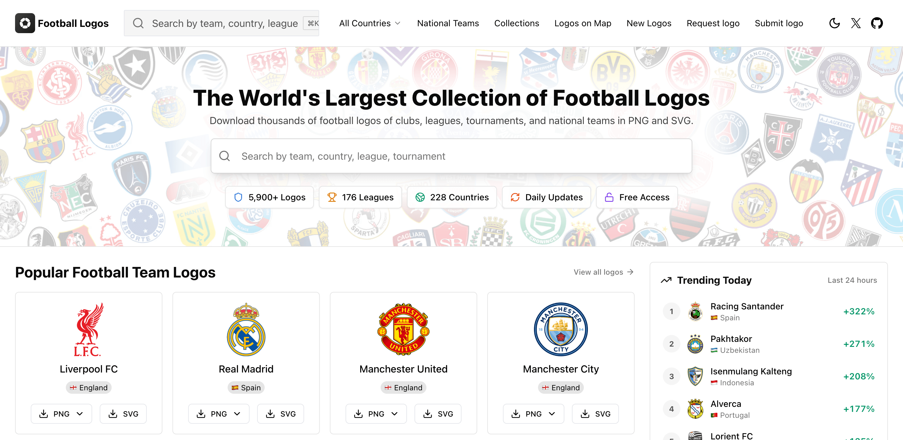
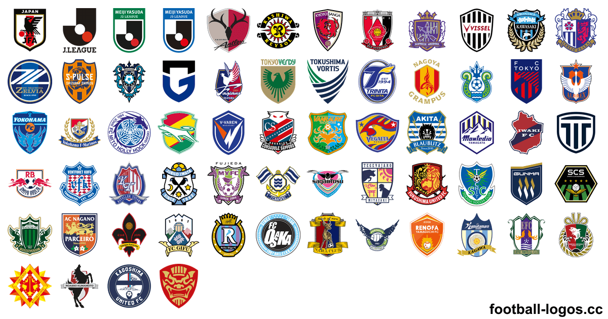

<h1>サッカー エンブレム一覧 – 6,100点以上のクラブ・代表チームのロゴ（PNG・SVG）</h1>

世界220以上の国と地域のクラブ、代表チーム、リーグ、大会のエンブレム（ロゴ）を、64〜3000pxの透過PNGとベクター形式のSVGで無料ダウンロードできます。ダウンロードは<a href="https://football-logos.cc">football-logos.cc</a>（英語サイト）から。2026年11月更新。

<a href="https://github.com/Leo4815162342/football-logos">English</a> · <a href="README.es.md">Español</a> · <a href="README.pt-BR.md">Português</a> · <a href="README.fr.md">Français</a> · <a href="README.ar.md">العربية</a> · <a href="README.vi.md">Tiếng Việt</a> · <b>日本語</b>

<a href="https://football-logos.cc"><picture><source media="(prefers-color-scheme: dark)" srcset="screenshot-dark.png"></picture></a>

## コレクションの内容

- **クラブのエンブレム**：220以上の国と地域、トップリーグから下部リーグまで
- **[代表チームのエンブレム](https://football-logos.cc/national-teams/)**：230以上の国
- **[リーグ・大会のロゴ](https://football-logos.cc/tournaments/)**：UEFAチャンピオンズリーグ、ヨーロッパリーグ、ワールドカップ、コパ・アメリカ、EUROなど
- **透過PNG**（64、128、256、512、700、1500、3000px）と、ほぼすべてのロゴの**SVG**
- **白黒バージョン**：710以上のロゴ
- **[新着ロゴ](https://football-logos.cc/new/)**：毎日追加、過去30日間で330以上
- **エンブレムの歴史**：30以上のクラブの旧エンブレム（例：[Real Madrid](https://football-logos.cc/spain/real-madrid/logo-history/)、[Barcelona](https://football-logos.cc/spain/barcelona/logo-history/)）
- **[クラブマップ](https://football-logos.cc/map/)**：都市・国・リーグからクラブを探せます

## 人気クラブのエンブレム

### 🇯🇵 [Jリーグ クラブのエンブレム一覧](https://football-logos.cc/japan/)

[鹿島アントラーズ](https://football-logos.cc/japan/kashima-antlers/)（Kashima Antlers） · [浦和レッズ](https://football-logos.cc/japan/urawa-reds/)（Urawa Reds） · [ヴィッセル神戸](https://football-logos.cc/japan/vissel-kobe/)（Vissel Kobe） · [ガンバ大阪](https://football-logos.cc/japan/gamba-osaka/)（Gamba Osaka） · [柏レイソル](https://football-logos.cc/japan/kashiwa-reysol/)（Kashiwa Reysol） · [川崎フロンターレ](https://football-logos.cc/japan/kawasaki-frontale/)（Kawasaki Frontale） · [FC町田ゼルビア](https://football-logos.cc/japan/machida-zelvia/)（Machida Zelvia） · [京都サンガF.C.](https://football-logos.cc/japan/kyoto-sanga/)（Kyoto Sanga） · [横浜F・マリノス](https://football-logos.cc/japan/yokohama-f-marinos/)（Yokohama F. Marinos） · [FC東京](https://football-logos.cc/japan/fc-tokyo/)（FC Tokyo） · [サンフレッチェ広島](https://football-logos.cc/japan/sanfrecce-hiroshima/)（Sanfrecce Hiroshima） · [セレッソ大阪](https://football-logos.cc/japan/cerezo-osaka/)（Cerezo Osaka） · [東京ヴェルディ](https://football-logos.cc/japan/tokyo-verdy/)（Tokyo Verdy） · [名古屋グランパス](https://football-logos.cc/japan/nagoya-grampus/)（Nagoya Grampus） · [アビスパ福岡](https://football-logos.cc/japan/avispa-fukuoka/)（Avispa Fukuoka） · [清水エスパルス](https://football-logos.cc/japan/shimizu-s-pulse/)（Shimizu S-Pulse） · [ファジアーノ岡山](https://football-logos.cc/japan/fagiano-okayama/)（Fagiano Okayama） · [水戸ホーリーホック](https://football-logos.cc/japan/mito-hollyhock/)（Mito HollyHock） · [ジェフユナイテッド千葉](https://football-logos.cc/japan/jef-united-chiba/)（JEF United Chiba） · [V・ファーレン長崎](https://football-logos.cc/japan/v-varen-nagasaki/)（V-Varen Nagasaki）

### 海外サッカークラブのエンブレム一覧

[Real Madrid](https://football-logos.cc/spain/real-madrid/) · [Barcelona](https://football-logos.cc/spain/barcelona/) · [Liverpool FC](https://football-logos.cc/england/liverpool/) · [Manchester City](https://football-logos.cc/england/manchester-city/) · [Manchester United](https://football-logos.cc/england/manchester-united/) · [Arsenal](https://football-logos.cc/england/arsenal/) · [Chelsea](https://football-logos.cc/england/chelsea/) · [PSG](https://football-logos.cc/france/paris-saint-germain/) · [Bayern Munich](https://football-logos.cc/germany/bayern-munchen/) · [Atletico Madrid](https://football-logos.cc/spain/atletico-madrid/) · [Aston Villa](https://football-logos.cc/england/aston-villa/) · [Tottenham](https://football-logos.cc/england/tottenham/) · [Inter](https://football-logos.cc/italy/inter/) · [Juventus](https://football-logos.cc/italy/juventus/) · [AS Roma](https://football-logos.cc/italy/roma/) · [Milan](https://football-logos.cc/italy/milan/) · [Borussia Dortmund](https://football-logos.cc/germany/borussia-dortmund/) · [Newcastle United](https://football-logos.cc/england/newcastle/) · [Napoli](https://football-logos.cc/italy/napoli/) · [Everton](https://football-logos.cc/england/everton/)

世界でダウンロード数の多いエンブレム： [Real Madrid](https://football-logos.cc/spain/real-madrid/) · [Barcelona](https://football-logos.cc/spain/barcelona/) · [Liverpool FC](https://football-logos.cc/england/liverpool/) · [Manchester City](https://football-logos.cc/england/manchester-city/) · [Manchester United](https://football-logos.cc/england/manchester-united/) · [Arsenal](https://football-logos.cc/england/arsenal/) · [Chelsea](https://football-logos.cc/england/chelsea/) · [PSG](https://football-logos.cc/france/paris-saint-germain/) · [Bayern Munich](https://football-logos.cc/germany/bayern-munchen/) · [Atletico Madrid](https://football-logos.cc/spain/atletico-madrid/) · [Aston Villa](https://football-logos.cc/england/aston-villa/) · [Tottenham](https://football-logos.cc/england/tottenham/)

## 国別のエンブレム

コレクションのすべての国と地域：

🇮🇸 [アイスランド](https://football-logos.cc/iceland/) (30+) · 🇮🇪 [アイルランド](https://football-logos.cc/republic-of-ireland/) (20+) · 🇦🇿 [アゼルバイジャン](https://football-logos.cc/azerbaijan/) (20+) · 🇦🇫 [アフガニスタン](https://football-logos.cc/afghanistan/) (1) · 🇺🇸 [アメリカ合衆国](https://football-logos.cc/usa/) (140+) · 🇦🇪 [アラブ首長国連邦](https://football-logos.cc/uae/) (10+) · 🇩🇿 [アルジェリア](https://football-logos.cc/algeria/) (20+) · 🇦🇷 [アルゼンチン](https://football-logos.cc/argentina/) (200+) · 🇦🇼 [アルバ](https://football-logos.cc/aruba/) (1) · 🇦🇱 [アルバニア](https://football-logos.cc/albania/) (20+) · 🇦🇲 [アルメニア](https://football-logos.cc/armenia/) (10+) · 🇦🇮 [アンギラ](https://football-logos.cc/anguilla/) (1) · 🇦🇴 [アンゴラ](https://football-logos.cc/angola/) (3) · 🇦🇬 [アンティグア・バーブーダ](https://football-logos.cc/antigua-and-barbuda/) (1) · 🇦🇩 [アンドラ](https://football-logos.cc/andorra/) (10+) · 🇾🇪 [イエメン](https://football-logos.cc/yemen/) (1) · 🇮🇱 [イスラエル](https://football-logos.cc/israel/) (20+) · 🇮🇹 [イタリア](https://football-logos.cc/italy/) (420+) · 🇮🇶 [イラク](https://football-logos.cc/iraq/) (20+) · 🇮🇷 [イラン](https://football-logos.cc/iran/) (20+) · 🏴󠁧󠁢󠁥󠁮󠁧󠁿 [イングランド](https://football-logos.cc/england/) (560+) · 🇮🇳 [インド](https://football-logos.cc/india/) (20+) · 🇮🇩 [インドネシア](https://football-logos.cc/indonesia/) (60+) · 🏴󠁧󠁢󠁷󠁬󠁳󠁿 [ウェールズ](https://football-logos.cc/wales/) (60+) · 🇺🇬 [ウガンダ](https://football-logos.cc/uganda/) (2) · 🇺🇦 [ウクライナ](https://football-logos.cc/ukraine/) (50+) · 🇺🇿 [ウズベキスタン](https://football-logos.cc/uzbekistan/) (20+) · 🇺🇾 [ウルグアイ](https://football-logos.cc/uruguay/) (30+) · 🇪🇨 [エクアドル](https://football-logos.cc/ecuador/) (20+) · 🇪🇬 [エジプト](https://football-logos.cc/egypt/) (20+) · 🇪🇪 [エストニア](https://football-logos.cc/estonia/) (10+) · 🇸🇿 [エスワティニ](https://football-logos.cc/eswatini/) (1) · 🇪🇹 [エチオピア](https://football-logos.cc/ethiopia/) (1) · 🇪🇷 [エリトリア](https://football-logos.cc/eritrea/) (1) · 🇸🇻 [エルサルバドル](https://football-logos.cc/el-salvador/) (2) · 🇦🇺 [オーストラリア](https://football-logos.cc/australia/) (20+) · 🇦🇹 [オーストリア](https://football-logos.cc/austria/) (40+) · 🇴🇲 [オマーン](https://football-logos.cc/oman/) (1) · 🇳🇱 [オランダ](https://football-logos.cc/netherlands/) (140+) · 🇬🇭 [ガーナ](https://football-logos.cc/ghana/) (20+) · 🇨🇻 [カーボベルデ](https://football-logos.cc/cabo-verde/) (2) · 🇬🇾 [ガイアナ](https://football-logos.cc/guyana/) (1) · 🇰🇿 [カザフスタン](https://football-logos.cc/kazakhstan/) (20+) · 🇶🇦 [カタール](https://football-logos.cc/qatar/) (20+) · 🏳 [カタルーニャ](https://football-logos.cc/catalonia/) (1) · 🇨🇦 [カナダ](https://football-logos.cc/canada/) (10+) · 🇬🇦 [ガボン](https://football-logos.cc/gabon/) (1) · 🇨🇲 [カメルーン](https://football-logos.cc/cameroon/) (2) · 🇬🇲 [ガンビア](https://football-logos.cc/gambia/) (1) · 🇰🇭 [カンボジア](https://football-logos.cc/cambodia/) (3) · 🇬🇳 [ギニア](https://football-logos.cc/guinea/) (1) · 🇬🇼 [ギニアビサウ](https://football-logos.cc/guinea-bissau/) (1) · 🇨🇾 [キプロス](https://football-logos.cc/cyprus/) (20+) · 🇨🇺 [キューバ](https://football-logos.cc/cuba/) (1) · 🇨🇼 [キュラソー](https://football-logos.cc/curacao/) (4) · 🇬🇷 [ギリシャ](https://football-logos.cc/greece/) (100+) · 🇰🇮 [キリバス](https://football-logos.cc/kiribati/) (1) · 🇰🇬 [キルギス](https://football-logos.cc/kyrgyzstan/) (1) · 🇬🇹 [グアテマラ](https://football-logos.cc/guatemala/) (10+) · 🇬🇵 [グアドループ](https://football-logos.cc/guadeloupe/) (1) · 🇬🇺 [グアム](https://football-logos.cc/guam/) (1) · 🇰🇼 [クウェート](https://football-logos.cc/kuwait/) (1) · 🇨🇰 [クック諸島](https://football-logos.cc/cook-islands/) (1) · 🇬🇱 [グリーンランド](https://football-logos.cc/greenland/) (1) · 🏴 [クルディスタン](https://football-logos.cc/kurdistan/) (1) · 🇬🇩 [グレナダ](https://football-logos.cc/grenada/) (1) · 🇭🇷 [クロアチア](https://football-logos.cc/croatia/) (20+) · 🇰🇾 [ケイマン諸島](https://football-logos.cc/cayman-islands/) (1) · 🇰🇪 [ケニア](https://football-logos.cc/kenya/) (2) · 🇨🇮 [コートジボワール](https://football-logos.cc/cote-d-ivoire/) (2) · 🇨🇷 [コスタリカ](https://football-logos.cc/costa-rica/) (10+) · 🇽🇰 [コソボ](https://football-logos.cc/kosovo/) (10+) · 🇰🇲 [コモロ](https://football-logos.cc/comoros/) (1) · 🇨🇴 [コロンビア](https://football-logos.cc/colombia/) (20+) · 🇨🇬 [コンゴ共和国](https://football-logos.cc/congo/) (1) · 🇨🇩 [コンゴ民主共和国](https://football-logos.cc/congo-dr/) (3) · 🇸🇦 [サウジアラビア](https://football-logos.cc/saudi-arabia/) (50+) · 🇼🇸 [サモア](https://football-logos.cc/samoa/) (1) · 🇲🇫 [サン・マルタン](https://football-logos.cc/saint-martin/) (1) · 🏴 [ザンジバル](https://football-logos.cc/zanzibar/) (1) · 🇸🇹 [サントメ・プリンシペ](https://football-logos.cc/sao-tome-and-principe/) (1) · 🇿🇲 [ザンビア](https://football-logos.cc/zambia/) (2) · 🇸🇲 [サンマリノ](https://football-logos.cc/san-marino/) (10+) · 🇸🇱 [シエラレオネ](https://football-logos.cc/sierra-leone/) (1) · 🇩🇯 [ジブチ](https://football-logos.cc/djibouti/) (1) · 🇬🇮 [ジブラルタル](https://football-logos.cc/gibraltar/) (10+) · 🇯🇲 [ジャマイカ](https://football-logos.cc/jamaica/) (2) · 🇬🇪 [ジョージア](https://football-logos.cc/georgia/) (20+) · 🇸🇾 [シリア](https://football-logos.cc/syria/) (1) · 🇸🇬 [シンガポール](https://football-logos.cc/singapore/) (10+) · 🇸🇽 [シント・マールテン](https://football-logos.cc/sint-maarten/) (1) · 🇿🇼 [ジンバブエ](https://football-logos.cc/zimbabwe/) (1) · 🇨🇭 [スイス](https://football-logos.cc/switzerland/) (30+) · 🇸🇪 [スウェーデン](https://football-logos.cc/sweden/) (60+) · 🇸🇩 [スーダン](https://football-logos.cc/sudan/) (1) · 🏴󠁧󠁢󠁳󠁣󠁴󠁿 [スコットランド](https://football-logos.cc/scotland/) (80+) · 🇪🇸 [スペイン](https://football-logos.cc/spain/) (240+) · 🇸🇷 [スリナム](https://football-logos.cc/suriname/) (6) · 🇱🇰 [スリランカ](https://football-logos.cc/sri-lanka/) (1) · 🇸🇰 [スロバキア](https://football-logos.cc/slovakia/) (20+) · 🇸🇮 [スロベニア](https://football-logos.cc/slovenia/) (20+) · 🇸🇨 [セーシェル](https://football-logos.cc/seychelles/) (1) · 🇸🇳 [セネガル](https://football-logos.cc/senegal/) (3) · 🇷🇸 [セルビア](https://football-logos.cc/serbia/) (30+) · 🇰🇳 [セントクリストファー・ネーヴィス](https://football-logos.cc/st-kitts-and-nevis/) (1) · 🇻🇨 [セントビンセント及びグレナディーン諸島](https://football-logos.cc/saint-vincent-and-the-grenadines/) (1) · 🇱🇨 [セントルシア](https://football-logos.cc/saint-lucia/) (1) · 🇸🇴 [ソマリア](https://football-logos.cc/somalia/) (1) · 🇸🇧 [ソロモン諸島](https://football-logos.cc/solomon-islands/) (1) · 🇹🇨 [タークス・カイコス諸島](https://football-logos.cc/turks-and-caicos-islands/) (1) · 🇹🇭 [タイ](https://football-logos.cc/thailand/) (10+) · 🇹🇯 [タジキスタン](https://football-logos.cc/tajikistan/) (1) · 🇵🇫 [タヒチ](https://football-logos.cc/tahiti/) (1) · 🇹🇿 [タンザニア](https://football-logos.cc/tanzania/) (20+) · 🇨🇿 [チェコ](https://football-logos.cc/czech-republic/) (40+) · 🇹🇩 [チャド](https://football-logos.cc/chad/) (1) · 🇹🇳 [チュニジア](https://football-logos.cc/tunisia/) (20+) · 🇨🇱 [チリ](https://football-logos.cc/chile/) (40+) · 🇹🇻 [ツバル](https://football-logos.cc/tuvalu/) (1) · 🇩🇰 [デンマーク](https://football-logos.cc/denmark/) (50+) · 🇩🇪 [ドイツ](https://football-logos.cc/germany/) (450+) · 🇹🇬 [トーゴ](https://football-logos.cc/togo/) (1) · 🇩🇴 [ドミニカ共和国](https://football-logos.cc/dominican-republic/) (1) · 🇩🇲 [ドミニカ国](https://football-logos.cc/dominica/) (1) · 🇹🇹 [トリニダード・トバゴ](https://football-logos.cc/trinidad-and-tobago/) (1) · 🇹🇲 [トルクメニスタン](https://football-logos.cc/turkmenistan/) (2) · 🇹🇷 [トルコ](https://football-logos.cc/turkey/) (120+) · 🇹🇴 [トンガ](https://football-logos.cc/tonga/) (1) · 🇳🇬 [ナイジェリア](https://football-logos.cc/nigeria/) (20+) · 🇳🇷 [ナウル](https://football-logos.cc/nauru/) (1) · 🇳🇦 [ナミビア](https://football-logos.cc/namibia/) (2) · 🇳🇮 [ニカラグア](https://football-logos.cc/nicaragua/) (1) · 🇳🇪 [ニジェール](https://football-logos.cc/niger/) (1) · 🇳🇨 [ニューカレドニア](https://football-logos.cc/new-caledonia/) (1) · 🇳🇿 [ニュージーランド](https://football-logos.cc/new-zealand/) (10+) · 🇳🇵 [ネパール](https://football-logos.cc/nepal/) (1) · 🇳🇴 [ノルウェー](https://football-logos.cc/norway/) (50+) · 🇧🇭 [バーレーン](https://football-logos.cc/bahrain/) (2) · 🇭🇹 [ハイチ](https://football-logos.cc/haiti/) (2) · 🇵🇰 [パキスタン](https://football-logos.cc/pakistan/) (1) · 🇻🇦 [バチカン市国](https://football-logos.cc/vatican-city/) (1) · 🇵🇦 [パナマ](https://football-logos.cc/panama/) (10+) · 🇻🇺 [バヌアツ](https://football-logos.cc/vanuatu/) (1) · 🇧🇸 [バハマ](https://football-logos.cc/bahamas/) (1) · 🇵🇬 [パプアニューギニア](https://football-logos.cc/papua-new-guinea/) (1) · 🇧🇲 [バミューダ](https://football-logos.cc/bermuda/) (1) · 🇵🇼 [パラオ](https://football-logos.cc/palau/) (1) · 🇵🇾 [パラグアイ](https://football-logos.cc/paraguay/) (10+) · 🇧🇧 [バルバドス](https://football-logos.cc/barbados/) (1) · 🇵🇸 [パレスチナ](https://football-logos.cc/palestine/) (1) · 🇭🇺 [ハンガリー](https://football-logos.cc/hungary/) (40+) · 🇧🇩 [バングラデシュ](https://football-logos.cc/bangladesh/) (10+) · 🇫🇯 [フィジー](https://football-logos.cc/fiji/) (1) · 🇵🇭 [フィリピン](https://football-logos.cc/philippines/) (1) · 🇫🇮 [フィンランド](https://football-logos.cc/finland/) (30+) · 🇧🇹 [ブータン](https://football-logos.cc/bhutan/) (1) · 🇵🇷 [プエルトリコ](https://football-logos.cc/puerto-rico/) (10+) · 🇫🇴 [フェロー諸島](https://football-logos.cc/faroe-islands/) (10+) · 🇧🇷 [ブラジル](https://football-logos.cc/brazil/) (320+) · 🇫🇷 [フランス](https://football-logos.cc/france/) (400+) · 🇧🇬 [ブルガリア](https://football-logos.cc/bulgaria/) (20+) · 🇧🇫 [ブルキナファソ](https://football-logos.cc/burkina-faso/) (1) · 🇧🇳 [ブルネイ](https://football-logos.cc/brunei/) (1) · 🇧🇮 [ブルンジ](https://football-logos.cc/burundi/) (3) · 🇻🇳 [ベトナム](https://football-logos.cc/vietnam/) (30+) · 🇧🇯 [ベナン](https://football-logos.cc/benin/) (1) · 🇻🇪 [ベネズエラ](https://football-logos.cc/venezuela/) (10+) · 🇧🇾 [ベラルーシ](https://football-logos.cc/belarus/) (20+) · 🇧🇿 [ベリーズ](https://football-logos.cc/belize/) (1) · 🇵🇪 [ペルー](https://football-logos.cc/peru/) (30+) · 🇧🇪 [ベルギー](https://football-logos.cc/belgium/) (80+) · 🇵🇱 [ポーランド](https://football-logos.cc/poland/) (60+) · 🇧🇦 [ボスニア・ヘルツェゴビナ](https://football-logos.cc/bosnia-and-herzegovina/) (20+) · 🇧🇼 [ボツワナ](https://football-logos.cc/botswana/) (1) · 🇧🇶 [ボネール](https://football-logos.cc/bonaire/) (1) · 🇧🇴 [ボリビア](https://football-logos.cc/bolivia/) (20+) · 🇵🇹 [ポルトガル](https://football-logos.cc/portugal/) (180+) · 🇭🇳 [ホンジュラス](https://football-logos.cc/honduras/) (1) · 🇲🇴 [マカオ](https://football-logos.cc/macau/) (1) · 🇲🇬 [マダガスカル](https://football-logos.cc/madagascar/) (2) · 🇲🇼 [マラウイ](https://football-logos.cc/malawi/) (1) · 🇲🇱 [マリ](https://football-logos.cc/mali/) (1) · 🇲🇹 [マルタ](https://football-logos.cc/malta/) (20+) · 🇲🇶 [マルティニーク](https://football-logos.cc/martinique/) (1) · 🇲🇾 [マレーシア](https://football-logos.cc/malaysia/) (10+) · 🇲🇲 [ミャンマー](https://football-logos.cc/myanmar/) (1) · 🇲🇽 [メキシコ](https://football-logos.cc/mexico/) (70+) · 🇲🇺 [モーリシャス](https://football-logos.cc/mauritius/) (1) · 🇲🇷 [モーリタニア](https://football-logos.cc/mauritania/) (1) · 🇲🇿 [モザンビーク](https://football-logos.cc/mozambique/) (1) · 🇲🇻 [モルディブ](https://football-logos.cc/maldives/) (2) · 🇲🇩 [モルドバ](https://football-logos.cc/moldova/) (10+) · 🇲🇦 [モロッコ](https://football-logos.cc/morocco/) (20+) · 🇲🇳 [モンゴル](https://football-logos.cc/mongolia/) (1) · 🇲🇪 [モンテネグロ](https://football-logos.cc/montenegro/) (10+) · 🇲🇸 [モントセラト](https://football-logos.cc/montserrat/) (1) · 🏴 [ユーゴスラビア](https://football-logos.cc/yugoslavia/) (1) · 🇯🇴 [ヨルダン](https://football-logos.cc/jordan/) (6) · 🇱🇦 [ラオス](https://football-logos.cc/laos/) (1) · 🇱🇻 [ラトビア](https://football-logos.cc/latvia/) (10+) · 🇱🇹 [リトアニア](https://football-logos.cc/lithuania/) (10+) · 🇱🇾 [リビア](https://football-logos.cc/libya/) (1) · 🇱🇮 [リヒテンシュタイン](https://football-logos.cc/liechtenstein/) (6) · 🇱🇷 [リベリア](https://football-logos.cc/liberia/) (1) · 🇷🇴 [ルーマニア](https://football-logos.cc/romania/) (30+) · 🇱🇺 [ルクセンブルク](https://football-logos.cc/luxembourg/) (30+) · 🇷🇼 [ルワンダ](https://football-logos.cc/rwanda/) (1) · 🇱🇸 [レソト](https://football-logos.cc/lesotho/) (1) · 🇱🇧 [レバノン](https://football-logos.cc/lebanon/) (1) · 🇷🇪 [レユニオン](https://football-logos.cc/reunion/) (2) · 🇷🇺 [ロシア](https://football-logos.cc/russia/) (60+) · 🇻🇬 [英領ヴァージン諸島](https://football-logos.cc/british-virgin-islands/) (1) · 🇰🇷 [韓国](https://football-logos.cc/south-korea/) (30+) · 🇭🇰 [香港](https://football-logos.cc/hong-kong/) (10+) · 🇬🇶 [赤道ギニア](https://football-logos.cc/equatorial-guinea/) (1) · 🇹🇼 [台湾](https://football-logos.cc/taiwan/) (10+) · 🇨🇫 [中央アフリカ共和国](https://football-logos.cc/central-african-republic/) (1) · 🇨🇳 [中国](https://football-logos.cc/china/) (30+) · 🇹🇱 [東ティモール](https://football-logos.cc/timor-leste/) (1) · 🇿🇦 [南アフリカ](https://football-logos.cc/south-africa/) (20+) · 🇸🇸 [南スーダン](https://football-logos.cc/south-sudan/) (1) · 🇯🇵 [日本](https://football-logos.cc/japan/) (70+) · 🇬🇫 [仏領ギアナ](https://football-logos.cc/french-guiana/) (1) · 🇻🇮 [米領ヴァージン諸島](https://football-logos.cc/us-virgin-islands/) (1) · 🇦🇸 [米領サモア](https://football-logos.cc/american-samoa/) (1) · 🏴 [北アイルランド](https://football-logos.cc/northern-ireland/) (20+) · 🇲🇰 [北マケドニア](https://football-logos.cc/north-macedonia/) (20+) · 🇲🇵 [北マリアナ諸島](https://football-logos.cc/northern-mariana-islands/) (1) · 🇰🇵 [北朝鮮](https://football-logos.cc/north-korea/) (1)

## リーグ別エンブレム

2026/27シーズンのクラブエンブレムを国・リーグ別に掲載：

| リーグ | 国 | ロゴ数 |
| --- | --- | ---: |
| J. League · J. League Cup | 🇯🇵 [日本](https://football-logos.cc/japan/) | 70+ |
| Premier League · FA Cup | 🏴󠁧󠁢󠁥󠁮󠁧󠁿 [イングランド](https://football-logos.cc/england/) | 560+ |
| La Liga · Copa del Rey | 🇪🇸 [スペイン](https://football-logos.cc/spain/) | 240+ |
| Serie A · Coppa Italia | 🇮🇹 [イタリア](https://football-logos.cc/italy/) | 420+ |
| Bundesliga · DFB-Pokal | 🇩🇪 [ドイツ](https://football-logos.cc/germany/) | 450+ |
| Ligue 1 · Coupe de France | 🇫🇷 [フランス](https://football-logos.cc/france/) | 400+ |
| Primeira Liga · Taça de Portugal | 🇵🇹 [ポルトガル](https://football-logos.cc/portugal/) | 180+ |
| Eredivisie · KNVB Cup | 🇳🇱 [オランダ](https://football-logos.cc/netherlands/) | 140+ |
| K League 1 · K League Cup | 🇰🇷 [韓国](https://football-logos.cc/south-korea/) | 30+ |
| Saudi Professional League · Saudi Cup | 🇸🇦 [サウジアラビア](https://football-logos.cc/saudi-arabia/) | 50+ |
| MLS · MLS Cup | 🇺🇸 [アメリカ合衆国](https://football-logos.cc/usa/) | 140+ |
| Campeonato Brasileiro Série A · Copa do Brasil | 🇧🇷 [ブラジル](https://football-logos.cc/brazil/) | 320+ |

## DLS 26用のロゴとユニフォーム

Dream League Soccer（DLS 26）向け：

- [DLSロゴ](https://football-logos.cc/dls/)：どのクラブも512×512のロゴURLをすぐにコピー
- [DLSキット](https://football-logos.cc/dls/kits/)：512×512のユニフォームURL、3Dプレビュー付き
- [DLSロゴメーカー](https://football-logos.cc/logo-maker/)：オリジナルのエンブレムを作ってURLをコピー
- [DLSキットメーカー](https://football-logos.cc/kit-maker/)：ユニフォームをデザインして3Dで確認、URLをコピー

## サッカー壁紙

[11,700点以上のサッカー壁紙（4K）](https://football-logos.cc/wallpapers/)を無料で。620以上のクラブ・代表チームのエンブレムを使ったデザインで、iPhone、Android、iPad、PCに対応。

## よくある質問

### エンブレムは無料ですか？

はい。すべてのロゴは[football-logos.cc](https://football-logos.cc)からPNGまたはSVGで無料ダウンロードできます。ロゴの権利は各クラブ・連盟にあるため、使用前に[ロゴ使用に関する注意事項](https://football-logos.cc/license/)（英語）をご確認ください。

### ファイル形式とサイズは？

背景透過のPNG（64、128、256、512、700、1500、3000px）と、拡大しても劣化しないベクター形式のSVGです。710以上のロゴには白黒バージョンもあります。

### 商用利用はできますか？

できません。ロゴは各クラブ、リーグ、連盟の商標です。情報提供、報道・編集、ファン活動（調査、非商用のデザイン、ファンプロジェクト）のために公開しており、商品やグッズ、ブランディング、公式な関係を連想させる用途には使えません。

### Dream League Soccer（DLS）でロゴを使うには？

[DLSロゴ](https://football-logos.cc/dls/)でクラブを探して512×512のロゴURLをコピーし、DLS 26の「Custom Logo」に貼り付けます。オリジナルのエンブレムは[ロゴメーカー](https://football-logos.cc/logo-maker/)で作れます。

### ロゴがない、または古い場合は？

[football-logos.cc/request](https://football-logos.cc/request/)からリクエストしてください。

## 利用と商標

すべてのロゴは各クラブ、リーグ、連盟に帰属し、商標として保護されています。football-logos.ccは独立したサイトで、これらの団体とは提携していません。ロゴは情報提供、報道・編集、ファン活動のために公開しているもので、商品、グッズ、ブランディングや、公式な関係を連想させる形では使用できません。詳しくは[ロゴ使用に関する注意事項](https://football-logos.cc/license/)（英語）をご覧ください。

