

<h1>Football Logos – 5,900+ club and national team logos in PNG &amp; SVG</h1>

Free football (soccer) logos of clubs, national teams, leagues and tournaments from 220+ countries: transparent PNG from 64 to 3000 px and vector SVG. Browse and download them all at <a href="https://football-logos.cc">football-logos.cc</a>. Updated November 2026.

<b>English</b> · <a href="README.es.md">Español</a> · <a href="README.pt-BR.md">Português</a> · <a href="README.fr.md">Français</a> · <a href="README.ar.md">العربية</a> · <a href="README.vi.md">Tiếng Việt</a> · <a href="README.ja.md">日本語</a>

<a href="https://football-logos.cc"><picture><source media="(prefers-color-scheme: dark)" srcset="screenshot-dark.png"></picture></a>

## What's in the collection

- **Club logos** from 220+ countries and territories, from the top leagues to the lower divisions
- **[National team logos](https://football-logos.cc/national-teams/)** of 220+ national teams
- **[League and tournament logos](https://football-logos.cc/tournaments/)**: Champions League, Europa League, World Cup, Copa América, Euro and more
- **Transparent PNG** in 64, 128, 256, 512, 700, 1500 and 3000 px and **SVG vector files** for almost every logo
- **Black and white versions** of 610+ logos
- **[New logos](https://football-logos.cc/new/)** every day, 280+ in the last 30 days
- **Logo history** of 30+ clubs, such as [Real Madrid](https://football-logos.cc/spain/real-madrid/logo-history/) and [Barcelona](https://football-logos.cc/spain/barcelona/logo-history/)
- **[Football club map](https://football-logos.cc/map/)**: find any club by city, country or league

## Popular club logos

Most downloaded in the last 3 months: [Real Madrid](https://football-logos.cc/spain/real-madrid/) · [Barcelona](https://football-logos.cc/spain/barcelona/) · [Liverpool FC](https://football-logos.cc/england/liverpool/) · [Manchester City](https://football-logos.cc/england/manchester-city/) · [Chelsea](https://football-logos.cc/england/chelsea/) · [Arsenal](https://football-logos.cc/england/arsenal/) · [Manchester United](https://football-logos.cc/england/manchester-united/) · [PSG](https://football-logos.cc/france/paris-saint-germain/) · [Bayern Munich](https://football-logos.cc/germany/bayern-munchen/) · [Tottenham](https://football-logos.cc/england/tottenham/) · [Atletico Madrid](https://football-logos.cc/spain/atletico-madrid/) · [Inter](https://football-logos.cc/italy/inter/) · [Aston Villa](https://football-logos.cc/england/aston-villa/) · [Juventus](https://football-logos.cc/italy/juventus/) · [Milan](https://football-logos.cc/italy/milan/) · [AS Roma](https://football-logos.cc/italy/roma/)

## Football logos by league

Club logos for the 2026/27 season, by country and top league:

| League | Country | Logos |
| --- | --- | ---: |
| Premier League · FA Cup | 🏴󠁧󠁢󠁥󠁮󠁧󠁿 [England](https://football-logos.cc/england/) | 540+ |
| La Liga · Copa del Rey | 🇪🇸 [Spain](https://football-logos.cc/spain/) | 240+ |
| Serie A · Coppa Italia | 🇮🇹 [Italy](https://football-logos.cc/italy/) | 400+ |
| Bundesliga · DFB-Pokal | 🇩🇪 [Germany](https://football-logos.cc/germany/) | 420+ |
| Ligue 1 · Coupe de France | 🇫🇷 [France](https://football-logos.cc/france/) | 370+ |
| Primeira Liga · Taça de Portugal | 🇵🇹 [Portugal](https://football-logos.cc/portugal/) | 180+ |
| Eredivisie · KNVB Cup | 🇳🇱 [Netherlands](https://football-logos.cc/netherlands/) | 120+ |
| Campeonato Brasileiro Série A · Copa do Brasil | 🇧🇷 [Brazil](https://football-logos.cc/brazil/) | 270+ |
| Argentine Primera Division · Argentine Cup | 🇦🇷 [Argentina](https://football-logos.cc/argentina/) | 180+ |
| Süper Lig · Turkish Cup | 🇹🇷 [Turkey](https://football-logos.cc/turkey/) | 110+ |
| Scottish Premiership · Scottish Cup | 🏴󠁧󠁢󠁳󠁣󠁴󠁿 [Scotland](https://football-logos.cc/scotland/) | 80+ |
| Belgian Pro League · Belgian Cup | 🇧🇪 [Belgium](https://football-logos.cc/belgium/) | 60+ |
| MLS · MLS Cup | 🇺🇸 [USA](https://football-logos.cc/usa/) | 130+ |
| Liga MX · Copa MX | 🇲🇽 [Mexico](https://football-logos.cc/mexico/) | 70+ |
| Saudi Professional League · Saudi Cup | 🇸🇦 [Saudi Arabia](https://football-logos.cc/saudi-arabia/) | 50+ |
| J. League · J. League Cup | 🇯🇵 [Japan](https://football-logos.cc/japan/) | 70+ |
| Egyptian Premier League · Egyptian Cup | 🇪🇬 [Egypt](https://football-logos.cc/egypt/) | 20+ |
| Botola Pro · Moroccan Cup | 🇲🇦 [Morocco](https://football-logos.cc/morocco/) | 20+ |

## DLS logos and kits

For Dream League Soccer (DLS 26):

- [DLS logos](https://football-logos.cc/dls/): 512×512 logo URLs for any club, ready to copy
- [DLS kits](https://football-logos.cc/dls/kits/): 512×512 kit URLs with a 3D preview
- [DLS logo maker](https://football-logos.cc/logo-maker/): design your own crest and copy its logo URL
- [DLS kit maker](https://football-logos.cc/kit-maker/): design a custom kit, see it in 3D and copy its kit URL

## Football wallpapers

[9,600+ free 4K football wallpapers](https://football-logos.cc/wallpapers/) built around the logos of 600+ clubs and national teams, for iPhone, Android, iPad and PC.

## Browse by country

The biggest collections:

<a href="https://football-logos.cc/england/">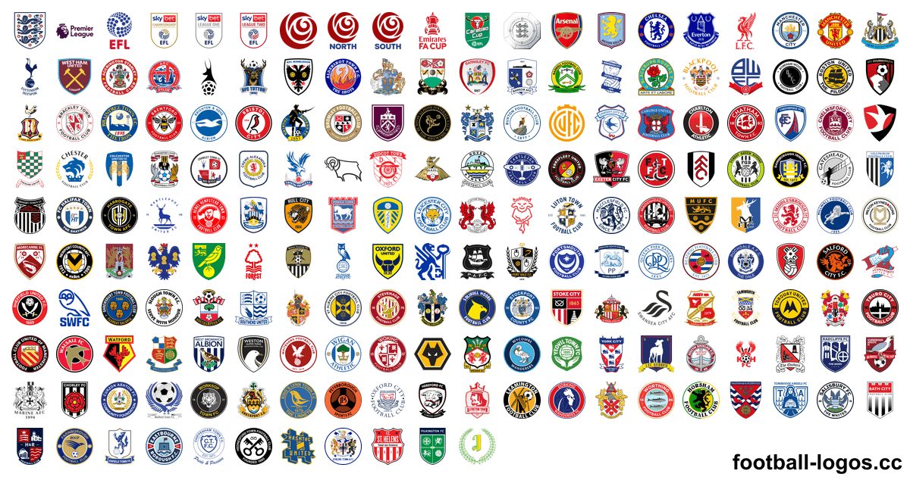</a>
<a href="https://football-logos.cc/spain/">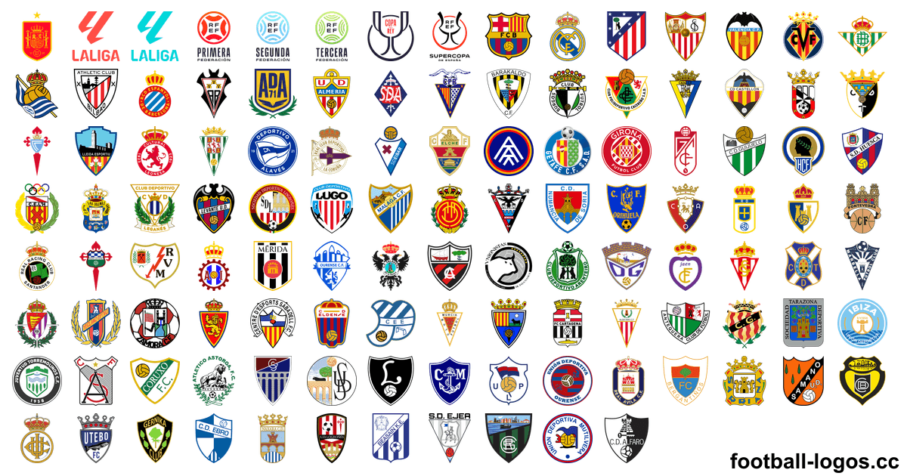</a>
 
<a href="https://football-logos.cc/england/">🏴󠁧󠁢󠁥󠁮󠁧󠁿 England</a> (540+) · <a href="https://football-logos.cc/spain/">🇪🇸 Spain</a> (240+)

<a href="https://football-logos.cc/italy/">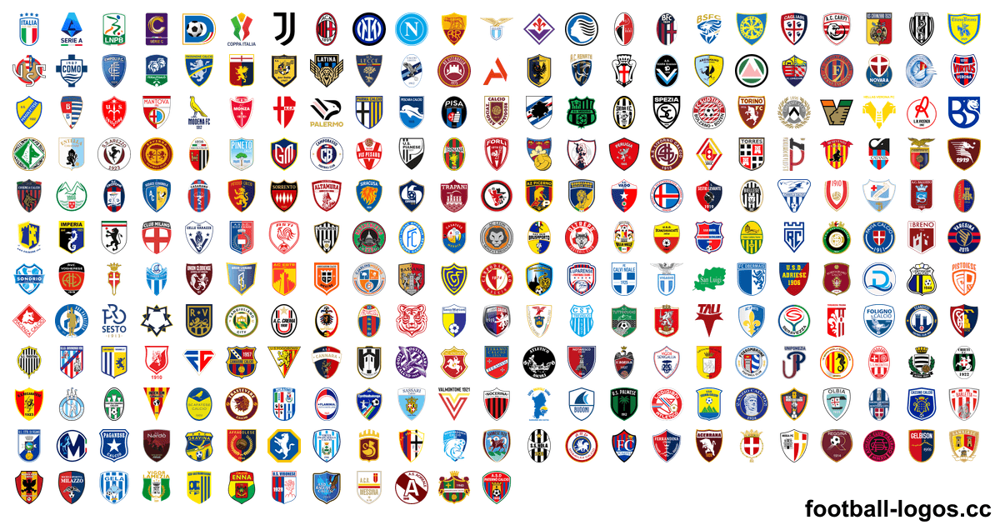</a>
<a href="https://football-logos.cc/germany/">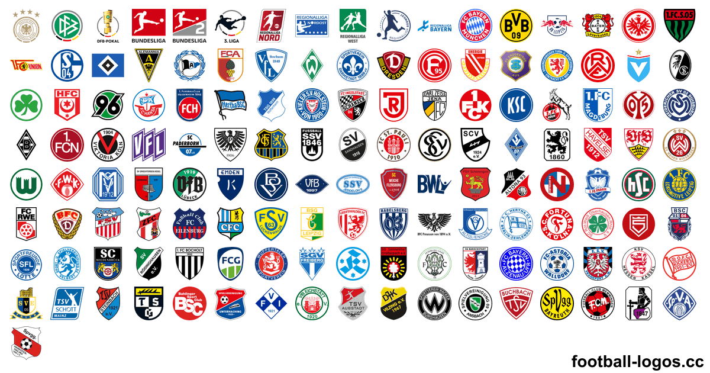</a>
 
<a href="https://football-logos.cc/italy/">🇮🇹 Italy</a> (400+) · <a href="https://football-logos.cc/germany/">🇩🇪 Germany</a> (420+)

<a href="https://football-logos.cc/france/">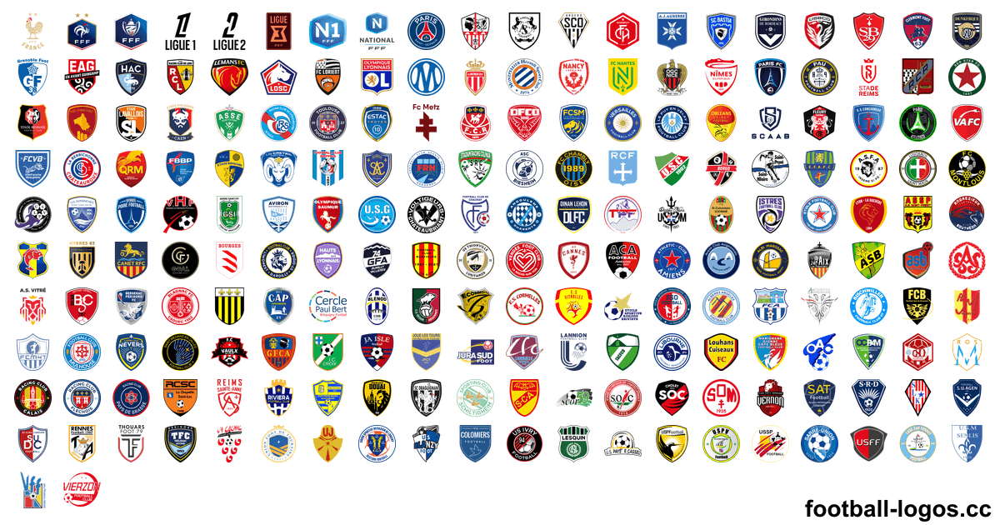</a>
<a href="https://football-logos.cc/portugal/">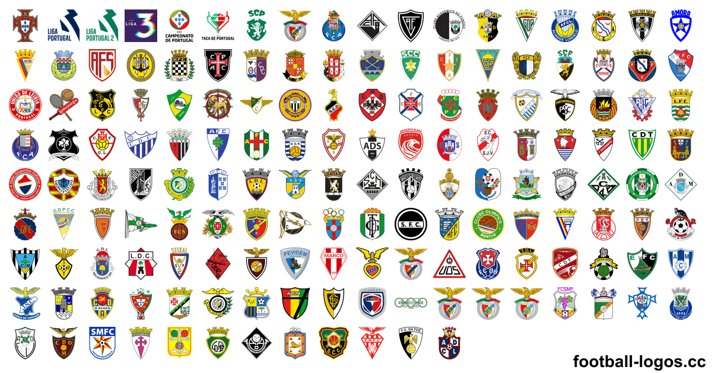</a>
 
<a href="https://football-logos.cc/france/">🇫🇷 France</a> (370+) · <a href="https://football-logos.cc/portugal/">🇵🇹 Portugal</a> (180+)

<a href="https://football-logos.cc/netherlands/">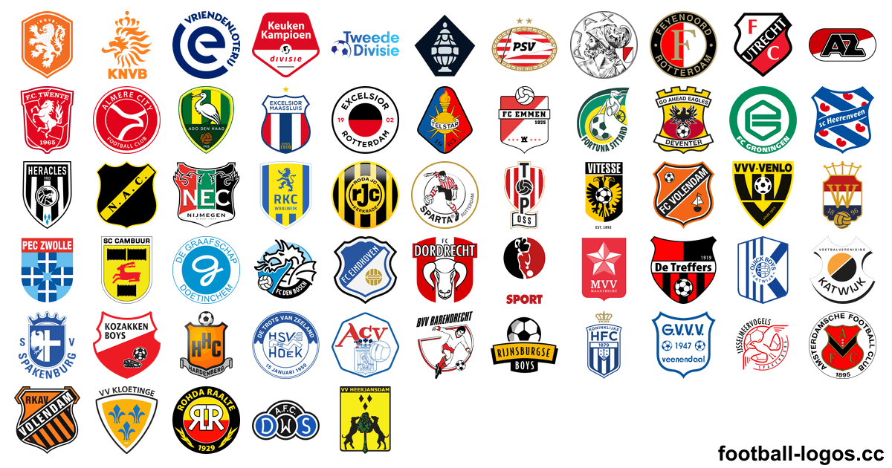</a>
<a href="https://football-logos.cc/brazil/">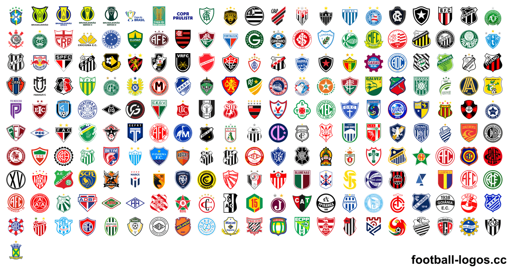</a>
 
<a href="https://football-logos.cc/netherlands/">🇳🇱 Netherlands</a> (120+) · <a href="https://football-logos.cc/brazil/">🇧🇷 Brazil</a> (270+)

<a href="https://football-logos.cc/argentina/">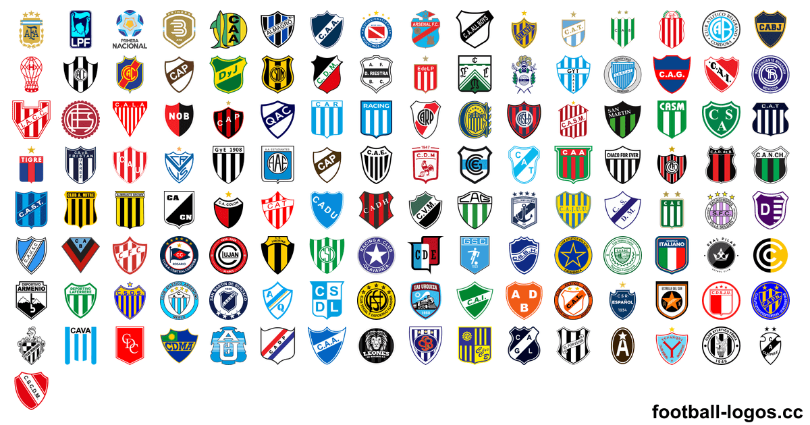</a>
<a href="https://football-logos.cc/turkey/">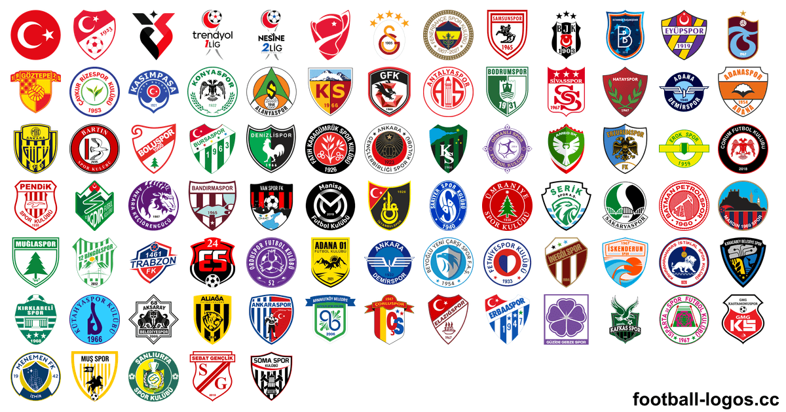</a>
 
<a href="https://football-logos.cc/argentina/">🇦🇷 Argentina</a> (180+) · <a href="https://football-logos.cc/turkey/">🇹🇷 Turkey</a> (110+)

<a href="https://football-logos.cc/usa/">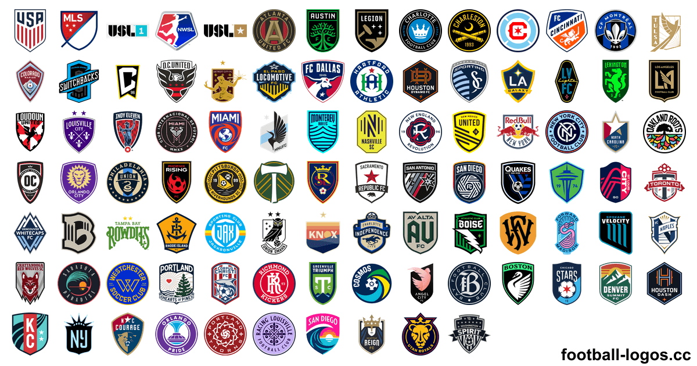</a>
<a href="https://football-logos.cc/saudi-arabia/">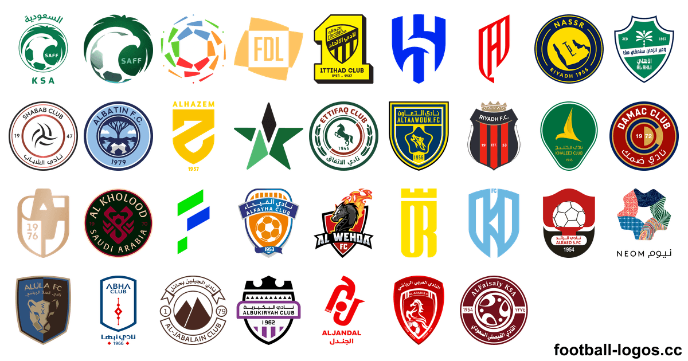</a>
 
<a href="https://football-logos.cc/usa/">🇺🇸 USA</a> (130+) · <a href="https://football-logos.cc/saudi-arabia/">🇸🇦 Saudi Arabia</a> (50+)

### All countries

**A** · 🇦🇫 [Afghanistan](https://football-logos.cc/afghanistan/) (1) · 🇦🇱 [Albania](https://football-logos.cc/albania/) (20+) · 🇩🇿 [Algeria](https://football-logos.cc/algeria/) (20+) · 🇦🇸 [American Samoa](https://football-logos.cc/american-samoa/) (1) · 🇦🇩 [Andorra](https://football-logos.cc/andorra/) (10+) · 🇦🇴 [Angola](https://football-logos.cc/angola/) (2) · 🇦🇮 [Anguilla](https://football-logos.cc/anguilla/) (1) · 🇦🇬 [Antigua and Barbuda](https://football-logos.cc/antigua-and-barbuda/) (1) · 🇦🇷 [Argentina](https://football-logos.cc/argentina/) (180+) · 🇦🇲 [Armenia](https://football-logos.cc/armenia/) (10+) · 🇦🇼 [Aruba](https://football-logos.cc/aruba/) (1) · 🇦🇺 [Australia](https://football-logos.cc/australia/) (20+) · 🇦🇹 [Austria](https://football-logos.cc/austria/) (40+) · 🇦🇿 [Azerbaijan](https://football-logos.cc/azerbaijan/) (20+)

**B** · 🇧🇸 [Bahamas](https://football-logos.cc/bahamas/) (1) · 🇧🇭 [Bahrain](https://football-logos.cc/bahrain/) (1) · 🇧🇩 [Bangladesh](https://football-logos.cc/bangladesh/) (10+) · 🇧🇧 [Barbados](https://football-logos.cc/barbados/) (1) · 🇧🇾 [Belarus](https://football-logos.cc/belarus/) (20+) · 🇧🇪 [Belgium](https://football-logos.cc/belgium/) (60+) · 🇧🇿 [Belize](https://football-logos.cc/belize/) (1) · 🇧🇯 [Benin](https://football-logos.cc/benin/) (1) · 🇧🇲 [Bermuda](https://football-logos.cc/bermuda/) (1) · 🇧🇹 [Bhutan](https://football-logos.cc/bhutan/) (1) · 🇧🇴 [Bolivia](https://football-logos.cc/bolivia/) (20+) · 🇧🇶 [Bonaire](https://football-logos.cc/bonaire/) (1) · 🇧🇦 [Bosnia and Herzegovina](https://football-logos.cc/bosnia-and-herzegovina/) (20+) · 🇧🇼 [Botswana](https://football-logos.cc/botswana/) (1) · 🇧🇷 [Brazil](https://football-logos.cc/brazil/) (270+) · 🇻🇬 [British Virgin Islands](https://football-logos.cc/british-virgin-islands/) (1) · 🇧🇳 [Brunei](https://football-logos.cc/brunei/) (1) · 🇧🇬 [Bulgaria](https://football-logos.cc/bulgaria/) (20+) · 🇧🇫 [Burkina Faso](https://football-logos.cc/burkina-faso/) (1) · 🇧🇮 [Burundi](https://football-logos.cc/burundi/) (3)

**C** · 🇨🇻 [Cabo Verde](https://football-logos.cc/cabo-verde/) (2) · 🇰🇭 [Cambodia](https://football-logos.cc/cambodia/) (2) · 🇨🇲 [Cameroon](https://football-logos.cc/cameroon/) (2) · 🇨🇦 [Canada](https://football-logos.cc/canada/) (10+) · 🏳 [Catalonia](https://football-logos.cc/catalonia/) (1) · 🇰🇾 [Cayman Islands](https://football-logos.cc/cayman-islands/) (1) · 🇨🇫 [Central African Republic](https://football-logos.cc/central-african-republic/) (1) · 🇹🇩 [Chad](https://football-logos.cc/chad/) (1) · 🇨🇱 [Chile](https://football-logos.cc/chile/) (30+) · 🇨🇳 [China](https://football-logos.cc/china/) (30+) · 🇨🇴 [Colombia](https://football-logos.cc/colombia/) (20+) · 🇰🇲 [Comoros](https://football-logos.cc/comoros/) (1) · 🇨🇬 [Congo](https://football-logos.cc/congo/) (1) · 🇨🇩 [Congo DR](https://football-logos.cc/congo-dr/) (2) · 🇨🇰 [Cook Islands](https://football-logos.cc/cook-islands/) (1) · 🇨🇷 [Costa Rica](https://football-logos.cc/costa-rica/) (10+) · 🇨🇮 [Côte d'Ivoire](https://football-logos.cc/cote-d-ivoire/) (2) · 🇭🇷 [Croatia](https://football-logos.cc/croatia/) (20+) · 🇨🇺 [Cuba](https://football-logos.cc/cuba/) (1) · 🇨🇼 [Curacao](https://football-logos.cc/curacao/) (4) · 🇨🇾 [Cyprus](https://football-logos.cc/cyprus/) (20+) · 🇨🇿 [Czech Republic](https://football-logos.cc/czech-republic/) (40+)

**D** · 🇩🇰 [Denmark](https://football-logos.cc/denmark/) (50+) · 🇩🇯 [Djibouti](https://football-logos.cc/djibouti/) (1) · 🇩🇲 [Dominica](https://football-logos.cc/dominica/) (1) · 🇩🇴 [Dominican Republic](https://football-logos.cc/dominican-republic/) (1)

**E** · 🇪🇨 [Ecuador](https://football-logos.cc/ecuador/) (20+) · 🇪🇬 [Egypt](https://football-logos.cc/egypt/) (20+) · 🇸🇻 [El Salvador](https://football-logos.cc/el-salvador/) (2) · 🏴󠁧󠁢󠁥󠁮󠁧󠁿 [England](https://football-logos.cc/england/) (540+) · 🇬🇶 [Equatorial Guinea](https://football-logos.cc/equatorial-guinea/) (1) · 🇪🇷 [Eritrea](https://football-logos.cc/eritrea/) (1) · 🇪🇪 [Estonia](https://football-logos.cc/estonia/) (10+) · 🇸🇿 [Eswatini](https://football-logos.cc/eswatini/) (1) · 🇪🇹 [Ethiopia](https://football-logos.cc/ethiopia/) (1)

**F** · 🇫🇴 [Faroe Islands](https://football-logos.cc/faroe-islands/) (10+) · 🇫🇯 [Fiji](https://football-logos.cc/fiji/) (1) · 🇫🇮 [Finland](https://football-logos.cc/finland/) (30+) · 🇫🇷 [France](https://football-logos.cc/france/) (370+) · 🇬🇫 [French Guiana](https://football-logos.cc/french-guiana/) (1)

**G** · 🇬🇦 [Gabon](https://football-logos.cc/gabon/) (1) · 🇬🇲 [Gambia](https://football-logos.cc/gambia/) (1) · 🇬🇪 [Georgia](https://football-logos.cc/georgia/) (20+) · 🇩🇪 [Germany](https://football-logos.cc/germany/) (420+) · 🇬🇭 [Ghana](https://football-logos.cc/ghana/) (20+) · 🇬🇮 [Gibraltar](https://football-logos.cc/gibraltar/) (10+) · 🇬🇷 [Greece](https://football-logos.cc/greece/) (90+) · 🇬🇱 [Greenland](https://football-logos.cc/greenland/) (1) · 🇬🇩 [Grenada](https://football-logos.cc/grenada/) (1) · 🇬🇵 [Guadeloupe](https://football-logos.cc/guadeloupe/) (1) · 🇬🇺 [Guam](https://football-logos.cc/guam/) (1) · 🇬🇹 [Guatemala](https://football-logos.cc/guatemala/) (10+) · 🇬🇳 [Guinea](https://football-logos.cc/guinea/) (1) · 🇬🇼 [Guinea-Bissau](https://football-logos.cc/guinea-bissau/) (1) · 🇬🇾 [Guyana](https://football-logos.cc/guyana/) (1)

**H** · 🇭🇹 [Haiti](https://football-logos.cc/haiti/) (2) · 🇭🇳 [Honduras](https://football-logos.cc/honduras/) (1) · 🇭🇰 [Hong Kong](https://football-logos.cc/hong-kong/) (10+) · 🇭🇺 [Hungary](https://football-logos.cc/hungary/) (40+)

**I** · 🇮🇸 [Iceland](https://football-logos.cc/iceland/) (30+) · 🇮🇳 [India](https://football-logos.cc/india/) (20+) · 🇮🇩 [Indonesia](https://football-logos.cc/indonesia/) (60+) · 🇮🇷 [Iran](https://football-logos.cc/iran/) (20+) · 🇮🇶 [Iraq](https://football-logos.cc/iraq/) (20+) · 🇮🇱 [Israel](https://football-logos.cc/israel/) (20+) · 🇮🇹 [Italy](https://football-logos.cc/italy/) (400+)

**J** · 🇯🇲 [Jamaica](https://football-logos.cc/jamaica/) (2) · 🇯🇵 [Japan](https://football-logos.cc/japan/) (70+) · 🇯🇴 [Jordan](https://football-logos.cc/jordan/) (5)

**K** · 🇰🇿 [Kazakhstan](https://football-logos.cc/kazakhstan/) (20+) · 🇰🇪 [Kenya](https://football-logos.cc/kenya/) (2) · 🇰🇮 [Kiribati](https://football-logos.cc/kiribati/) (1) · 🇽🇰 [Kosovo](https://football-logos.cc/kosovo/) (10+) · 🏴 [Kurdistan](https://football-logos.cc/kurdistan/) (1) · 🇰🇼 [Kuwait](https://football-logos.cc/kuwait/) (1) · 🇰🇬 [Kyrgyzstan](https://football-logos.cc/kyrgyzstan/) (1)

**L** · 🇱🇦 [Laos](https://football-logos.cc/laos/) (1) · 🇱🇻 [Latvia](https://football-logos.cc/latvia/) (10+) · 🇱🇧 [Lebanon](https://football-logos.cc/lebanon/) (1) · 🇱🇸 [Lesotho](https://football-logos.cc/lesotho/) (1) · 🇱🇷 [Liberia](https://football-logos.cc/liberia/) (1) · 🇱🇾 [Libya](https://football-logos.cc/libya/) (1) · 🇱🇮 [Liechtenstein](https://football-logos.cc/liechtenstein/) (5) · 🇱🇹 [Lithuania](https://football-logos.cc/lithuania/) (10+) · 🇱🇺 [Luxembourg](https://football-logos.cc/luxembourg/) (30+)

**M** · 🇲🇴 [Macau](https://football-logos.cc/macau/) (1) · 🇲🇬 [Madagascar](https://football-logos.cc/madagascar/) (2) · 🇲🇼 [Malawi](https://football-logos.cc/malawi/) (1) · 🇲🇾 [Malaysia](https://football-logos.cc/malaysia/) (10+) · 🇲🇻 [Maldives](https://football-logos.cc/maldives/) (2) · 🇲🇱 [Mali](https://football-logos.cc/mali/) (1) · 🇲🇹 [Malta](https://football-logos.cc/malta/) (20+) · 🇲🇶 [Martinique](https://football-logos.cc/martinique/) (1) · 🇲🇷 [Mauritania](https://football-logos.cc/mauritania/) (1) · 🇲🇺 [Mauritius](https://football-logos.cc/mauritius/) (1) · 🇲🇽 [Mexico](https://football-logos.cc/mexico/) (70+) · 🇲🇩 [Moldova](https://football-logos.cc/moldova/) (10+) · 🇲🇳 [Mongolia](https://football-logos.cc/mongolia/) (1) · 🇲🇪 [Montenegro](https://football-logos.cc/montenegro/) (10+) · 🇲🇸 [Montserrat](https://football-logos.cc/montserrat/) (1) · 🇲🇦 [Morocco](https://football-logos.cc/morocco/) (20+) · 🇲🇿 [Mozambique](https://football-logos.cc/mozambique/) (1) · 🇲🇲 [Myanmar](https://football-logos.cc/myanmar/) (1)

**N** · 🇳🇦 [Namibia](https://football-logos.cc/namibia/) (2) · 🇳🇷 [Nauru](https://football-logos.cc/nauru/) (1) · 🇳🇵 [Nepal](https://football-logos.cc/nepal/) (1) · 🇳🇱 [Netherlands](https://football-logos.cc/netherlands/) (120+) · 🇳🇨 [New Caledonia](https://football-logos.cc/new-caledonia/) (1) · 🇳🇿 [New Zealand](https://football-logos.cc/new-zealand/) (10+) · 🇳🇮 [Nicaragua](https://football-logos.cc/nicaragua/) (1) · 🇳🇪 [Niger](https://football-logos.cc/niger/) (1) · 🇳🇬 [Nigeria](https://football-logos.cc/nigeria/) (20+) · 🇰🇵 [North Korea](https://football-logos.cc/north-korea/) (1) · 🇲🇰 [North Macedonia](https://football-logos.cc/north-macedonia/) (20+) · 🏴 [Northern Ireland](https://football-logos.cc/northern-ireland/) (20+) · 🇲🇵 [Northern Mariana Islands](https://football-logos.cc/northern-mariana-islands/) (1) · 🇳🇴 [Norway](https://football-logos.cc/norway/) (50+)

**O** · 🇴🇲 [Oman](https://football-logos.cc/oman/) (1)

**P** · 🇵🇰 [Pakistan](https://football-logos.cc/pakistan/) (1) · 🇵🇼 [Palau](https://football-logos.cc/palau/) (1) · 🇵🇸 [Palestine](https://football-logos.cc/palestine/) (1) · 🇵🇦 [Panama](https://football-logos.cc/panama/) (10+) · 🇵🇬 [Papua New Guinea](https://football-logos.cc/papua-new-guinea/) (1) · 🇵🇾 [Paraguay](https://football-logos.cc/paraguay/) (10+) · 🇵🇪 [Peru](https://football-logos.cc/peru/) (30+) · 🇵🇭 [Philippines](https://football-logos.cc/philippines/) (1) · 🇵🇱 [Poland](https://football-logos.cc/poland/) (60+) · 🇵🇹 [Portugal](https://football-logos.cc/portugal/) (180+) · 🇵🇷 [Puerto Rico](https://football-logos.cc/puerto-rico/) (10+)

**Q** · 🇶🇦 [Qatar](https://football-logos.cc/qatar/) (20+)

**R** · 🇮🇪 [Republic of Ireland](https://football-logos.cc/republic-of-ireland/) (20+) · 🇷🇪 [Réunion](https://football-logos.cc/reunion/) (2) · 🇷🇴 [Romania](https://football-logos.cc/romania/) (20+) · 🇷🇺 [Russia](https://football-logos.cc/russia/) (60+) · 🇷🇼 [Rwanda](https://football-logos.cc/rwanda/) (1)

**S** · 🇱🇨 [Saint Lucia](https://football-logos.cc/saint-lucia/) (1) · 🇲🇫 [Saint Martin](https://football-logos.cc/saint-martin/) (1) · 🇻🇨 [Saint Vincent and the Grenadines](https://football-logos.cc/saint-vincent-and-the-grenadines/) (1) · 🇼🇸 [Samoa](https://football-logos.cc/samoa/) (1) · 🇸🇲 [San Marino](https://football-logos.cc/san-marino/) (10+) · 🇸🇹 [Sao Tome and Principe](https://football-logos.cc/sao-tome-and-principe/) (1) · 🇸🇦 [Saudi Arabia](https://football-logos.cc/saudi-arabia/) (50+) · 🏴󠁧󠁢󠁳󠁣󠁴󠁿 [Scotland](https://football-logos.cc/scotland/) (80+) · 🇸🇳 [Senegal](https://football-logos.cc/senegal/) (3) · 🇷🇸 [Serbia](https://football-logos.cc/serbia/) (30+) · 🇸🇨 [Seychelles](https://football-logos.cc/seychelles/) (1) · 🇸🇱 [Sierra Leone](https://football-logos.cc/sierra-leone/) (1) · 🇸🇬 [Singapore](https://football-logos.cc/singapore/) (10+) · 🇸🇽 [Sint Maarten](https://football-logos.cc/sint-maarten/) (1) · 🇸🇰 [Slovakia](https://football-logos.cc/slovakia/) (20+) · 🇸🇮 [Slovenia](https://football-logos.cc/slovenia/) (20+) · 🇸🇧 [Solomon Islands](https://football-logos.cc/solomon-islands/) (1) · 🇸🇴 [Somalia](https://football-logos.cc/somalia/) (1) · 🇿🇦 [South Africa](https://football-logos.cc/south-africa/) (20+) · 🇰🇷 [South Korea](https://football-logos.cc/south-korea/) (30+) · 🇸🇸 [South Sudan](https://football-logos.cc/south-sudan/) (1) · 🇪🇸 [Spain](https://football-logos.cc/spain/) (240+) · 🇱🇰 [Sri Lanka](https://football-logos.cc/sri-lanka/) (1) · 🇰🇳 [St Kitts and Nevis](https://football-logos.cc/st-kitts-and-nevis/) (1) · 🇸🇩 [Sudan](https://football-logos.cc/sudan/) (1) · 🇸🇷 [Suriname](https://football-logos.cc/suriname/) (1) · 🇸🇪 [Sweden](https://football-logos.cc/sweden/) (60+) · 🇨🇭 [Switzerland](https://football-logos.cc/switzerland/) (20+) · 🇸🇾 [Syria](https://football-logos.cc/syria/) (1)

**T** · 🇵🇫 [Tahiti](https://football-logos.cc/tahiti/) (1) · 🇹🇼 [Taiwan](https://football-logos.cc/taiwan/) (10+) · 🇹🇯 [Tajikistan](https://football-logos.cc/tajikistan/) (1) · 🇹🇿 [Tanzania](https://football-logos.cc/tanzania/) (20+) · 🇹🇭 [Thailand](https://football-logos.cc/thailand/) (10+) · 🇹🇱 [Timor-Leste](https://football-logos.cc/timor-leste/) (1) · 🇹🇬 [Togo](https://football-logos.cc/togo/) (1) · 🇹🇴 [Tonga](https://football-logos.cc/tonga/) (1) · 🇹🇹 [Trinidad and Tobago](https://football-logos.cc/trinidad-and-tobago/) (1) · 🇹🇳 [Tunisia](https://football-logos.cc/tunisia/) (20+) · 🇹🇷 [Turkey](https://football-logos.cc/turkey/) (110+) · 🇹🇲 [Turkmenistan](https://football-logos.cc/turkmenistan/) (1) · 🇹🇨 [Turks and Caicos Islands](https://football-logos.cc/turks-and-caicos-islands/) (1) · 🇹🇻 [Tuvalu](https://football-logos.cc/tuvalu/) (1)

**U** · 🇻🇮 [U.S. Virgin Islands](https://football-logos.cc/us-virgin-islands/) (1) · 🇺🇬 [Uganda](https://football-logos.cc/uganda/) (2) · 🇺🇦 [Ukraine](https://football-logos.cc/ukraine/) (50+) · 🇦🇪 [United Arab Emirates](https://football-logos.cc/uae/) (10+) · 🇺🇾 [Uruguay](https://football-logos.cc/uruguay/) (30+) · 🇺🇸 [USA](https://football-logos.cc/usa/) (130+) · 🇺🇿 [Uzbekistan](https://football-logos.cc/uzbekistan/) (20+)

**V** · 🇻🇺 [Vanuatu](https://football-logos.cc/vanuatu/) (1) · 🇻🇦 [Vatican City](https://football-logos.cc/vatican-city/) (1) · 🇻🇪 [Venezuela](https://football-logos.cc/venezuela/) (10+) · 🇻🇳 [Vietnam](https://football-logos.cc/vietnam/) (30+)

**W** · 🏴󠁧󠁢󠁷󠁬󠁳󠁿 [Wales](https://football-logos.cc/wales/) (60+)

**Y** · 🇾🇪 [Yemen](https://football-logos.cc/yemen/) (1)

**Z** · 🇿🇲 [Zambia](https://football-logos.cc/zambia/) (1) · 🏴 [Zanzibar](https://football-logos.cc/zanzibar/) (1) · 🇿🇼 [Zimbabwe](https://football-logos.cc/zimbabwe/) (1)

## FAQ

### Are the football logos free to download?

Yes. Every logo can be downloaded for free on [football-logos.cc](https://football-logos.cc), as PNG or SVG. The logos still belong to their clubs and federations, so read [Usage and trademarks](#usage-and-trademarks) before you use them.

### Which formats and sizes are available?

PNG with a transparent background in 64, 128, 256, 512, 700, 1500 and 3000 px, and SVG vector files that scale to any size. 610+ logos also come in black and white.

### Can I use football logos commercially?

No. The logos are trademarks of their clubs, leagues and federations. They are shared for informational, editorial and fan use, such as research, non-commercial design work and fan projects, and not for merchandise, branding or anything that suggests endorsement. See the [logo usage disclaimer](https://football-logos.cc/license/).

### How do I use a logo in Dream League Soccer (DLS)?

Search for the club on [DLS logos](https://football-logos.cc/dls/), copy its 512×512 logo URL and paste it into Custom Logo in DLS 26. To design your own crest, use the [DLS logo maker](https://football-logos.cc/logo-maker/).

### A logo is missing or out of date. What can I do?

[Request it](https://football-logos.cc/request/) on football-logos.cc.

### How often is the collection updated?

New logos are released every day, 280+ in the last 30 days, and listed under [New logos](https://football-logos.cc/new/). This page was last updated in November 2026.

## Football logos in other languages

- 🇪🇸 **Escudos de fútbol** y logos de equipos en PNG con fondo transparente y SVG. [Leer en español](README.es.md)
- 🇧🇷 **Escudos de times de futebol** em PNG com fundo transparente e SVG. [Ler em português](README.pt-BR.md)
- 🇫🇷 **Logos de clubs de foot** et écussons en PNG transparent et SVG. [Lire en français](README.fr.md)
- 🇸🇦 **شعارات أندية كرة القدم** بصيغة PNG بخلفية شفافة و SVG. [اقرأ بالعربية](README.ar.md)
- 🇻🇳 **Logo bóng đá** và logo các câu lạc bộ, PNG nền trong suốt và SVG. [Đọc bằng tiếng Việt](README.vi.md)
- 🇯🇵 **サッカー エンブレム一覧**：クラブのロゴを透過PNGとSVGで。 [日本語で読む](README.ja.md)
- 🇮🇩 **Logo klub bola** dan logo sepak bola PNG & SVG, dari klub Indonesia sampai klub Eropa. [Klub Indonesia](https://football-logos.cc/indonesia/)
- 🇳🇱 **Voetbal logo's** en clublogo's van de Eredivisie en de rest van de wereld, als PNG en SVG. [Nederlandse clubs](https://football-logos.cc/netherlands/)
- 🇮🇹 **Loghi e stemmi delle squadre di calcio** di Serie A e di tutto il mondo, in PNG e SVG. [Squadre italiane](https://football-logos.cc/italy/)
- 🇩🇪 **Fußball-Logos und Vereinswappen** der Bundesliga und aus aller Welt als PNG und SVG. [Deutsche Vereine](https://football-logos.cc/germany/)
- 🇹🇷 **Futbol takımı logoları** ve armaları, Süper Lig'den tüm dünyaya, PNG ve SVG. [Türk takımları](https://football-logos.cc/turkey/)
- 🇷🇺 **Логотипы и эмблемы футбольных клубов** в PNG и SVG. [Клубы России](https://football-logos.cc/russia/)
- 🇺🇦 **Логотипи та емблеми футбольних клубів** у PNG і SVG. [Клуби України](https://football-logos.cc/ukraine/)
- 🇵🇱 **Herby i loga klubów piłkarskich** w PNG i SVG. [Polskie kluby](https://football-logos.cc/poland/)
- 🇰🇷 **축구팀 로고·엠블럼 모음** (PNG, SVG 파일). [한국 클럽](https://football-logos.cc/south-korea/)
- 🇹🇭 **โลโก้ทีมฟุตบอล**ทั้งหมด ไฟล์ PNG และ SVG [สโมสรไทย](https://football-logos.cc/thailand/)
- 🇮🇷 **لوگو باشگاه‌ها و تیم‌های فوتبال** با فرمت PNG و SVG. [باشگاه‌های ایران](https://football-logos.cc/iran/)
- 🇬🇷 **Σήματα ομάδων ποδοσφαίρου** σε PNG και SVG. [Ελληνικές ομάδες](https://football-logos.cc/greece/)
- 🇹🇿 **Nembo za timu** za mpira wa miguu kutoka Ulaya, Afrika na dunia nzima, PNG na SVG. [Timu za Tanzania](https://football-logos.cc/tanzania/)
- 🇨🇳 **足球俱乐部队徽**，PNG 和 SVG 格式。 [中国球队](https://football-logos.cc/china/)

## Usage and trademarks

All logos are the property of their clubs, leagues and federations and are protected by trademark law. football-logos.cc is an independent site and is not affiliated with any of them. The logos are shared for informational, editorial and fan use: don't use them on commercial products or merchandise, in branding, or in a way that implies endorsement. Rights holders can get in touch through the [logo usage disclaimer](https://football-logos.cc/license/).
