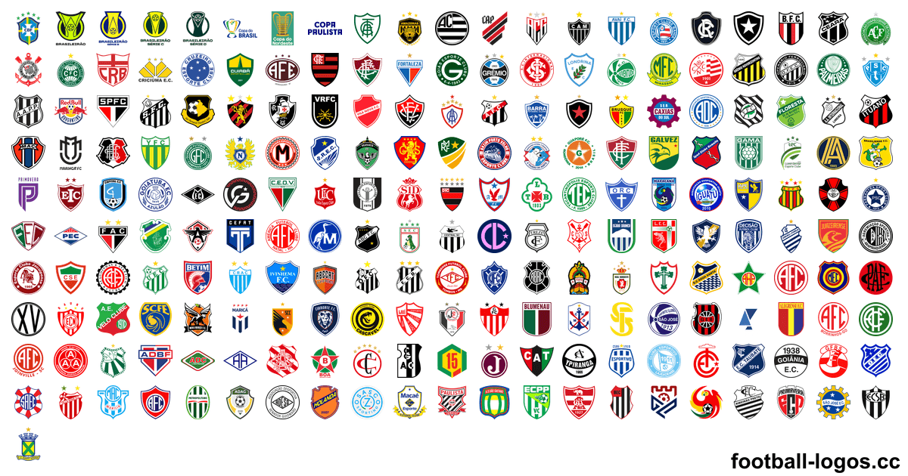
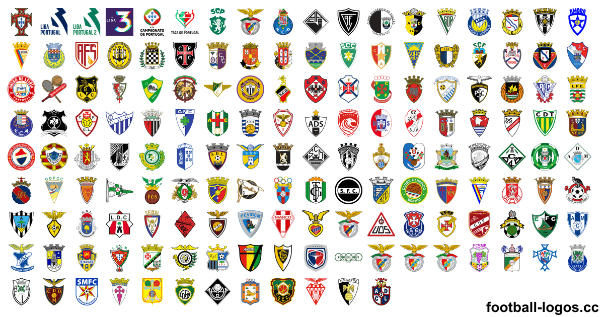
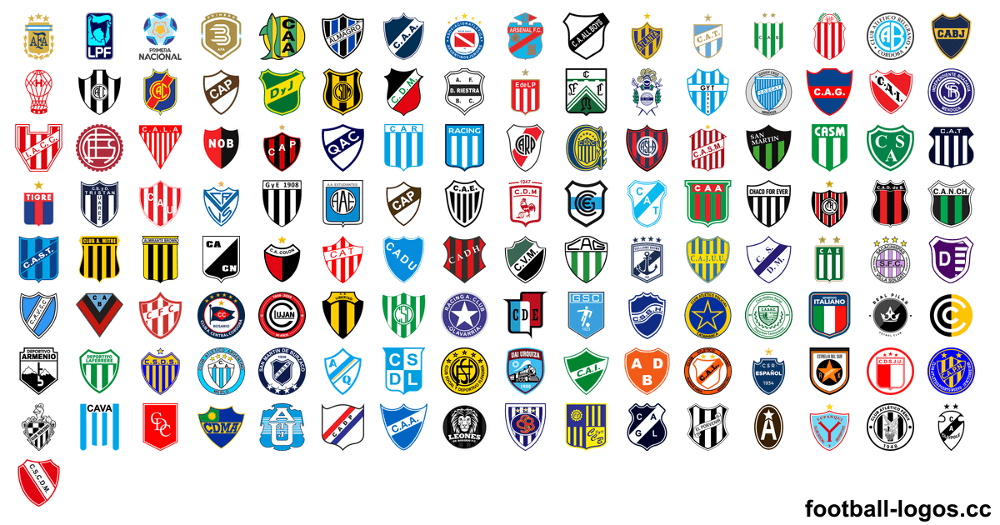

<h1>Escudos de times de futebol – mais de 6.100 escudos em PNG e SVG</h1>

Escudos e logos de times, seleções, ligas e campeonatos de futebol de mais de 220 países: PNG com fundo transparente de 64 a 3000 px e SVG vetorial. Baixe grátis em <a href="https://football-logos.cc">football-logos.cc</a> (site em inglês). Atualizado em novembro de 2026.

<a href="https://github.com/Leo4815162342/football-logos">English</a> · <a href="README.es.md">Español</a> · <b>Português</b> · <a href="README.fr.md">Français</a> · <a href="README.ar.md">العربية</a> · <a href="README.vi.md">Tiếng Việt</a> · <a href="README.ja.md">日本語</a>

<a href="https://football-logos.cc"><picture><source media="(prefers-color-scheme: dark)" srcset="screenshot-dark.png"></picture></a>

## O que tem na coleção

- **Escudos de clubes** de mais de 220 países e territórios, das ligas principais às divisões inferiores
- **[Escudos de seleções](https://football-logos.cc/national-teams/)** de mais de 230 países
- **[Logos de ligas e campeonatos](https://football-logos.cc/tournaments/)**: Champions League, Europa League, Copa do Mundo, Copa América, Eurocopa e mais
- **PNG com fundo transparente** em 64, 128, 256, 512, 700, 1500 e 3000 px e **SVG vetorial** de quase todos os escudos
- **Versões em preto e branco** de mais de 710 escudos
- **[Escudos novos](https://football-logos.cc/new/)** todos os dias: mais de 330 nos últimos 30 dias
- **História dos escudos** de mais de 30 clubes, como [Real Madrid](https://football-logos.cc/spain/real-madrid/logo-history/) e [Barcelona](https://football-logos.cc/spain/barcelona/logo-history/)
- **[Mapa dos clubes](https://football-logos.cc/map/)**: encontre qualquer time por cidade, país ou liga

## Escudos de times populares

### 🇧🇷 [Escudos de times brasileiros](https://football-logos.cc/brazil/)

[Corinthians](https://football-logos.cc/brazil/corinthians/) · [Flamengo](https://football-logos.cc/brazil/flamengo/) · [Palmeiras](https://football-logos.cc/brazil/palmeiras/) · [Santos FC](https://football-logos.cc/brazil/santos/) · [Vasco da Gama](https://football-logos.cc/brazil/vasco-da-gama/) · [São Paulo](https://football-logos.cc/brazil/sao-paulo/) · [Grêmio](https://football-logos.cc/brazil/gremio/) · [Fluminense](https://football-logos.cc/brazil/fluminense/) · [Atlético Mineiro](https://football-logos.cc/brazil/atletico-mineiro/) · [Cruzeiro](https://football-logos.cc/brazil/cruzeiro/) · [Botafogo FR](https://football-logos.cc/brazil/botafogo/) · [Internacional](https://football-logos.cc/brazil/internacional/) · [Athletico Paranaense](https://football-logos.cc/brazil/athletico-paranaense/) · [Bahia](https://football-logos.cc/brazil/bahia/) · [Mirassol](https://football-logos.cc/brazil/mirassol/) · [RB Bragantino](https://football-logos.cc/brazil/rb-bragantino/) · [Coritiba](https://football-logos.cc/brazil/coritiba/) · [Vitória](https://football-logos.cc/brazil/vitoria/) · [Remo](https://football-logos.cc/brazil/clube-do-remo/) · [Chapecoense](https://football-logos.cc/brazil/chapecoense/)

### 🇵🇹 [Emblemas dos clubes portugueses](https://football-logos.cc/portugal/)

[Sporting CP](https://football-logos.cc/portugal/sporting-cp/) · [FC Porto](https://football-logos.cc/portugal/fc-porto/) · [Benfica](https://football-logos.cc/portugal/benfica/) · [SC Braga](https://football-logos.cc/portugal/sc-braga/) · [Vitória de Guimarães](https://football-logos.cc/portugal/vitoria-de-guimaraes/) · [S.C.U. Torreense](https://football-logos.cc/portugal/torreense/) · [Marítimo](https://football-logos.cc/portugal/maritimo/) · [Académico de Viseu](https://football-logos.cc/portugal/academico-de-viseu/) · [Gil Vicente](https://football-logos.cc/portugal/gil-vicente/) · [Rio Ave](https://football-logos.cc/portugal/rio-ave/) · [Casa Pia AC](https://football-logos.cc/portugal/casa-pia-ac/) · [Estoril](https://football-logos.cc/portugal/estoril/)

### Escudos de times europeus

[Real Madrid](https://football-logos.cc/spain/real-madrid/) · [Barcelona](https://football-logos.cc/spain/barcelona/) · [Liverpool FC](https://football-logos.cc/england/liverpool/) · [Manchester City](https://football-logos.cc/england/manchester-city/) · [Manchester United](https://football-logos.cc/england/manchester-united/) · [Arsenal](https://football-logos.cc/england/arsenal/) · [Chelsea](https://football-logos.cc/england/chelsea/) · [PSG](https://football-logos.cc/france/paris-saint-germain/) · [Bayern Munich](https://football-logos.cc/germany/bayern-munchen/) · [Atletico Madrid](https://football-logos.cc/spain/atletico-madrid/) · [Aston Villa](https://football-logos.cc/england/aston-villa/) · [Tottenham](https://football-logos.cc/england/tottenham/) · [Inter](https://football-logos.cc/italy/inter/) · [Juventus](https://football-logos.cc/italy/juventus/) · [AS Roma](https://football-logos.cc/italy/roma/) · [Milan](https://football-logos.cc/italy/milan/)

### 🇦🇷 [Escudos de times argentinos](https://football-logos.cc/argentina/)

[Boca Juniors](https://football-logos.cc/argentina/boca-juniors/) · [River Plate](https://football-logos.cc/argentina/river-plate/) · [Estudiantes de La Plata](https://football-logos.cc/argentina/estudiantes-de-la-plata/) · [Rosario Central](https://football-logos.cc/argentina/rosario-central/) · [Independiente](https://football-logos.cc/argentina/independiente/) · [Racing Club](https://football-logos.cc/argentina/racing-club/) · [San Lorenzo de Almagro](https://football-logos.cc/argentina/san-lorenzo-de-almagro/) · [Vélez Sarsfield](https://football-logos.cc/argentina/velez-sarsfield/)

Os mais baixados no mundo: [Real Madrid](https://football-logos.cc/spain/real-madrid/) · [Barcelona](https://football-logos.cc/spain/barcelona/) · [Liverpool FC](https://football-logos.cc/england/liverpool/) · [Manchester City](https://football-logos.cc/england/manchester-city/) · [Manchester United](https://football-logos.cc/england/manchester-united/) · [Arsenal](https://football-logos.cc/england/arsenal/) · [Chelsea](https://football-logos.cc/england/chelsea/) · [PSG](https://football-logos.cc/france/paris-saint-germain/) · [Bayern Munich](https://football-logos.cc/germany/bayern-munchen/) · [Atletico Madrid](https://football-logos.cc/spain/atletico-madrid/) · [Aston Villa](https://football-logos.cc/england/aston-villa/) · [Tottenham](https://football-logos.cc/england/tottenham/)

## Escudos de futebol por país

Todos os países e territórios da coleção:

**A** · 🇦🇫 [Afeganistão](https://football-logos.cc/afghanistan/) (1) · 🇿🇦 [África do Sul](https://football-logos.cc/south-africa/) (20+) · 🇦🇱 [Albânia](https://football-logos.cc/albania/) (20+) · 🇩🇪 [Alemanha](https://football-logos.cc/germany/) (450+) · 🇦🇩 [Andorra](https://football-logos.cc/andorra/) (10+) · 🇦🇴 [Angola](https://football-logos.cc/angola/) (3) · 🇦🇮 [Anguila](https://football-logos.cc/anguilla/) (1) · 🇦🇬 [Antígua e Barbuda](https://football-logos.cc/antigua-and-barbuda/) (1) · 🇸🇦 [Arábia Saudita](https://football-logos.cc/saudi-arabia/) (50+) · 🇩🇿 [Argélia](https://football-logos.cc/algeria/) (20+) · 🇦🇷 [Argentina](https://football-logos.cc/argentina/) (200+) · 🇦🇲 [Armênia](https://football-logos.cc/armenia/) (10+) · 🇦🇼 [Aruba](https://football-logos.cc/aruba/) (1) · 🇦🇺 [Austrália](https://football-logos.cc/australia/) (20+) · 🇦🇹 [Áustria](https://football-logos.cc/austria/) (40+) · 🇦🇿 [Azerbaijão](https://football-logos.cc/azerbaijan/) (20+)

**B** · 🇧🇸 [Bahamas](https://football-logos.cc/bahamas/) (1) · 🇧🇩 [Bangladesh](https://football-logos.cc/bangladesh/) (10+) · 🇧🇧 [Barbados](https://football-logos.cc/barbados/) (1) · 🇧🇭 [Barein](https://football-logos.cc/bahrain/) (2) · 🇧🇪 [Bélgica](https://football-logos.cc/belgium/) (80+) · 🇧🇿 [Belize](https://football-logos.cc/belize/) (1) · 🇧🇯 [Benin](https://football-logos.cc/benin/) (1) · 🇧🇲 [Bermudas](https://football-logos.cc/bermuda/) (1) · 🇧🇾 [Bielorrússia](https://football-logos.cc/belarus/) (20+) · 🇧🇴 [Bolívia](https://football-logos.cc/bolivia/) (20+) · 🇧🇶 [Bonaire](https://football-logos.cc/bonaire/) (1) · 🇧🇦 [Bósnia e Herzegovina](https://football-logos.cc/bosnia-and-herzegovina/) (20+) · 🇧🇼 [Botsuana](https://football-logos.cc/botswana/) (1) · 🇧🇷 [Brasil](https://football-logos.cc/brazil/) (320+) · 🇧🇳 [Brunei](https://football-logos.cc/brunei/) (1) · 🇧🇬 [Bulgária](https://football-logos.cc/bulgaria/) (20+) · 🇧🇫 [Burquina Faso](https://football-logos.cc/burkina-faso/) (1) · 🇧🇮 [Burundi](https://football-logos.cc/burundi/) (3) · 🇧🇹 [Butão](https://football-logos.cc/bhutan/) (1)

**C** · 🇨🇻 [Cabo Verde](https://football-logos.cc/cabo-verde/) (2) · 🇨🇲 [Camarões](https://football-logos.cc/cameroon/) (2) · 🇰🇭 [Camboja](https://football-logos.cc/cambodia/) (3) · 🇨🇦 [Canadá](https://football-logos.cc/canada/) (10+) · 🏳 [Catalunha](https://football-logos.cc/catalonia/) (1) · 🇶🇦 [Catar](https://football-logos.cc/qatar/) (20+) · 🇰🇿 [Cazaquistão](https://football-logos.cc/kazakhstan/) (20+) · 🇹🇩 [Chade](https://football-logos.cc/chad/) (1) · 🇨🇱 [Chile](https://football-logos.cc/chile/) (40+) · 🇨🇳 [China](https://football-logos.cc/china/) (30+) · 🇨🇾 [Chipre](https://football-logos.cc/cyprus/) (20+) · 🇻🇦 [Cidade do Vaticano](https://football-logos.cc/vatican-city/) (1) · 🇨🇴 [Colômbia](https://football-logos.cc/colombia/) (20+) · 🇰🇲 [Comores](https://football-logos.cc/comoros/) (1) · 🇨🇬 [Congo](https://football-logos.cc/congo/) (1) · 🇰🇵 [Coreia do Norte](https://football-logos.cc/north-korea/) (1) · 🇰🇷 [Coreia do Sul](https://football-logos.cc/south-korea/) (30+) · 🇨🇮 [Costa do Marfim](https://football-logos.cc/cote-d-ivoire/) (2) · 🇨🇷 [Costa Rica](https://football-logos.cc/costa-rica/) (10+) · 🇭🇷 [Croácia](https://football-logos.cc/croatia/) (20+) · 🇨🇺 [Cuba](https://football-logos.cc/cuba/) (1) · 🇨🇼 [Curaçao](https://football-logos.cc/curacao/) (4) · 🏴 [Curdistão](https://football-logos.cc/kurdistan/) (1)

**D** · 🇩🇰 [Dinamarca](https://football-logos.cc/denmark/) (50+) · 🇩🇯 [Djibuti](https://football-logos.cc/djibouti/) (1) · 🇩🇲 [Dominica](https://football-logos.cc/dominica/) (1)

**E** · 🇪🇬 [Egito](https://football-logos.cc/egypt/) (20+) · 🇸🇻 [El Salvador](https://football-logos.cc/el-salvador/) (2) · 🇦🇪 [Emirados Árabes Unidos](https://football-logos.cc/uae/) (10+) · 🇪🇨 [Equador](https://football-logos.cc/ecuador/) (20+) · 🇪🇷 [Eritreia](https://football-logos.cc/eritrea/) (1) · 🏴󠁧󠁢󠁳󠁣󠁴󠁿 [Escócia](https://football-logos.cc/scotland/) (80+) · 🇸🇰 [Eslováquia](https://football-logos.cc/slovakia/) (20+) · 🇸🇮 [Eslovênia](https://football-logos.cc/slovenia/) (20+) · 🇪🇸 [Espanha](https://football-logos.cc/spain/) (240+) · 🇸🇿 [Essuatíni](https://football-logos.cc/eswatini/) (1) · 🇺🇸 [Estados Unidos](https://football-logos.cc/usa/) (140+) · 🇪🇪 [Estônia](https://football-logos.cc/estonia/) (10+) · 🇪🇹 [Etiópia](https://football-logos.cc/ethiopia/) (1)

**F** · 🇫🇯 [Fiji](https://football-logos.cc/fiji/) (1) · 🇵🇭 [Filipinas](https://football-logos.cc/philippines/) (1) · 🇫🇮 [Finlândia](https://football-logos.cc/finland/) (30+) · 🇫🇷 [França](https://football-logos.cc/france/) (400+)

**G** · 🇬🇦 [Gabão](https://football-logos.cc/gabon/) (1) · 🇬🇲 [Gâmbia](https://football-logos.cc/gambia/) (1) · 🇬🇭 [Gana](https://football-logos.cc/ghana/) (20+) · 🇬🇪 [Geórgia](https://football-logos.cc/georgia/) (20+) · 🇬🇮 [Gibraltar](https://football-logos.cc/gibraltar/) (10+) · 🇬🇩 [Granada](https://football-logos.cc/grenada/) (1) · 🇬🇷 [Grécia](https://football-logos.cc/greece/) (100+) · 🇬🇱 [Groenlândia](https://football-logos.cc/greenland/) (1) · 🇬🇵 [Guadalupe](https://football-logos.cc/guadeloupe/) (1) · 🇬🇺 [Guam](https://football-logos.cc/guam/) (1) · 🇬🇹 [Guatemala](https://football-logos.cc/guatemala/) (10+) · 🇬🇾 [Guiana](https://football-logos.cc/guyana/) (1) · 🇬🇫 [Guiana Francesa](https://football-logos.cc/french-guiana/) (1) · 🇬🇳 [Guiné](https://football-logos.cc/guinea/) (1) · 🇬🇶 [Guiné Equatorial](https://football-logos.cc/equatorial-guinea/) (1) · 🇬🇼 [Guiné-Bissau](https://football-logos.cc/guinea-bissau/) (1)

**H** · 🇭🇹 [Haiti](https://football-logos.cc/haiti/) (2) · 🇭🇳 [Honduras](https://football-logos.cc/honduras/) (1) · 🇭🇰 [Hong Kong](https://football-logos.cc/hong-kong/) (10+) · 🇭🇺 [Hungria](https://football-logos.cc/hungary/) (40+)

**I** · 🇾🇪 [Iêmen](https://football-logos.cc/yemen/) (1) · 🇰🇾 [Ilhas Cayman](https://football-logos.cc/cayman-islands/) (1) · 🇨🇰 [Ilhas Cook](https://football-logos.cc/cook-islands/) (1) · 🇫🇴 [Ilhas Faroé](https://football-logos.cc/faroe-islands/) (10+) · 🇲🇵 [Ilhas Marianas do Norte](https://football-logos.cc/northern-mariana-islands/) (1) · 🇸🇧 [Ilhas Salomão](https://football-logos.cc/solomon-islands/) (1) · 🇹🇨 [Ilhas Turcas e Caicos](https://football-logos.cc/turks-and-caicos-islands/) (1) · 🇻🇮 [Ilhas Virgens Americanas](https://football-logos.cc/us-virgin-islands/) (1) · 🇻🇬 [Ilhas Virgens Britânicas](https://football-logos.cc/british-virgin-islands/) (1) · 🇮🇳 [Índia](https://football-logos.cc/india/) (20+) · 🇮🇩 [Indonésia](https://football-logos.cc/indonesia/) (60+) · 🏴󠁧󠁢󠁥󠁮󠁧󠁿 [Inglaterra](https://football-logos.cc/england/) (560+) · 🇮🇷 [Irã](https://football-logos.cc/iran/) (20+) · 🇮🇶 [Iraque](https://football-logos.cc/iraq/) (20+) · 🇮🇪 [Irlanda](https://football-logos.cc/republic-of-ireland/) (20+) · 🏴 [Irlanda do Norte](https://football-logos.cc/northern-ireland/) (20+) · 🇮🇸 [Islândia](https://football-logos.cc/iceland/) (30+) · 🇮🇱 [Israel](https://football-logos.cc/israel/) (20+) · 🇮🇹 [Itália](https://football-logos.cc/italy/) (420+) · 🏴 [Iugoslávia](https://football-logos.cc/yugoslavia/) (1)

**J** · 🇯🇲 [Jamaica](https://football-logos.cc/jamaica/) (2) · 🇯🇵 [Japão](https://football-logos.cc/japan/) (70+) · 🇯🇴 [Jordânia](https://football-logos.cc/jordan/) (6)

**K** · 🇽🇰 [Kosovo](https://football-logos.cc/kosovo/) (10+) · 🇰🇼 [Kuwait](https://football-logos.cc/kuwait/) (1)

**L** · 🇱🇦 [Laos](https://football-logos.cc/laos/) (1) · 🇱🇸 [Lesoto](https://football-logos.cc/lesotho/) (1) · 🇱🇻 [Letônia](https://football-logos.cc/latvia/) (10+) · 🇱🇧 [Líbano](https://football-logos.cc/lebanon/) (1) · 🇱🇷 [Libéria](https://football-logos.cc/liberia/) (1) · 🇱🇾 [Líbia](https://football-logos.cc/libya/) (1) · 🇱🇮 [Liechtenstein](https://football-logos.cc/liechtenstein/) (6) · 🇱🇹 [Lituânia](https://football-logos.cc/lithuania/) (10+) · 🇱🇺 [Luxemburgo](https://football-logos.cc/luxembourg/) (30+)

**M** · 🇲🇴 [Macau](https://football-logos.cc/macau/) (1) · 🇲🇰 [Macedônia do Norte](https://football-logos.cc/north-macedonia/) (20+) · 🇲🇬 [Madagascar](https://football-logos.cc/madagascar/) (2) · 🇲🇾 [Malásia](https://football-logos.cc/malaysia/) (10+) · 🇲🇼 [Malaui](https://football-logos.cc/malawi/) (1) · 🇲🇻 [Maldivas](https://football-logos.cc/maldives/) (2) · 🇲🇱 [Mali](https://football-logos.cc/mali/) (1) · 🇲🇹 [Malta](https://football-logos.cc/malta/) (20+) · 🇲🇦 [Marrocos](https://football-logos.cc/morocco/) (20+) · 🇲🇶 [Martinica](https://football-logos.cc/martinique/) (1) · 🇲🇺 [Maurício](https://football-logos.cc/mauritius/) (1) · 🇲🇷 [Mauritânia](https://football-logos.cc/mauritania/) (1) · 🇲🇽 [México](https://football-logos.cc/mexico/) (70+) · 🇲🇲 [Mianmar](https://football-logos.cc/myanmar/) (1) · 🇲🇿 [Moçambique](https://football-logos.cc/mozambique/) (1) · 🇲🇩 [Moldávia](https://football-logos.cc/moldova/) (10+) · 🇲🇳 [Mongólia](https://football-logos.cc/mongolia/) (1) · 🇲🇪 [Montenegro](https://football-logos.cc/montenegro/) (10+) · 🇲🇸 [Montserrat](https://football-logos.cc/montserrat/) (1)

**N** · 🇳🇦 [Namíbia](https://football-logos.cc/namibia/) (2) · 🇳🇷 [Nauru](https://football-logos.cc/nauru/) (1) · 🇳🇵 [Nepal](https://football-logos.cc/nepal/) (1) · 🇳🇮 [Nicarágua](https://football-logos.cc/nicaragua/) (1) · 🇳🇪 [Níger](https://football-logos.cc/niger/) (1) · 🇳🇬 [Nigéria](https://football-logos.cc/nigeria/) (20+) · 🇳🇴 [Noruega](https://football-logos.cc/norway/) (50+) · 🇳🇨 [Nova Caledônia](https://football-logos.cc/new-caledonia/) (1) · 🇳🇿 [Nova Zelândia](https://football-logos.cc/new-zealand/) (10+)

**O** · 🇴🇲 [Omã](https://football-logos.cc/oman/) (1)

**P** · 🏴󠁧󠁢󠁷󠁬󠁳󠁿 [País de Gales](https://football-logos.cc/wales/) (60+) · 🇳🇱 [Países Baixos](https://football-logos.cc/netherlands/) (140+) · 🇵🇼 [Palau](https://football-logos.cc/palau/) (1) · 🇵🇸 [Palestina](https://football-logos.cc/palestine/) (1) · 🇵🇦 [Panamá](https://football-logos.cc/panama/) (10+) · 🇵🇬 [Papua-Nova Guiné](https://football-logos.cc/papua-new-guinea/) (1) · 🇵🇰 [Paquistão](https://football-logos.cc/pakistan/) (1) · 🇵🇾 [Paraguai](https://football-logos.cc/paraguay/) (10+) · 🇵🇪 [Peru](https://football-logos.cc/peru/) (30+) · 🇵🇱 [Polônia](https://football-logos.cc/poland/) (60+) · 🇵🇷 [Porto Rico](https://football-logos.cc/puerto-rico/) (10+) · 🇵🇹 [Portugal](https://football-logos.cc/portugal/) (180+)

**Q** · 🇰🇪 [Quênia](https://football-logos.cc/kenya/) (2) · 🇰🇬 [Quirguistão](https://football-logos.cc/kyrgyzstan/) (1) · 🇰🇮 [Quiribati](https://football-logos.cc/kiribati/) (1)

**R** · 🇨🇩 [RD Congo](https://football-logos.cc/congo-dr/) (3) · 🇨🇫 [República Centro-Africana](https://football-logos.cc/central-african-republic/) (1) · 🇩🇴 [República Dominicana](https://football-logos.cc/dominican-republic/) (1) · 🇷🇪 [Reunião](https://football-logos.cc/reunion/) (2) · 🇷🇴 [Romênia](https://football-logos.cc/romania/) (30+) · 🇷🇼 [Ruanda](https://football-logos.cc/rwanda/) (1) · 🇷🇺 [Rússia](https://football-logos.cc/russia/) (60+)

**S** · 🇼🇸 [Samoa](https://football-logos.cc/samoa/) (1) · 🇦🇸 [Samoa Americana](https://football-logos.cc/american-samoa/) (1) · 🇸🇲 [San Marino](https://football-logos.cc/san-marino/) (10+) · 🇱🇨 [Santa Lúcia](https://football-logos.cc/saint-lucia/) (1) · 🇰🇳 [São Cristóvão e Névis](https://football-logos.cc/st-kitts-and-nevis/) (1) · 🇲🇫 [São Martinho](https://football-logos.cc/saint-martin/) (1) · 🇸🇹 [São Tomé e Príncipe](https://football-logos.cc/sao-tome-and-principe/) (1) · 🇻🇨 [São Vicente e Granadinas](https://football-logos.cc/saint-vincent-and-the-grenadines/) (1) · 🇸🇨 [Seicheles](https://football-logos.cc/seychelles/) (1) · 🇸🇳 [Senegal](https://football-logos.cc/senegal/) (3) · 🇸🇱 [Serra Leoa](https://football-logos.cc/sierra-leone/) (1) · 🇷🇸 [Sérvia](https://football-logos.cc/serbia/) (30+) · 🇸🇬 [Singapura](https://football-logos.cc/singapore/) (10+) · 🇸🇽 [Sint Maarten](https://football-logos.cc/sint-maarten/) (1) · 🇸🇾 [Síria](https://football-logos.cc/syria/) (1) · 🇸🇴 [Somália](https://football-logos.cc/somalia/) (1) · 🇱🇰 [Sri Lanka](https://football-logos.cc/sri-lanka/) (1) · 🇸🇩 [Sudão](https://football-logos.cc/sudan/) (1) · 🇸🇸 [Sudão do Sul](https://football-logos.cc/south-sudan/) (1) · 🇸🇪 [Suécia](https://football-logos.cc/sweden/) (60+) · 🇨🇭 [Suíça](https://football-logos.cc/switzerland/) (30+) · 🇸🇷 [Suriname](https://football-logos.cc/suriname/) (6)

**T** · 🇹🇯 [Tadjiquistão](https://football-logos.cc/tajikistan/) (1) · 🇹🇭 [Tailândia](https://football-logos.cc/thailand/) (10+) · 🇵🇫 [Taiti](https://football-logos.cc/tahiti/) (1) · 🇹🇼 [Taiwan](https://football-logos.cc/taiwan/) (10+) · 🇹🇿 [Tanzânia](https://football-logos.cc/tanzania/) (20+) · 🇨🇿 [Tchéquia](https://football-logos.cc/czech-republic/) (40+) · 🇹🇱 [Timor-Leste](https://football-logos.cc/timor-leste/) (1) · 🇹🇬 [Togo](https://football-logos.cc/togo/) (1) · 🇹🇴 [Tonga](https://football-logos.cc/tonga/) (1) · 🇹🇹 [Trinidad e Tobago](https://football-logos.cc/trinidad-and-tobago/) (1) · 🇹🇳 [Tunísia](https://football-logos.cc/tunisia/) (20+) · 🇹🇲 [Turcomenistão](https://football-logos.cc/turkmenistan/) (2) · 🇹🇷 [Turquia](https://football-logos.cc/turkey/) (120+) · 🇹🇻 [Tuvalu](https://football-logos.cc/tuvalu/) (1)

**U** · 🇺🇦 [Ucrânia](https://football-logos.cc/ukraine/) (50+) · 🇺🇬 [Uganda](https://football-logos.cc/uganda/) (2) · 🇺🇾 [Uruguai](https://football-logos.cc/uruguay/) (30+) · 🇺🇿 [Uzbequistão](https://football-logos.cc/uzbekistan/) (20+)

**V** · 🇻🇺 [Vanuatu](https://football-logos.cc/vanuatu/) (1) · 🇻🇪 [Venezuela](https://football-logos.cc/venezuela/) (10+) · 🇻🇳 [Vietnã](https://football-logos.cc/vietnam/) (30+)

**Z** · 🇿🇲 [Zâmbia](https://football-logos.cc/zambia/) (2) · 🏴 [Zanzibar](https://football-logos.cc/zanzibar/) (1) · 🇿🇼 [Zimbábue](https://football-logos.cc/zimbabwe/) (1)

## Escudos por liga

Escudos da temporada 2026/27, por país e liga principal:

| Liga | País | Escudos |
| --- | --- | ---: |
| Campeonato Brasileiro Série A · Copa do Brasil | 🇧🇷 [Brasil](https://football-logos.cc/brazil/) | 320+ |
| Primeira Liga · Taça de Portugal | 🇵🇹 [Portugal](https://football-logos.cc/portugal/) | 180+ |
| Argentine Primera Division · Argentine Cup | 🇦🇷 [Argentina](https://football-logos.cc/argentina/) | 200+ |
| La Liga · Copa del Rey | 🇪🇸 [Espanha](https://football-logos.cc/spain/) | 240+ |
| Premier League · FA Cup | 🏴󠁧󠁢󠁥󠁮󠁧󠁿 [Inglaterra](https://football-logos.cc/england/) | 560+ |
| Serie A · Coppa Italia | 🇮🇹 [Itália](https://football-logos.cc/italy/) | 420+ |
| Bundesliga · DFB-Pokal | 🇩🇪 [Alemanha](https://football-logos.cc/germany/) | 450+ |
| Ligue 1 · Coupe de France | 🇫🇷 [França](https://football-logos.cc/france/) | 400+ |
| Eredivisie · KNVB Cup | 🇳🇱 [Países Baixos](https://football-logos.cc/netherlands/) | 140+ |
| MLS · MLS Cup | 🇺🇸 [Estados Unidos](https://football-logos.cc/usa/) | 140+ |
| Liga MX · Copa MX | 🇲🇽 [México](https://football-logos.cc/mexico/) | 70+ |
| Saudi Professional League · Saudi Cup | 🇸🇦 [Arábia Saudita](https://football-logos.cc/saudi-arabia/) | 50+ |

## Escudos e uniformes para DLS 26

Para o Dream League Soccer (DLS 26):

- [Logos para DLS](https://football-logos.cc/dls/): URLs de escudos 512×512 de qualquer time, prontas para copiar
- [Kits para DLS](https://football-logos.cc/dls/kits/): URLs de uniformes 512×512 com prévia em 3D
- [Criador de escudos para DLS](https://football-logos.cc/logo-maker/): crie seu próprio escudo e copie a URL
- [Criador de uniformes para DLS](https://football-logos.cc/kit-maker/): monte seu uniforme, veja em 3D e copie a URL

## Papéis de parede de futebol

[Mais de 11.700 papéis de parede de futebol em 4K](https://football-logos.cc/wallpapers/), grátis, com os escudos de mais de 620 clubes e seleções, para iPhone, Android, iPad e PC.

## Perguntas frequentes

### Os escudos são grátis?

Sim. Todos os escudos podem ser baixados grátis no [football-logos.cc](https://football-logos.cc), em PNG ou SVG. Eles continuam sendo propriedade dos clubes e federações, então leia o [aviso de uso dos logos](https://football-logos.cc/license/) (em inglês) antes de usar.

### Quais formatos e tamanhos existem?

PNG com fundo transparente em 64, 128, 256, 512, 700, 1500 e 3000 px e SVG vetorial, que pode ser ampliado sem perder qualidade. Mais de 710 escudos também têm versão em preto e branco.

### Posso usar os escudos comercialmente?

Não. Os escudos são marcas registradas dos clubes, ligas e federações. Eles são compartilhados para uso informativo, editorial e de torcedores (pesquisa, design sem fins comerciais, projetos de fãs), e não para produtos, merchandising, identidade de marca ou qualquer uso que sugira apoio oficial.

### Como coloco um escudo no Dream League Soccer (DLS)?

Procure o time em [Logos para DLS](https://football-logos.cc/dls/), copie a URL do escudo 512×512 e cole em Custom Logo, no DLS 26. Para criar seu próprio escudo, use o [criador de escudos](https://football-logos.cc/logo-maker/).

### Falta um escudo ou ele está desatualizado. O que faço?

Peça em [football-logos.cc/request](https://football-logos.cc/request/).

## Uso e marcas registradas

Todos os escudos pertencem aos seus clubes, ligas e federações e são protegidos como marcas registradas. O football-logos.cc é um site independente, sem vínculo com nenhum deles. Os escudos são compartilhados para uso informativo, editorial e de torcedores: não os use em produtos comerciais, merchandising ou identidade de marca, nem de forma que sugira apoio oficial. Mais detalhes no [aviso de uso dos logos](https://football-logos.cc/license/) (em inglês).

