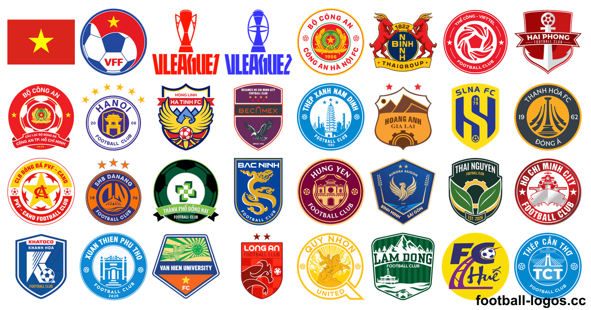
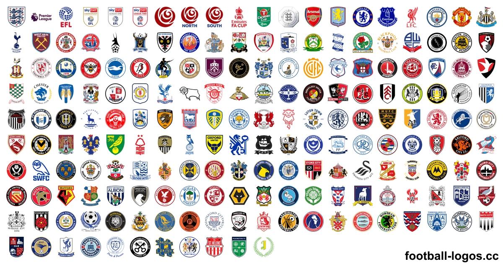

<h1>Logo bóng đá – hơn 6.100 logo câu lạc bộ PNG và SVG</h1>

Logo các câu lạc bộ bóng đá, đội tuyển quốc gia và giải đấu của hơn 220 quốc gia: PNG nền trong suốt từ 64 đến 3000 px và SVG vector. Tải miễn phí tại <a href="https://football-logos.cc">football-logos.cc</a> (trang tiếng Anh). Cập nhật tháng 11 năm 2026.

<a href="https://github.com/Leo4815162342/football-logos">English</a> · <a href="README.es.md">Español</a> · <a href="README.pt-BR.md">Português</a> · <a href="README.fr.md">Français</a> · <a href="README.ar.md">العربية</a> · <b>Tiếng Việt</b> · <a href="README.ja.md">日本語</a>

<a href="https://football-logos.cc"><picture><source media="(prefers-color-scheme: dark)" srcset="screenshot-dark.png"></picture></a>

## Bộ sưu tập có gì

- **Logo câu lạc bộ** của hơn 220 quốc gia và vùng lãnh thổ, từ các giải hàng đầu đến các hạng đấu thấp hơn
- **[Logo đội tuyển quốc gia](https://football-logos.cc/national-teams/)** của hơn 230 quốc gia
- **[Logo giải đấu](https://football-logos.cc/tournaments/)**: Champions League, Europa League, World Cup, Copa América, Euro và nhiều giải khác
- **PNG nền trong suốt** cỡ 64, 128, 256, 512, 700, 1500 và 3000 px, cùng **SVG vector** cho gần như mọi logo
- **Phiên bản đen trắng** của hơn 710 logo
- **[Logo mới](https://football-logos.cc/new/)** mỗi ngày: hơn 330 logo trong 30 ngày qua
- **Lịch sử logo** của hơn 30 câu lạc bộ, ví dụ [Real Madrid](https://football-logos.cc/spain/real-madrid/logo-history/) và [Barcelona](https://football-logos.cc/spain/barcelona/logo-history/)
- **[Bản đồ câu lạc bộ](https://football-logos.cc/map/)**: tìm câu lạc bộ theo thành phố, quốc gia hoặc giải đấu

## Logo các câu lạc bộ nổi tiếng

### 🇻🇳 [Logo các câu lạc bộ bóng đá Việt Nam](https://football-logos.cc/vietnam/)

[Thể Công – Viettel](https://football-logos.cc/vietnam/the-cong-viettel/) · [Công an Hà Nội](https://football-logos.cc/vietnam/cong-an-ha-noi/) · [Hà Nội](https://football-logos.cc/vietnam/ha-noi/) · [Công an TP. Hồ Chí Minh](https://football-logos.cc/vietnam/cong-an-tp-ho-chi-minh/) · [Thanh Hóa](https://football-logos.cc/vietnam/thanh-hoa/) · [SHB Đà Nẵng](https://football-logos.cc/vietnam/shb-da-nang/) · [Thép Xanh Nam Định](https://football-logos.cc/vietnam/thep-xanh-nam-dinh/) · [Hải Phòng](https://football-logos.cc/vietnam/hai-phong/) · [Ninh Bình](https://football-logos.cc/vietnam/ninh-binh/) · [Bắc Ninh](https://football-logos.cc/vietnam/bac-ninh/) · [Sông Lam Nghệ An](https://football-logos.cc/vietnam/song-lam-nghe-an/) · [Hồng Lĩnh Hà Tĩnh](https://football-logos.cc/vietnam/hong-linh-ha-tinh/) · [Hoàng Anh Gia Lai](https://football-logos.cc/vietnam/hoang-anh-gia-lai/) · [Thành Phố Đồng Nai](https://football-logos.cc/vietnam/thanh-pho-dong-nai/)

### 🏴󠁧󠁢󠁥󠁮󠁧󠁿 [Logo các câu lạc bộ bóng đá Anh](https://football-logos.cc/england/)

[Liverpool FC](https://football-logos.cc/england/liverpool/) · [Manchester City](https://football-logos.cc/england/manchester-city/) · [Manchester United](https://football-logos.cc/england/manchester-united/) · [Arsenal](https://football-logos.cc/england/arsenal/) · [Chelsea](https://football-logos.cc/england/chelsea/) · [Aston Villa](https://football-logos.cc/england/aston-villa/) · [Tottenham](https://football-logos.cc/england/tottenham/) · [Newcastle United](https://football-logos.cc/england/newcastle/) · [Everton](https://football-logos.cc/england/everton/) · [Brighton](https://football-logos.cc/england/brighton/) · [Bournemouth](https://football-logos.cc/england/bournemouth/) · [Crystal Palace](https://football-logos.cc/england/crystal-palace/) · [Hull City](https://football-logos.cc/england/hull-city/) · [Leeds United](https://football-logos.cc/england/leeds-united/) · [Nottingham Forest](https://football-logos.cc/england/nottingham-forest/) · [Coventry City](https://football-logos.cc/england/coventry-city/) · [Fulham](https://football-logos.cc/england/fulham/) · [Sunderland](https://football-logos.cc/england/sunderland/) · [Ipswich](https://football-logos.cc/england/ipswich/) · [Brentford](https://football-logos.cc/england/brentford/)

### Logo các câu lạc bộ bóng đá châu Âu

[Real Madrid](https://football-logos.cc/spain/real-madrid/) · [Barcelona](https://football-logos.cc/spain/barcelona/) · [PSG](https://football-logos.cc/france/paris-saint-germain/) · [Bayern Munich](https://football-logos.cc/germany/bayern-munchen/) · [Atletico Madrid](https://football-logos.cc/spain/atletico-madrid/) · [Inter](https://football-logos.cc/italy/inter/) · [Juventus](https://football-logos.cc/italy/juventus/) · [AS Roma](https://football-logos.cc/italy/roma/) · [Milan](https://football-logos.cc/italy/milan/) · [Borussia Dortmund](https://football-logos.cc/germany/borussia-dortmund/) · [Napoli](https://football-logos.cc/italy/napoli/) · [Real Betis](https://football-logos.cc/spain/real-betis/) · [Como 1907](https://football-logos.cc/italy/como-1907/) · [Villarreal](https://football-logos.cc/spain/villarreal/) · [Sporting CP](https://football-logos.cc/portugal/sporting-cp/) · [RB Leipzig](https://football-logos.cc/germany/rb-leipzig/)

Được tải nhiều nhất trên thế giới: [Real Madrid](https://football-logos.cc/spain/real-madrid/) · [Barcelona](https://football-logos.cc/spain/barcelona/) · [Liverpool FC](https://football-logos.cc/england/liverpool/) · [Manchester City](https://football-logos.cc/england/manchester-city/) · [Manchester United](https://football-logos.cc/england/manchester-united/) · [Arsenal](https://football-logos.cc/england/arsenal/) · [Chelsea](https://football-logos.cc/england/chelsea/) · [PSG](https://football-logos.cc/france/paris-saint-germain/) · [Bayern Munich](https://football-logos.cc/germany/bayern-munchen/) · [Atletico Madrid](https://football-logos.cc/spain/atletico-madrid/) · [Aston Villa](https://football-logos.cc/england/aston-villa/) · [Tottenham](https://football-logos.cc/england/tottenham/)

## Logo bóng đá theo quốc gia

Tất cả quốc gia và vùng lãnh thổ trong bộ sưu tập:

**A** · 🇸🇦 [Ả Rập Xê-út](https://football-logos.cc/saudi-arabia/) (50+) · 🇦🇫 [Afghanistan](https://football-logos.cc/afghanistan/) (1) · 🇪🇬 [Ai Cập](https://football-logos.cc/egypt/) (20+) · 🇦🇱 [Albania](https://football-logos.cc/albania/) (20+) · 🇩🇿 [Algeria](https://football-logos.cc/algeria/) (20+) · 🇦🇩 [Andorra](https://football-logos.cc/andorra/) (10+) · 🇦🇴 [Angola](https://football-logos.cc/angola/) (3) · 🇦🇮 [Anguilla](https://football-logos.cc/anguilla/) (1) · 🏴󠁧󠁢󠁥󠁮󠁧󠁿 [Anh](https://football-logos.cc/england/) (560+) · 🇦🇬 [Antigua và Barbuda](https://football-logos.cc/antigua-and-barbuda/) (1) · 🇦🇹 [Áo](https://football-logos.cc/austria/) (40+) · 🇦🇷 [Argentina](https://football-logos.cc/argentina/) (200+) · 🇦🇲 [Armenia](https://football-logos.cc/armenia/) (10+) · 🇦🇼 [Aruba](https://football-logos.cc/aruba/) (1) · 🇦🇿 [Azerbaijan](https://football-logos.cc/azerbaijan/) (20+) · 🇮🇳 [Ấn Độ](https://football-logos.cc/india/) (20+)

**B** · 🇵🇱 [Ba Lan](https://football-logos.cc/poland/) (60+) · 🇧🇸 [Bahamas](https://football-logos.cc/bahamas/) (1) · 🇧🇭 [Bahrain](https://football-logos.cc/bahrain/) (2) · 🇧🇩 [Bangladesh](https://football-logos.cc/bangladesh/) (10+) · 🇧🇧 [Barbados](https://football-logos.cc/barbados/) (1) · 🏴 [Bắc Ireland](https://football-logos.cc/northern-ireland/) (20+) · 🇲🇰 [Bắc Macedonia](https://football-logos.cc/north-macedonia/) (20+) · 🇧🇾 [Belarus](https://football-logos.cc/belarus/) (20+) · 🇧🇿 [Belize](https://football-logos.cc/belize/) (1) · 🇧🇯 [Benin](https://football-logos.cc/benin/) (1) · 🇧🇲 [Bermuda](https://football-logos.cc/bermuda/) (1) · 🇧🇹 [Bhutan](https://football-logos.cc/bhutan/) (1) · 🇧🇪 [Bỉ](https://football-logos.cc/belgium/) (80+) · 🇧🇴 [Bolivia](https://football-logos.cc/bolivia/) (20+) · 🇧🇶 [Bonaire](https://football-logos.cc/bonaire/) (1) · 🇧🇦 [Bosnia và Herzegovina](https://football-logos.cc/bosnia-and-herzegovina/) (20+) · 🇧🇼 [Botswana](https://football-logos.cc/botswana/) (1) · 🇵🇹 [Bồ Đào Nha](https://football-logos.cc/portugal/) (180+) · 🇧🇷 [Brazil](https://football-logos.cc/brazil/) (320+) · 🇧🇳 [Brunei](https://football-logos.cc/brunei/) (1) · 🇧🇬 [Bulgaria](https://football-logos.cc/bulgaria/) (20+) · 🇧🇫 [Burkina Faso](https://football-logos.cc/burkina-faso/) (1) · 🇧🇮 [Burundi](https://football-logos.cc/burundi/) (3)

**C** · 🇦🇪 [Các Tiểu Vương quốc Ả Rập Thống nhất](https://football-logos.cc/uae/) (10+) · 🇨🇲 [Cameroon](https://football-logos.cc/cameroon/) (2) · 🇰🇭 [Campuchia](https://football-logos.cc/cambodia/) (3) · 🇨🇦 [Canada](https://football-logos.cc/canada/) (10+) · 🇨🇻 [Cape Verde](https://football-logos.cc/cabo-verde/) (2) · 🏳 [Catalonia](https://football-logos.cc/catalonia/) (1) · 🇹🇩 [Chad](https://football-logos.cc/chad/) (1) · 🇨🇩 [CHDC Congo](https://football-logos.cc/congo-dr/) (3) · 🇨🇱 [Chile](https://football-logos.cc/chile/) (40+) · 🇨🇴 [Colombia](https://football-logos.cc/colombia/) (20+) · 🇰🇲 [Comoros](https://football-logos.cc/comoros/) (1) · 🇨🇬 [Congo](https://football-logos.cc/congo/) (1) · 🇨🇷 [Costa Rica](https://football-logos.cc/costa-rica/) (10+) · 🇩🇴 [Cộng hòa Dominica](https://football-logos.cc/dominican-republic/) (1) · 🇨🇫 [Cộng hòa Trung Phi](https://football-logos.cc/central-african-republic/) (1) · 🇨🇮 [Côte d’Ivoire](https://football-logos.cc/cote-d-ivoire/) (2) · 🇭🇷 [Croatia](https://football-logos.cc/croatia/) (20+) · 🇨🇺 [Cuba](https://football-logos.cc/cuba/) (1) · 🇨🇼 [Curaçao](https://football-logos.cc/curacao/) (4)

**D** · 🇩🇯 [Djibouti](https://football-logos.cc/djibouti/) (1) · 🇩🇲 [Dominica](https://football-logos.cc/dominica/) (1)

**Đ** · 🇹🇼 [Đài Loan](https://football-logos.cc/taiwan/) (10+) · 🇩🇰 [Đan Mạch](https://football-logos.cc/denmark/) (50+) · 🇩🇪 [Đức](https://football-logos.cc/germany/) (450+)

**E** · 🇪🇨 [Ecuador](https://football-logos.cc/ecuador/) (20+) · 🇸🇻 [El Salvador](https://football-logos.cc/el-salvador/) (2) · 🇪🇷 [Eritrea](https://football-logos.cc/eritrea/) (1) · 🇪🇪 [Estonia](https://football-logos.cc/estonia/) (10+) · 🇸🇿 [Eswatini](https://football-logos.cc/eswatini/) (1) · 🇪🇹 [Ethiopia](https://football-logos.cc/ethiopia/) (1)

**F** · 🇫🇯 [Fiji](https://football-logos.cc/fiji/) (1)

**G** · 🇬🇦 [Gabon](https://football-logos.cc/gabon/) (1) · 🇬🇲 [Gambia](https://football-logos.cc/gambia/) (1) · 🇬🇪 [Georgia](https://football-logos.cc/georgia/) (20+) · 🇬🇭 [Ghana](https://football-logos.cc/ghana/) (20+) · 🇬🇮 [Gibraltar](https://football-logos.cc/gibraltar/) (10+) · 🇬🇱 [Greenland](https://football-logos.cc/greenland/) (1) · 🇬🇩 [Grenada](https://football-logos.cc/grenada/) (1) · 🇬🇵 [Guadeloupe](https://football-logos.cc/guadeloupe/) (1) · 🇬🇺 [Guam](https://football-logos.cc/guam/) (1) · 🇬🇹 [Guatemala](https://football-logos.cc/guatemala/) (10+) · 🇬🇫 [Guiana thuộc Pháp](https://football-logos.cc/french-guiana/) (1) · 🇬🇳 [Guinea](https://football-logos.cc/guinea/) (1) · 🇬🇶 [Guinea Xích Đạo](https://football-logos.cc/equatorial-guinea/) (1) · 🇬🇼 [Guinea-Bissau](https://football-logos.cc/guinea-bissau/) (1) · 🇬🇾 [Guyana](https://football-logos.cc/guyana/) (1)

**H** · 🇳🇱 [Hà Lan](https://football-logos.cc/netherlands/) (140+) · 🇭🇹 [Haiti](https://football-logos.cc/haiti/) (2) · 🇰🇷 [Hàn Quốc](https://football-logos.cc/south-korea/) (30+) · 🇺🇸 [Hoa Kỳ](https://football-logos.cc/usa/) (140+) · 🇭🇳 [Honduras](https://football-logos.cc/honduras/) (1) · 🇭🇰 [Hồng Kông](https://football-logos.cc/hong-kong/) (10+) · 🇭🇺 [Hungary](https://football-logos.cc/hungary/) (40+) · 🇬🇷 [Hy Lạp](https://football-logos.cc/greece/) (100+)

**I** · 🇮🇸 [Iceland](https://football-logos.cc/iceland/) (30+) · 🇮🇩 [Indonesia](https://football-logos.cc/indonesia/) (60+) · 🇮🇷 [Iran](https://football-logos.cc/iran/) (20+) · 🇮🇶 [Iraq](https://football-logos.cc/iraq/) (20+) · 🇮🇪 [Ireland](https://football-logos.cc/republic-of-ireland/) (20+) · 🇮🇱 [Israel](https://football-logos.cc/israel/) (20+) · 🇮🇹 [Italy](https://football-logos.cc/italy/) (420+)

**J** · 🇯🇲 [Jamaica](https://football-logos.cc/jamaica/) (2) · 🇯🇴 [Jordan](https://football-logos.cc/jordan/) (6)

**K** · 🇰🇿 [Kazakhstan](https://football-logos.cc/kazakhstan/) (20+) · 🇰🇪 [Kenya](https://football-logos.cc/kenya/) (2) · 🇰🇮 [Kiribati](https://football-logos.cc/kiribati/) (1) · 🇽🇰 [Kosovo](https://football-logos.cc/kosovo/) (10+) · 🏴 [Kurdistan](https://football-logos.cc/kurdistan/) (1) · 🇰🇼 [Kuwait](https://football-logos.cc/kuwait/) (1) · 🇰🇬 [Kyrgyzstan](https://football-logos.cc/kyrgyzstan/) (1)

**L** · 🇱🇦 [Lào](https://football-logos.cc/laos/) (1) · 🇱🇻 [Latvia](https://football-logos.cc/latvia/) (10+) · 🇱🇸 [Lesotho](https://football-logos.cc/lesotho/) (1) · 🇱🇧 [Li-băng](https://football-logos.cc/lebanon/) (1) · 🇱🇷 [Liberia](https://football-logos.cc/liberia/) (1) · 🇱🇾 [Libya](https://football-logos.cc/libya/) (1) · 🇱🇮 [Liechtenstein](https://football-logos.cc/liechtenstein/) (6) · 🇱🇹 [Litva](https://football-logos.cc/lithuania/) (10+) · 🇱🇺 [Luxembourg](https://football-logos.cc/luxembourg/) (30+)

**M** · 🇲🇴 [Ma Cao](https://football-logos.cc/macau/) (1) · 🇲🇦 [Ma-rốc](https://football-logos.cc/morocco/) (20+) · 🇲🇬 [Madagascar](https://football-logos.cc/madagascar/) (2) · 🇲🇼 [Malawi](https://football-logos.cc/malawi/) (1) · 🇲🇾 [Malaysia](https://football-logos.cc/malaysia/) (10+) · 🇲🇻 [Maldives](https://football-logos.cc/maldives/) (2) · 🇲🇱 [Mali](https://football-logos.cc/mali/) (1) · 🇲🇹 [Malta](https://football-logos.cc/malta/) (20+) · 🇲🇶 [Martinique](https://football-logos.cc/martinique/) (1) · 🇲🇷 [Mauritania](https://football-logos.cc/mauritania/) (1) · 🇲🇺 [Mauritius](https://football-logos.cc/mauritius/) (1) · 🇲🇽 [Mexico](https://football-logos.cc/mexico/) (70+) · 🇲🇩 [Moldova](https://football-logos.cc/moldova/) (10+) · 🇲🇪 [Montenegro](https://football-logos.cc/montenegro/) (10+) · 🇲🇸 [Montserrat](https://football-logos.cc/montserrat/) (1) · 🇲🇿 [Mozambique](https://football-logos.cc/mozambique/) (1) · 🇲🇳 [Mông Cổ](https://football-logos.cc/mongolia/) (1) · 🇲🇲 [Myanmar](https://football-logos.cc/myanmar/) (1)

**N** · 🇳🇴 [Na Uy](https://football-logos.cc/norway/) (50+) · 🇿🇦 [Nam Phi](https://football-logos.cc/south-africa/) (20+) · 🇸🇸 [Nam Sudan](https://football-logos.cc/south-sudan/) (1) · 🏴 [Nam Tư](https://football-logos.cc/yugoslavia/) (1) · 🇳🇦 [Namibia](https://football-logos.cc/namibia/) (2) · 🇳🇷 [Nauru](https://football-logos.cc/nauru/) (1) · 🇳🇵 [Nepal](https://football-logos.cc/nepal/) (1) · 🇳🇨 [New Caledonia](https://football-logos.cc/new-caledonia/) (1) · 🇳🇿 [New Zealand](https://football-logos.cc/new-zealand/) (10+) · 🇷🇺 [Nga](https://football-logos.cc/russia/) (60+) · 🇯🇵 [Nhật Bản](https://football-logos.cc/japan/) (70+) · 🇳🇮 [Nicaragua](https://football-logos.cc/nicaragua/) (1) · 🇳🇪 [Niger](https://football-logos.cc/niger/) (1) · 🇳🇬 [Nigeria](https://football-logos.cc/nigeria/) (20+)

**O** · 🇴🇲 [Oman](https://football-logos.cc/oman/) (1)

**P** · 🇵🇰 [Pakistan](https://football-logos.cc/pakistan/) (1) · 🇵🇼 [Palau](https://football-logos.cc/palau/) (1) · 🇵🇸 [Palestine](https://football-logos.cc/palestine/) (1) · 🇵🇦 [Panama](https://football-logos.cc/panama/) (10+) · 🇵🇬 [Papua New Guinea](https://football-logos.cc/papua-new-guinea/) (1) · 🇵🇾 [Paraguay](https://football-logos.cc/paraguay/) (10+) · 🇵🇪 [Peru](https://football-logos.cc/peru/) (30+) · 🇫🇷 [Pháp](https://football-logos.cc/france/) (400+) · 🇫🇮 [Phần Lan](https://football-logos.cc/finland/) (30+) · 🇵🇭 [Philippines](https://football-logos.cc/philippines/) (1) · 🇵🇷 [Puerto Rico](https://football-logos.cc/puerto-rico/) (10+)

**Q** · 🇶🇦 [Qatar](https://football-logos.cc/qatar/) (20+) · 🇲🇵 [Quần đảo Bắc Mariana](https://football-logos.cc/northern-mariana-islands/) (1) · 🇰🇾 [Quần đảo Cayman](https://football-logos.cc/cayman-islands/) (1) · 🇨🇰 [Quần đảo Cook](https://football-logos.cc/cook-islands/) (1) · 🇫🇴 [Quần đảo Faroe](https://football-logos.cc/faroe-islands/) (10+) · 🇸🇧 [Quần đảo Solomon](https://football-logos.cc/solomon-islands/) (1) · 🇹🇨 [Quần đảo Turks và Caicos](https://football-logos.cc/turks-and-caicos-islands/) (1) · 🇻🇬 [Quần đảo Virgin thuộc Anh](https://football-logos.cc/british-virgin-islands/) (1) · 🇻🇮 [Quần đảo Virgin thuộc Hoa Kỳ](https://football-logos.cc/us-virgin-islands/) (1)

**R** · 🇷🇪 [Réunion](https://football-logos.cc/reunion/) (2) · 🇷🇴 [Romania](https://football-logos.cc/romania/) (30+) · 🇷🇼 [Rwanda](https://football-logos.cc/rwanda/) (1)

**S** · 🇼🇸 [Samoa](https://football-logos.cc/samoa/) (1) · 🇦🇸 [Samoa thuộc Mỹ](https://football-logos.cc/american-samoa/) (1) · 🇸🇲 [San Marino](https://football-logos.cc/san-marino/) (10+) · 🇸🇹 [São Tomé và Príncipe](https://football-logos.cc/sao-tome-and-principe/) (1) · 🏴󠁧󠁢󠁳󠁣󠁴󠁿 [Scotland](https://football-logos.cc/scotland/) (80+) · 🇨🇿 [Séc](https://football-logos.cc/czech-republic/) (40+) · 🇸🇳 [Senegal](https://football-logos.cc/senegal/) (3) · 🇷🇸 [Serbia](https://football-logos.cc/serbia/) (30+) · 🇸🇨 [Seychelles](https://football-logos.cc/seychelles/) (1) · 🇸🇱 [Sierra Leone](https://football-logos.cc/sierra-leone/) (1) · 🇸🇬 [Singapore](https://football-logos.cc/singapore/) (10+) · 🇸🇽 [Sint Maarten](https://football-logos.cc/sint-maarten/) (1) · 🇨🇾 [Síp](https://football-logos.cc/cyprus/) (20+) · 🇸🇰 [Slovakia](https://football-logos.cc/slovakia/) (20+) · 🇸🇮 [Slovenia](https://football-logos.cc/slovenia/) (20+) · 🇸🇴 [Somalia](https://football-logos.cc/somalia/) (1) · 🇱🇰 [Sri Lanka](https://football-logos.cc/sri-lanka/) (1) · 🇰🇳 [St. Kitts và Nevis](https://football-logos.cc/st-kitts-and-nevis/) (1) · 🇱🇨 [St. Lucia](https://football-logos.cc/saint-lucia/) (1) · 🇲🇫 [St. Martin](https://football-logos.cc/saint-martin/) (1) · 🇻🇨 [St. Vincent và Grenadines](https://football-logos.cc/saint-vincent-and-the-grenadines/) (1) · 🇸🇩 [Sudan](https://football-logos.cc/sudan/) (1) · 🇸🇷 [Suriname](https://football-logos.cc/suriname/) (6) · 🇸🇾 [Syria](https://football-logos.cc/syria/) (1)

**T** · 🇵🇫 [Tahiti](https://football-logos.cc/tahiti/) (1) · 🇹🇯 [Tajikistan](https://football-logos.cc/tajikistan/) (1) · 🇹🇿 [Tanzania](https://football-logos.cc/tanzania/) (20+) · 🇪🇸 [Tây Ban Nha](https://football-logos.cc/spain/) (240+) · 🇹🇭 [Thái Lan](https://football-logos.cc/thailand/) (10+) · 🇻🇦 [Thành Vatican](https://football-logos.cc/vatican-city/) (1) · 🇹🇷 [Thổ Nhĩ Kỳ](https://football-logos.cc/turkey/) (120+) · 🇸🇪 [Thụy Điển](https://football-logos.cc/sweden/) (60+) · 🇨🇭 [Thụy Sĩ](https://football-logos.cc/switzerland/) (30+) · 🇹🇱 [Timor-Leste](https://football-logos.cc/timor-leste/) (1) · 🇹🇬 [Togo](https://football-logos.cc/togo/) (1) · 🇹🇴 [Tonga](https://football-logos.cc/tonga/) (1) · 🇰🇵 [Triều Tiên](https://football-logos.cc/north-korea/) (1) · 🇹🇹 [Trinidad và Tobago](https://football-logos.cc/trinidad-and-tobago/) (1) · 🇨🇳 [Trung Quốc](https://football-logos.cc/china/) (30+) · 🇹🇳 [Tunisia](https://football-logos.cc/tunisia/) (20+) · 🇹🇲 [Turkmenistan](https://football-logos.cc/turkmenistan/) (2) · 🇹🇻 [Tuvalu](https://football-logos.cc/tuvalu/) (1)

**U** · 🇦🇺 [Úc](https://football-logos.cc/australia/) (20+) · 🇺🇬 [Uganda](https://football-logos.cc/uganda/) (2) · 🇺🇦 [Ukraina](https://football-logos.cc/ukraine/) (50+) · 🇺🇾 [Uruguay](https://football-logos.cc/uruguay/) (30+) · 🇺🇿 [Uzbekistan](https://football-logos.cc/uzbekistan/) (20+)

**V** · 🇻🇺 [Vanuatu](https://football-logos.cc/vanuatu/) (1) · 🇻🇪 [Venezuela](https://football-logos.cc/venezuela/) (10+) · 🇻🇳 [Việt Nam](https://football-logos.cc/vietnam/) (30+)

**X** · 🏴󠁧󠁢󠁷󠁬󠁳󠁿 [Xứ Wales](https://football-logos.cc/wales/) (60+)

**Y** · 🇾🇪 [Yemen](https://football-logos.cc/yemen/) (1)

**Z** · 🇿🇲 [Zambia](https://football-logos.cc/zambia/) (2) · 🏴 [Zanzibar](https://football-logos.cc/zanzibar/) (1) · 🇿🇼 [Zimbabwe](https://football-logos.cc/zimbabwe/) (1)

## Logo theo giải đấu

Logo câu lạc bộ mùa giải 2026/27, theo quốc gia và giải vô địch quốc gia:

| Giải đấu | Quốc gia | Logo |
| --- | --- | ---: |
| V.League 1 · Vietnamese Cup | 🇻🇳 [Việt Nam](https://football-logos.cc/vietnam/) | 30+ |
| Premier League · FA Cup | 🏴󠁧󠁢󠁥󠁮󠁧󠁿 [Anh](https://football-logos.cc/england/) | 560+ |
| La Liga · Copa del Rey | 🇪🇸 [Tây Ban Nha](https://football-logos.cc/spain/) | 240+ |
| Serie A · Coppa Italia | 🇮🇹 [Italy](https://football-logos.cc/italy/) | 420+ |
| Bundesliga · DFB-Pokal | 🇩🇪 [Đức](https://football-logos.cc/germany/) | 450+ |
| Ligue 1 · Coupe de France | 🇫🇷 [Pháp](https://football-logos.cc/france/) | 400+ |
| Thai League 1 | 🇹🇭 [Thái Lan](https://football-logos.cc/thailand/) | 10+ |
| J. League · J. League Cup | 🇯🇵 [Nhật Bản](https://football-logos.cc/japan/) | 70+ |
| K League 1 · K League Cup | 🇰🇷 [Hàn Quốc](https://football-logos.cc/south-korea/) | 30+ |
| Saudi Professional League · Saudi Cup | 🇸🇦 [Ả Rập Xê-út](https://football-logos.cc/saudi-arabia/) | 50+ |
| Primeira Liga · Taça de Portugal | 🇵🇹 [Bồ Đào Nha](https://football-logos.cc/portugal/) | 180+ |
| Eredivisie · KNVB Cup | 🇳🇱 [Hà Lan](https://football-logos.cc/netherlands/) | 140+ |

## Logo và áo đấu cho DLS 26

Dành cho Dream League Soccer (DLS 26):

- [Logo DLS](https://football-logos.cc/dls/): link logo 512×512 của mọi câu lạc bộ, sẵn sàng để sao chép
- [Áo đấu DLS](https://football-logos.cc/dls/kits/): link áo đấu (kit) 512×512 kèm bản xem trước 3D
- [Công cụ tạo logo DLS](https://football-logos.cc/logo-maker/): tự thiết kế logo và sao chép link
- [Công cụ tạo áo đấu DLS](https://football-logos.cc/kit-maker/): thiết kế áo đấu, xem 3D và sao chép link

## Hình nền bóng đá

[Hơn 11.700 hình nền bóng đá 4K](https://football-logos.cc/wallpapers/) miễn phí, với logo của hơn 620 câu lạc bộ và đội tuyển, cho iPhone, Android, iPad và PC.

## Câu hỏi thường gặp

### Logo có miễn phí không?

Có. Mọi logo đều tải miễn phí tại [football-logos.cc](https://football-logos.cc), dạng PNG hoặc SVG. Logo vẫn thuộc quyền sở hữu của câu lạc bộ và liên đoàn, vì vậy hãy đọc [lưu ý về việc sử dụng logo](https://football-logos.cc/license/) (tiếng Anh) trước khi dùng.

### Có những định dạng và kích thước nào?

PNG nền trong suốt cỡ 64, 128, 256, 512, 700, 1500 và 3000 px, và SVG vector phóng to không vỡ hình. Hơn 710 logo còn có bản đen trắng.

### Tôi có thể dùng logo cho mục đích thương mại không?

Không. Logo là nhãn hiệu của câu lạc bộ, giải đấu và liên đoàn. Logo được chia sẻ cho mục đích thông tin, biên tập và người hâm mộ (nghiên cứu, thiết kế phi thương mại, dự án của fan), không dùng cho sản phẩm, hàng hóa, nhận diện thương hiệu hay bất kỳ cách dùng nào khiến người khác nghĩ là có liên kết chính thức.

### Làm sao để đưa logo vào Dream League Soccer (DLS)?

Tìm câu lạc bộ trong [Logo DLS](https://football-logos.cc/dls/), sao chép link logo 512×512 rồi dán vào Custom Logo trong DLS 26. Để tự thiết kế logo, hãy dùng [công cụ tạo logo](https://football-logos.cc/logo-maker/).

### Thiếu logo hoặc logo đã cũ thì làm sao?

Hãy gửi yêu cầu tại [football-logos.cc/request](https://football-logos.cc/request/).

## Sử dụng và nhãn hiệu

Mọi logo thuộc về câu lạc bộ, giải đấu và liên đoàn tương ứng và được bảo hộ nhãn hiệu. football-logos.cc là trang độc lập, không liên kết với các tổ chức này. Logo được chia sẻ cho mục đích thông tin, biên tập và người hâm mộ: không dùng logo cho sản phẩm thương mại, hàng hóa hay nhận diện thương hiệu, hoặc theo cách khiến người khác nghĩ là có liên kết chính thức. Chi tiết trong [lưu ý về việc sử dụng logo](https://football-logos.cc/license/) (tiếng Anh).

